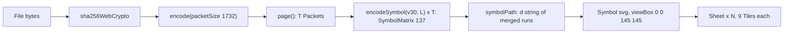
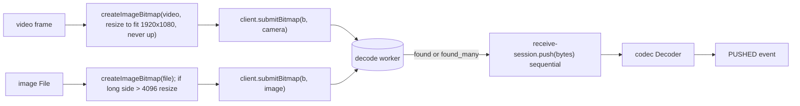

# Design Document

## Overview
`@strip/app` (`apps/strip`) is the Strip PWA: sender and receiver in one client-side app. It turns the 34 design boards into React views, wires them to `@strip/codec` and `@strip/symbols`, and ships a hand-written router, a hand-written service worker, a strict header set, and a design fidelity gate. Requirement ids are written R5.3 and so on. Appendix letters (A to F) and Resolved or Open question numbers refer to `.kiro/specs/app/requirements.md`. Facts about the codec and symbols APIs come from `packages/codec/README.md`, `packages/symbols/README.md` and `.kiro/specs/symbols/design.md`.

Stack (R22.3, Resolved question 24):
| Part | Choice | Note |
|---|---|---|
| Bundler | Vite 8.3.8 (installed), Rolldown and Oxc inside | no plugin |
| Language | TypeScript 6.0.3 strict, `jsx: "react-jsx"` in `apps/strip/tsconfig.json` | |
| UI | `react`, `react-dom`, `@types/react`, `@types/react-dom`, exact-pinned, each with a `docs/dependencies.md` row in the task that adds it | version is Open question 7. Recommendation: 18.3.1, the Baseline's version. The design works with 18 or 19 |
| JSX transform | Vite 8 itself, through its Oxc transform, no `@vitejs/plugin-react` | Confirmed against the installed `vite@8.3.8`: `transformWithOxc` on a `.tsx` snippet with no options emits `import { jsx as _jsx, jsxs as _jsxs, Fragment as _Fragment } from "react/jsx-runtime"` (automatic runtime, `importSource` "react"). `vite.config.ts` still sets `oxc: { jsx: { runtime: "automatic", importSource: "react" } }` explicitly so a Vite default change cannot alter it. No Fast Refresh (that is the plugin's job); dev reloads the page on edit. Dev builds emit `react/jsx-dev-runtime` (Vite sets `development: true` outside production), which React ships |
| Router, state | none: `src/app/router.ts` (history API) and `useSyncExternalStore` stores | R22.3 |
| Service worker | one hand-written `sw.js`, generated from a template by `scripts/build-sw.mjs` | no Workbox, no plugin |
| Tests | vitest 5.1.0 (node env, no DOM emulation), fast-check 4.10.2, `react-dom/server` `renderToStaticMarkup`, Playwright 1.65.1 | R22.7 |
| Packages | stay DOM-free (no change). The app imports `@strip/codec`, `@strip/symbols` (barrels) and `@strip/symbols/wasm-url` (only from `src/workers/symbols-wasm.ts`) | R22.1 |

Design decisions that differ from or add to the requirements are collected under "Requirement changes suggested (not applied)" at the end. Where this design makes a choice the requirements leave open, the section says "Decision".

Verified or measured facts used here (this design session): Vite 8.3.8 JSX output (above); `packages/symbols` barrel runtime exports are the 11 names of its README; `csp.ts` today already contains `worker-src 'self'` (so `APP_CSP` equals `STRIP_CSP`, see section 9); `apps/strip/package.json` has `zod` 4.6.7 (unused by the app, R22.6); the existing worker protocol is in `src/decode-protocol.ts`. Items that cannot be confirmed before code exists are marked "verify in task N".

## Module layout
### apps/strip
| Path | Content | Reqs |
|---|---|---|
| `index.html` | `<div id="root">`, `lang="en"`, viewport meta, `theme-color` `#F7F5EF`, `<link rel="manifest">`, `<link rel="icon">`, three `<link rel="stylesheet">` in this order: `/src/styles/strip.css`, `/src/styles/fonts.css`, `/src/styles/strip-additions.css`; one `<script type="module" src="/src/main.tsx">`. CSS is linked, never imported from TS, so dev mode serves it as a real stylesheet and no `<style>` element is injected (CSP) | R14.2, R15.9, R19.2 |
| `vercel.json` | Decision: `apps/strip/vercel.json`, not the repo root. Vercel reads `vercel.json` from the project Root Directory, which for a pnpm monorepo is the app directory; the file then sits beside `src/csp.ts` so its equality test needs no cross-package path and no import boundary exception | R15.5, R15.6, R15.11 |
| `vite.config.ts` | function config: dev and preview headers from `csp.ts`; `define: { __STRIP_GALLERY__ }`; `oxc.jsx`; `build.outDir`, `build.manifest: true` (section 2 gallery rule) | R15.7 |
| `vite.harness.config.ts` | existing, unchanged: builds `e2e-harness/*.html` to `dist/harness` | |
| `playwright.config.ts` | projects and web servers (section 10, 13) | |
| `tsconfig.json` | adds `"jsx": "react-jsx"`; include `src`, `e2e-harness` (unchanged) plus `e2e`, `e2e-fidelity` | |
| `vitest.config.ts` | `include: ["src/**/*.test.{ts,tsx}"]`, node environment | R22.7 |
| `scripts/build-sw.mjs`, `scripts/sw.template.js` | generate `dist/app/sw.js` and `dist/app/sw-manifest.json` (section 8) | R14.4 |
| `scripts/bundle-report.mjs` | Bundle_Report: raw, gzip, brotli per asset and totals, first-load set; prints a table and writes `apps/strip/bundle-report.json` (gitignored, outside `dist`) | R18.1, R18.2 |
| `scripts/make-icons.mjs` | dev-time: renders the brand mark SVG with the bundled Chromium into `public/icons/*.png` (committed). No new dependency | R14.1 |
| `public/fonts/` | 6 woff2 (IBM Plex Sans and Mono, 400, 500, 600, full Latin plus the glyphs `≈ ≠ × · … ’ – → ←` the boards use; verify glyph coverage in task 4) and `OFL.txt` | R19.3 |
| `public/` | `THIRD_PARTY_NOTICES` (existing, extended with React, react-dom, IBM Plex), `manifest.webmanifest`, `icons/icon-192.png`, `icon-512.png`, `icon-maskable-512.png` | R14.1, R22.5 |
| `e2e/` | existing harness specs plus `app-*.spec.ts` against the production build | section 13 |
| `e2e-fidelity/` | `targets.ts`, `baseline-server.mjs`, `baseline.setup.ts`, `fidelity.spec.ts`, `dom-parity.spec.ts`, `normalize-dom.ts`, `parity-allowlist.ts`, `hide-additions.css` | section 10 |
| `e2e-harness/` | existing `server.mjs`, `symbols-main.ts` and pages; new `serve.mjs` (shared static server core), `app-server.mjs` (production dist, gallery dist and baseline listeners) | R15.7, R15.11 |
| `dist/` | `app/` (production), `gallery/` (Harness_Build), `harness/` (existing); each build has its own `outDir` so none empties another | |

### apps/strip/src
| Path | Content | Reqs |
|---|---|---|
| `main.tsx` | `createRoot(#root).render(<App/>)`; registers the service worker after `load` when `import.meta.env.PROD && !__STRIP_GALLERY__`; `StrictMode` in dev only | R14.3 |
| `env.d.ts` | `declare const __STRIP_GALLERY__: boolean`, `/// <reference types="vite/client" />` | |
| `csp.ts` | existing `STRIP_CSP`; adds `APP_CSP`, `SECURITY_HEADERS` (section 9) | R15.3 |
| `limits.ts` | the only definitions of FILE_CAP_BYTES, PAPER_WARN_BYTES, PER_PAGE, FPS_MIN/MAX/DEFAULT, STEP_HISTORY, STALL_TIMEOUT_MS, NOTHING_TIMEOUT_MS, REPEAT_HOLD_MS, VERIFY_SLOW_MS (100), IMAGE_* , MAX_PAYLOAD (= FILE_CAP_BYTES + 422), REPO_URL | R9.1, R9.3 |
| `app/` | `App.tsx` (shell: `Chrome`, route switch, error boundary), `router.ts` (pure), `router-store.ts` (history store), `links.ts` (interception, pure), `focus.ts` (heading focus, scroll) | R8 |
| `screens/` | containers, one per route: `HomeScreen`, `SendScreen`, `StreamScreen`, `PaperScreen`, `ReceiveScreen`, `AboutScreen` | R1 to R6 |
| `components/` | presentational, pure functions of props, no service import: `Chrome` (page root and `header.nav`), `HomeView`, `SendView` (+ `FileCard`, `OutputChoices`), `StreamView`, `FullScreenView`, `PaperView` (+ `Sheet`, `Tile`), `ReceiveView` (the `ReceiveState` board: viewfinder, capture, `PhotoList`, stats, dock), `ErrorPanel` (the `ErrorState` board), `AboutView`, `Symbol`, `Ring`, `Icon` (the board's inline `svg.ico` paths) | R19.1, R19.12 |
| `state/` | pure code: `send-step.ts`, `stream.ts`, `paper.ts`, `receive.ts` (reducer), `receive-timers.ts`, `photos.ts`, `disposition.ts`, `routes.ts`, `href-map.ts`, `format.ts` (sizes, hash chip), `session-short.ts`, `ring.ts`, `symbol-path.ts`, `view-models/` (`home.ts`, `send.ts`, `stream.ts`, `paper.ts`, `receive.ts`, `error.ts`, `about.ts`) | |
| `services/` | impure edges: `sample-file.ts`, `send-session.ts` (store), `file-intake.ts`, `paper-pages.ts`, `stream-player.ts`, `camera.ts`, `frame-loop.ts`, `image-intake.ts`, `receive-session.ts`, `download.ts`, `browser.ts` (print, fullscreen, clipboard, matchMedia, visibility), `diag.ts`, `sw-register.ts` | R9 to R12 |
| `workers/` | `decode.worker.ts`, `decode-client.ts`, `decode-protocol.ts`, `transfer-list.ts`, `symbols-wasm.ts` (moved from `src/` with `smart_relocate` in task 2; update `e2e-harness/symbols-main.ts` and the `new URL(...)` strings by grep) | R12.17 |
| `clock/index.ts` | the only module reading time: `Clock` interface (`now`, `setTimeout`, `clearTimeout`) and `systemClock` | R11.3, R22.2 |
| `styles/` | `strip.css` (copy, byte-identical to `design/project/strip.css`), `fonts.css` (6 `@font-face`, `font-display: swap`, `url(/fonts/...)`), `strip-additions.css` (exactly the rules of R19.8 and R19.13: `.paper--off`, ring tick override, `.vf video, .vf canvas`, `#diag`) | R19.2, R19.8 |
| `gallery/` | Harness_Build only: `index.tsx` (gallery router), `fixtures.ts` (board instance values), one file per board family | R20.7 |
| `test-support/` | `fake-clock.ts`, `fake-encoder.ts`, `arbitraries.ts` (fast-check), never imported by non-test code | |

### Gallery exclusion mechanism
1. `vite.config.ts` computes `gallery = command === "serve" || mode === "gallery"` and sets `define: { __STRIP_GALLERY__: JSON.stringify(gallery) }`. `vite build` (mode production) gives `false`; `vite build --mode gallery` gives `true` and writes `dist/gallery`.
2. The only reference to the gallery is in `app/App.tsx`: `if (__STRIP_GALLERY__) { const { galleryRoute } = await import("../gallery/index.tsx"); ... }`. With the constant `false` Rolldown removes the branch and never emits the chunk. `router.ts` registers the `/__gallery/` prefix under the same constant. `page--m` and `fs--m` are set only by `gallery/` components (R19.11).
3. ESLint `no-restricted-imports` forbids `**/gallery/**` everywhere except `src/app/App.tsx` and `src/gallery/**`.
4. Test `src/dist.test.ts` (runs when `dist/app` exists, CI builds first): no file under `dist/app` has `gallery` in its name; no emitted file contains the sentinel `STRIP_GALLERY_SENTINEL` (a constant exported only by `gallery/index.tsx`), `__gallery`, `page--m` or `fs--m`; the manifest has no gallery entry (P40).

### Import boundaries and ESLint rules to add (extend `eslint.config.js`; no new dependency, so no `react-hooks` plugin)
| Rule | Files |
|---|---|
| Globs of the app blocks change from `*.ts` to `*.{ts,tsx}` (purity bans, boundary patterns, clock exception stays `apps/strip/src/clock/**` only) | `apps/strip/src/**` |
| No `Math.random`, `Date.now`, `performance.now` (existing), plus property `timeStamp` and `new Date()` with no arguments (`no-restricted-syntax`), outside `clock/` | `apps/strip/src/**` |
| `state/**`: no import of `react`, `react-dom`, `../services/**`, `../components/**`, `../screens/**`; `components/**`: no import of `../services/**`, `../screens/**`, `@strip/codec`, `@strip/symbols` (type imports allowed); `screens/**` may import all | layering |
| `no-restricted-globals`: `fetch`, `XMLHttpRequest`, `WebSocket`, `EventSource`, `MediaRecorder`, `ImageCapture`, `localStorage`, `sessionStorage`, `indexedDB`; `no-restricted-properties`: `navigator.sendBeacon`, `document.cookie` | `apps/strip/src/**` (R16.3, R12.16, R16.4) |
| `no-restricted-syntax`: JSX attribute `style` is an error except in `components/Ring.tsx`; `dangerouslySetInnerHTML` is an error | R15.9 |
| `no-restricted-imports`: `zod`, `**/gallery/**` (except the two files above), `**/design/**`, `**/support.js`, `**/codegen.js` | R22.6, R19.5 |
| `ignores` already lists `design/**`; add `apps/strip/.fidelity/**` | |
| Stream player time: `services/stream-player.ts` imports `Clock` only; ESLint cannot see "reads time", so the existing property bans plus a unit test with a throwing global `Date` and `performance` prove it (P14) | R11.3 |

## Screen-to-component map
Presentational components take one view-model prop (`vm`) plus callback props, are pure functions of it, and are tested with `renderToStaticMarkup`. Containers own state, services and routing. The `mobile` prop of a board exists only in `gallery/` (it adds `page--m` or `fs--m` to the root, R19.11).

| Boards (Appendix A) | Route or surface | Presentational (props from the board's `data-props`) | Container | View-model function (the board's `renderVals`) | Services bound |
|---|---|---|---|---|---|
| Home, HomeMobile | `/` | `HomeView` (`vm: HomeVM`) | `HomeScreen` | `toHomeVM(sample): HomeVM` (specimen tiles seeds 0..5, "Page 1 / {N}") | `sample-file` |
| Send, SendEmpty, SendTooLarge, SendEmptyFile (+ M) | `/send` | `SendView` (`stage: "chosen"\|"empty"\|"toolarge"\|"emptyfile"`) | `SendScreen` | `toSendVM(s: SendStepState): SendVM` (isChosen, isNone, isBad, choicesOff, screenOn, dropCls, bad*, card, choice lines, `paperWarning`) | `file-intake`, `send-session` |
| SendScreen, SendScreenPaused, SendScreenStep (+ M) | `/send/screen` | `StreamView` (`mode: "play"\|"paused"\|"step"`) | `StreamScreen` | `toStreamVM(u: StreamUi, info): StreamVM` (n, lap, codeLabel, isPlay, notPlay, isStep, stepOff, modeTag, modeTagCls, ppLabel, modeNote) | `stream-player`, `browser` |
| SendScreenFull (+ M) | state `fullScreen` of `/send/screen` | `FullScreenView` | `StreamScreen` | `toFullScreenVM(u, info)` ("Packet {n} of {K} + repair · Lap {L} · {fps} fps") | `stream-player`, `browser` |
| SendPaper, SendPaperLetter (+ M) | `/send/paper` | `PaperView` (`size` is CSS state: radios and `:has()`; gallery Letter board only presets `checked` and, to match the board DOM, nothing else) | `PaperScreen` | `toPaperVM(set, page, file): PaperVM` (tiles `{label:"P{p}·{ii}", of:"{g}/{T}", matrixIndex}`, "{p} / {N}", Print label) | `paper-pages`, `browser` |
| Receive (desktop, `scan`), ReceiveState, ReceiveStates | `/receive`; ReceiveStates and phone cells gallery only | `ReceiveView` (`phase`: 10 values; `viewfinder?: ReactNode` slot, default is the board's `.vf__code`) | `ReceiveScreen` | `toReceiveVM(r: ReceiveUi, opts?: { pct?: number }): ReceiveVM` (tag, tagCls, head, msg, ring, stats, buttons, vf, hud, camState, banner, bar, photos, photoHint, howto). `opts.pct` is the fixture override for C6 | `camera`, `frame-loop`, `image-intake`, `receive-session`, `download` |
| About, AboutMobile | `/about` | `AboutView` | `AboutScreen` | `toAboutVM()` (cap text from `limits.ts`) | none |
| ErrorState; Errors, ErrorsAll (+ M) | inline in `ReceiveScreen` and `SendScreen`; galleries only | `ErrorPanel` (`kind`: 14 values, `vm: ErrorVM`) | `ReceiveScreen`, `SendScreen`, `App` error boundary | `toErrorVM(kind, ctx): ErrorVM` per Appendix F; `ctx` carries computed values (name, size, counts, sessions, hashes, solved, total, seen, ago) | `browser` (copy link, reload) |
| Symbol | everywhere a code is drawn | `Symbol` (`matrix: SymbolMatrix`, `label`) | none | `symbolPath(matrix): string` (R19.12) | `encodeSymbol` in `paper-pages`, `stream-player`, `sample-file` |
| Main (design system) | none | not converted, not shipped | | | |

Rules: a presentational component never calls `Date`, `navigator`, `window`, a service or `@strip/*` at runtime; every string the board shows as text is in the VM, so `renderToStaticMarkup(vm)` equals the board's text. Interpolated `aria-label` strings are built in the VM (R19.10). Ring: `Ring` takes `{ pct, k }` and sets `--tick-on` and `--tick-off` through the React `style` prop (the only `style` use, R19.13); `ring.ts` has `arc(p)` (the board's formula, verbatim) and `tick(k)`.

## Router
`src/state/routes.ts` is the table; `src/app/router.ts` is pure (no `window`); `src/app/router-store.ts` binds it to `history`.

| id | path | `document.title` (board `<title>`) | View | Guard |
|---|---|---|---|---|
| home | `/` | Strip home | `HomeScreen` | none |
| send | `/send` | Send step 1 | `SendScreen` | none |
| stream | `/send/screen` | Send on screen | `StreamScreen` | no Sender_File: `replace("/send")` (R3.2) |
| paper | `/send/paper` | Send on paper | `PaperScreen` | no Sender_File: `replace("/send")` (R4.2) |
| receive | `/receive` | Receive desktop | `ReceiveScreen` | none |
| about | `/about` | About and privacy | `AboutScreen` | none |
| gallery | prefix `/__gallery/` | board title | `gallery/index.tsx` | exists only when `__STRIP_GALLERY__` |

```ts
export type RouteId = "home" | "send" | "stream" | "paper" | "receive" | "about";
export function matchRoute(pathname: string): RouteId | null;          // exact; "/send/" is normalised to "/send"; query and hash ignored
export function titleOf(id: RouteId): string;
export function navLinkCurrent(id: RouteId): "send" | "receive" | "about" | null; // stream and paper map to "send" (R8.4)
export function shouldIntercept(e: ClickLike, a: AnchorLike, origin: string): boolean;
```
Behaviour:
| Topic | Rule | Reqs |
|---|---|---|
| Store | `{ path, search, hash }` snapshot; `useSyncExternalStore(subscribe, getSnapshot)`; `navigate(to, { replace })` calls `history.pushState` or `replaceState`, then notifies; one `popstate` listener | R8.1 |
| Link interception | one `click` listener on `document`. Intercept only when: not `defaultPrevented`, button 0, no modifier key, anchor has no `target` other than `_self`, no `download`, `rel` has no `external`, `new URL(href, location).origin === location.origin`, and `matchRoute(pathname)` is not null. Everything else (`/THIRD_PARTY_NOTICES`, REPO_URL, `mailto`) is left to the browser | R1.5, R6.5 |
| Same-page hash | `a[href="#limits"]` and `/about#limits`: `pushState` then `scrollIntoView` on `getElementById` | R6.4, R8.8 |
| Unknown path | on load and on `popstate`: `replaceState("/")` then render Home | R8.2 |
| Aria-current | `Chrome` sets `aria-current="page"` from `navLinkCurrent`; the Send crumb keeps `aria-current="step"` | R8.4 |
| Focus and scroll | after a push navigation: `scrollTo(0, 0)`, then focus the first `main h1` (fallback `[role="alert"] h2`): `focus.ts` sets `tabindex="-1"` on that element at runtime (a deviation, listed in the report; the initial DOM has none, so DOM parity is unaffected). On `popstate` the same. Initial load focuses nothing | R17.4 |
| Reload | state is memory only: a reload on `/send/screen` or `/send/paper` finds no Sender_File and the guard replaces the route with `/send` | R8.6 |
| Title | `document.title = titleOf(id)` in a layout effect on route change | R8.7 |
| Full screen | `FullScreenView` is component state of `StreamScreen`, not a route and not a hash | R3.16 |
| Hash routes | none | |

How the design hrefs map (`href-map.ts`, used by the views, the DOM-parity gate and a unit test over every `href` found in the boards):
| Board href | App href | Mechanism |
|---|---|---|
| `Home.dc.html` | `/` | link |
| `Send.dc.html`, `SendEmpty.dc.html` and the other Send state boards | `/send` | link |
| `SendScreen.dc.html` | `/send/screen` | link (Send primary action) |
| `SendScreenFull.dc.html` (Full screen link) and `SendScreen.dc.html` (Exit full screen) | `/send/screen` | `a` with a click handler that calls `preventDefault` and sets the `fullScreen` state (deviation line, R7.12 pattern) |
| `SendPaper.dc.html` | `/send/paper` | link |
| `Receive.dc.html` | `/receive` | link, or a handler for actions that are not navigation (Appendix F) |
| `About.dc.html` | `/about` (Error panel "About limits": `/about#limits`, R7.3) | link |
| `#privacy` etc. | unchanged | hash scroll |
| `/THIRD_PARTY_NOTICES`, REPO_URL | unchanged | browser navigation, `rel="noopener"` on REPO_URL |

## State machines
All machines are pure reducers `reduce(state, event): { state; effects: Effect[] }` in `src/state/`. Containers run the effects through services and feed results back as events. Stale async results are dropped by a generation counter (`gen`) carried in each event (P21). Time enters only as an event field filled from `clock.now()` by the container.

### (a) Send step 1 (`state/send-step.ts`, R2, R9)
```ts
export type SendStage = "empty" | "chosen" | "toolarge" | "emptyfile";
export interface FileMeta { name: string; mime: string; size: number }
export interface SendCosts { K: number; T: number; N: number; hash12: string; sessionId: number }
export interface SendStepState {
  stage: SendStage; gen: number;
  meta?: FileMeta; costs?: SendCosts;     // costs only in "chosen"
  output: "screen" | "paper";             // default "screen"
  reading: boolean;                       // bytes are being read; the previous card stays visible
  failure?: PanelKind;                    // "size" | "internal" | "empty" shown as ErrorPanel (R9.4, R9.7)
}
export type SendEvent =
  | { t: "PICK"; meta: FileMeta }                     // first file only (R2.2)
  | { t: "READ_DONE"; gen: number; costs: SendCosts }
  | { t: "READ_FAILED"; gen: number; panel: PanelKind }
  | { t: "REMOVE" } | { t: "OUTPUT"; value: "screen" | "paper" } | { t: "CONTINUE" };
export type SendEffect =
  | { e: "READ_AND_ENCODE"; gen: number } | { e: "DROP_BYTES" } | { e: "NAVIGATE"; to: "/send/screen" | "/send/paper" };
```
| State | Event [guard] | Next | Effects |
|---|---|---|---|
| any | PICK [`size === 0`] | `emptyfile`, `gen+1` | DROP_BYTES |
| any | PICK [`size > FILE_CAP_BYTES`] | `toolarge`, `gen+1` | DROP_BYTES (bytes never read, R2.11) |
| any | PICK [`1 <= size <= FILE_CAP_BYTES`] | stage unchanged, `reading`, `gen+1` | READ_AND_ENCODE (hash with `sha256WebCrypto`, `encode`, `page().length`, drop the Encoder) |
| any | READ_DONE [`gen` current] | `chosen`, `output = "screen"` | none. A stale `gen` is ignored |
| any | READ_FAILED [`gen` current] | `empty` plus `failure` (PAYLOAD_TOO_LARGE and TOO_MANY_BLOCKS: `size`; BAD_METADATA and the rest: `internal`) | DROP_BYTES |
| `chosen`, `toolarge`, `emptyfile` | REMOVE | `empty` | DROP_BYTES |
| `chosen` | OUTPUT | `output` set | none |
| `chosen` | CONTINUE | unchanged | NAVIGATE (`screen` to `/send/screen`, `paper` to `/send/paper`) |
| `empty`, `toolarge`, `emptyfile` | OUTPUT, CONTINUE | unchanged | none (fieldset disabled, button disabled, R2.17) |
The MIME fallback and name rules run in the `PICK` mapping: `mimeOf(type)` returns `application/octet-stream` for an empty type, a type over 127 bytes, or any byte above 0x7F (R2.14, P3). Derived text: loop seconds `round(K / FPS_DEFAULT)`, pages `ceil(T / PER_PAGE)`, paper warning when `size > PAPER_WARN_BYTES && output === "paper"` (R9.8). The Sender_File bytes live in `services/send-session.ts` (memory only, R16.5).

### (b) Send on screen (`state/stream.ts`, `services/stream-player.ts`, R3, R11)
```ts
export type StreamMode = "play" | "paused" | "step";
export interface StreamUi { mode: StreamMode; fps: number; size: "s" | "m" | "l"; fullScreen: boolean; n: number /* shown, 1-based */; canPrev: boolean }
export type StreamEvent =
  | { t: "MOUNT"; reducedMotion: boolean }
  | { t: "TOGGLE" }                       // transport button or Space
  | { t: "NOTICE_BUTTON" }                // "Switch to step mode" / "Back to playback"
  | { t: "TICK" } | { t: "NEXT" } | { t: "PREV" }
  | { t: "FPS"; value: number } | { t: "SIZE"; value: "s" | "m" | "l" }
  | { t: "FULLSCREEN"; on: boolean } | { t: "HIDDEN" };
```
| Mode | Event [guard] | Next mode | Player action |
|---|---|---|---|
| (init) | MOUNT | `reducedMotion ? step : play`, `n = 1` | create Encoder (`packetSize: 1732`), `next()` once, show seq 0; if `play`, schedule tick (R11.1, R11.8) |
| `play` | TOGGLE or Space | `paused` | cancel timer; hold code (R3.7) |
| `paused`, `step` | TOGGLE or Space | `play` | schedule tick |
| `play`, `paused` | NOTICE_BUTTON | `step` | cancel timer |
| `step` | NOTICE_BUTTON | `play` | schedule tick |
| `play` | TICK | `play` | `advance()`; reschedule at `deadline += 1000 / fps` |
| `paused`, `step` | NEXT | same | `advance()` |
| `paused`, `step` | PREV [`canPrev`] | same | `back()` |
| `play` | NEXT, PREV, TICK in other modes | unchanged | none (buttons `disabled`; TICK in `paused` or `step` is impossible because the timer is cancelled and ignored if it fires late, R11.7) |
| `play`, `paused` | FPS | same, `fps = clamp(v, 2, 15)` | next tick uses the new interval (R11.4) |
| `step` | FPS | unchanged | none (range `disabled`, R3.8) |
| any | SIZE | same | CSS class only, no re-encode (R11.14) |
| any | FULLSCREEN on or off | same mode, `fullScreen` set | `browser.requestFullscreen(.fs)` when available; `fullscreenchange` to false sends `FULLSCREEN off` (R11.10, R11.11) |
| `play` | HIDDEN (`visibilitychange`, hidden) | `paused` | cancel timer (R11.12) |
| leave route | unmount | none | cancel timer, drop Encoder and history (R11.13, R11.18) |
```ts
export interface StreamPlayer {
  start(): Packet;                       // seq 0
  advance(): Packet;                     // shown+1: from history if shown < produced-1, else encoder.next()
  back(): Packet | null;                 // shown-1 while held in the last STEP_HISTORY (256) Packets
  readonly shown: number; readonly canPrev: boolean; dispose(): void;
}
export function createStreamPlayer(encoder: EncoderLike, history?: number): StreamPlayer;   // pure, no clock
export function createTicker(clock: Clock, onTick: () => void): { start(fps: number): void; setFps(fps: number): void; stop(): void };
```
`createTicker` is the only code that schedules: `clock.setTimeout(fire, max(0, deadline - clock.now()))`, so a fake clock drives it (R11.3). Derived numbers: counter `n = shown + 1`, lap `floor((n - 1) / T) + 1`, progress `min(n, K)` of K (R3.4, R11.17), code `aria-label` "Animated data code, packet {n} of {K}", stage label "Animated code, frame {n}". Space: one `keydown` listener on `window` that ignores events whose target is a `button`, `a`, `input`, `select`, `textarea`, `summary` or `[role=button]`, or whose `defaultPrevented` is true; it calls `preventDefault` when it handles the key (R17.6). The Photosensitivity_Notice is rendered in every mode (R3.13). Reduced motion is read once at MOUNT from `matchMedia("(prefers-reduced-motion: reduce)")`.

### (c) Send on paper (`state/paper.ts`, R4, R10)
```ts
export interface PaperUi { page: number /* 1-based */; N: number }
export type PaperEvent = { t: "PREV" } | { t: "NEXT" } | { t: "PRINT" } | { t: "SET_N"; N: number };
```
| Event [guard] | Result |
|---|---|
| PREV [`page > 1`] | `page - 1` |
| NEXT [`page < N`] | `page + 1` |
| PRINT | effect `window.print()` (R4.10); no state change; no `window.open` (R10.11) |
Paper size is not state: the radios `#paper-a4` (`defaultChecked`) and `#paper-letter` are uncontrolled inputs and the Stylesheet's `.two--side:has(#paper-letter:checked) .paper` and `@page letter` do the rest on screen and in print (R4.14, R10.10). All N `article.paper` stay in `div.paper-wrap`; every sheet except `page` gets the class `paper--off` (hidden by `@media screen` in the Additions_Stylesheet only), so print shows all N with no script at print time (R4.13). The Print button label is "Print {N} pages" or "Print 1 page". Above PAPER_WARN_BYTES the `callout--warn` (`data-addition`) is rendered above the preview (R9.11). Ruler and footer text are static board text.

### (d) Receive (`state/receive.ts`, `state/receive-timers.ts`, `state/photos.ts`, R5, R12, R13)
```ts
export type ReceivePhase = "empty" | "ask" | "denied" | "nocam" | "scan" | "repeat" | "dup" | "verify" | "done" | "failed";
export type PanelKind = "size" | "empty" | "imgread" | "imgbig" | "imgmany" | "nocode" | "denied" | "nocamera" | "nothing" | "otherfile" | "hash" | "internal" | "camera" | "stall";
export type Source = "camera" | { photo: number };
export interface Counters { seen: number; skipped: number; solved: number; total: number; distinct: number; complete: boolean }
export interface PhotoRow { id: number; name: string; found: number }
export interface ReceiveState {
  phase: ReceivePhase; panel: { kind: PanelKind; ctx: PanelCtx } | null;   // panel replaces section.strip.rx (R5.19)
  gen: number;                           // session generation: bumped by NEW_SESSION; stale results are ignored
  cameraOn: boolean; cameraPending: boolean; torchCapable: boolean;
  counters: Counters; session?: number;  // codec Session_Id (u32) of the current session
  foreign?: { id: number; dismissed: boolean };
  photos: PhotoRow[]; imageBusy: boolean;
  t: { cameraStartedAt?: number; firstAcceptedAt?: number; lastSolvedAt?: number; lastFoundAt?: number };
  diag: { badCrc: number; badHeader: number };
}
export type PushResult =
  | { k: "accepted"; counters: Counters; seq: number }
  | { k: "ignored"; reason: "DUPLICATE_PACKET" | "SESSION_MISMATCH" | "ALREADY_COMPLETE" | "DENSE_STORE_FULL"; foreign?: number; seq?: number }
  | { k: "rejected"; code: ErrorCode; hashes?: { expected: string; actual: string } };
export type ReceiveEvent =   // user | camera | decode | timer
  | { t: "START" } | { t: "STOP" } | { t: "START_OVER" } | { t: "KEEP" } | { t: "SWITCH" } | { t: "CANCEL" } | { t: "DOWNLOAD" }
  | { t: "RECEIVE_ANOTHER" } | { t: "DISCARD" } | { t: "SCAN_AGAIN" } | { t: "BACK" } | { t: "NOT_NOW" }
  | { t: "PANEL"; kind: PanelKind; action: "primary" | "secondary" }
  | { t: "ADD_PHOTO"; file: FileMeta } | { t: "PHOTO_DONE"; gen: number; row: PhotoRow } | { t: "PHOTO_FAILED"; gen: number; panel: PanelKind; ctx?: PanelCtx } | { t: "REMOVE_PHOTO"; id: number }
  | { t: "CAMERA_OK"; torch: boolean; at: number } | { t: "CAMERA_FAIL"; name: string } | { t: "CAMERA_API_MISSING" }
  | { t: "FOUND"; at: number }            // a found or found_many outcome (resets the "nothing" clock)
  | { t: "PUSHED"; gen: number; source: Source; result: PushResult; at: number }
  | { t: "PUSH_SLOW"; gen: number } | { t: "REPEAT_EXPIRED"; gen: number } | { t: "TIMER"; at: number };
export type ReceiveEffect =
  | "REQUEST_CAMERA" | "STOP_CAMERA" | "NEW_SESSION" | "OPEN_PICKER" | "DOWNLOAD_FILE" | "READ_RESULT" | "REBUILD_SESSION"
  | { e: "START_IMAGE"; file: FileMeta } | { e: "NAVIGATE"; to: string } | { e: "ARM_TIMERS" } | { e: "DISARM_TIMERS" } | { e: "ARM_REPEAT_HOLD" } | { e: "COPY_LINK" } | { e: "RELOAD" };
```
Transition table (Appendix D buttons, R5, R12). "camera path" means source `camera`.
| Phase | Event [guard] | Next | Effects |
|---|---|---|---|
| `empty` | START | `ask`, `cameraPending` | REQUEST_CAMERA (R5.3: never on page load) |
| `ask` | START [`!cameraPending`] ("Allow camera") | `ask` | REQUEST_CAMERA |
| `ask` | NOT_NOW | `ask` | NAVIGATE `/` |
| `denied` | START ("Try again") | `ask` | REQUEST_CAMERA |
| `empty`, `denied`, `nocam` | BACK | same | NAVIGATE `/` |
| `ask` | CAMERA_OK | `scan` | ARM_TIMERS, `cameraStartedAt = at`, `torchCapable`, the Frame_Loop starts |
| `ask`, `scan` (pending) | CAMERA_FAIL `NotAllowedError`, `SecurityError` | `denied` | none |
| `ask`, `scan` (pending) | CAMERA_FAIL `NotFoundError`, `NotReadableError`, `OverconstrainedError`, `AbortError` | `nocam` | none |
| `empty`, `ask` | CAMERA_API_MISSING | panel `camera` | none |
| `scan`, `repeat` | STOP | `empty` | STOP_CAMERA, DISARM_TIMERS |
| `scan`, `repeat` | START_OVER | `scan` | NEW_SESSION, ARM_TIMERS |
| `dup` | KEEP | `scan`, `foreign.dismissed = true` | none |
| `dup` | SWITCH | `scan` | NEW_SESSION, ARM_TIMERS |
| `verify` | CANCEL | `empty` | NEW_SESSION, STOP_CAMERA |
| `done` | DOWNLOAD | `done` | DOWNLOAD_FILE (R12.9) |
| `done` | RECEIVE_ANOTHER | `empty` | NEW_SESSION |
| `failed` | SCAN_AGAIN | `scan`, `cameraPending` | NEW_SESSION, REQUEST_CAMERA (the board says "go to `scan`"; the HUD "Looking for packets" shows until `CAMERA_OK`; a failure then goes to `denied` or `nocam`) |
| `failed` | DISCARD | `empty` | NEW_SESSION |
| `scan`, `repeat`, `dup` | PUSHED `accepted` [`!complete`], camera path | `scan` (from `repeat`) | counters; `lastSolvedAt` when `solved` grew; `firstAcceptedAt` on the first |
| any but `done`, `failed` | PUSHED `accepted` [`complete`] | `done` | STOP_CAMERA, DISARM_TIMERS, READ_RESULT (R13.7: only after `complete`) |
| `scan` | PUSHED `ignored` DUPLICATE_PACKET, camera | `repeat` | ARM_REPEAT_HOLD, `seen + 1` |
| `repeat` | PUSHED `ignored` DUPLICATE_PACKET, camera | `repeat` | ARM_REPEAT_HOLD (restart), `seen + 1` |
| `repeat` | REPEAT_EXPIRED [`gen` ok] | `scan` | none |
| `scan`, `repeat` | PUSHED `ignored` SESSION_MISMATCH, camera [foreign not dismissed] | `dup` | `skipped + 1`, `seen + 1`, `foreign = { id }` |
| `dup` | PUSHED `ignored` SESSION_MISMATCH, camera | `dup` | `skipped + 1`, `seen + 1` |
| any | PUSHED `ignored` ALREADY_COMPLETE or DENSE_STORE_FULL | unchanged | `seen + 1` |
| any | PUSHED `ignored` DUPLICATE_PACKET or SESSION_MISMATCH from a photo | unchanged (SESSION_MISMATCH: panel `otherfile`) | `seen + 1`; no `repeat` |
| `scan`, `repeat`, `dup` | PUSH_SLOW (a push pending for more than VERIFY_SLOW_MS, 100 ms) | `verify` | STOP_CAMERA (R5 Resolved question 28) |
| `scan`, `repeat`, `dup`, `verify` | PUSHED `rejected` HASH_MISMATCH | `failed` | STOP_CAMERA; panel none; `hashes` kept for the banner (no payload bytes kept) |
| `empty`, `nocam` | PUSHED `rejected` HASH_MISMATCH, photo | panel `hash` | NEW_SESSION on "Scan again" |
| any | PUSHED `rejected` BAD_CRC or BAD_HEADER | unchanged | `diag` counter only |
| any | PUSHED `rejected` PAYLOAD_TOO_LARGE or TOO_MANY_BLOCKS | panel `size` (sender copy, name "This strip", size from `decodePacket(bytes).totalLength`, File row omitted) | STOP_CAMERA |
| any | PUSHED `rejected` UNSUPPORTED_VERSION, BAD_METADATA, INVALID_INPUT | panel `internal` | STOP_CAMERA |
| `scan`, `repeat`, `dup` | TIMER [stall verdict] | panel `stall` | none (timers keep state) |
| `scan`, `repeat`, `dup` | TIMER [nothing verdict] | panel `nothing` | none |
| panel `stall`, `nothing` | PANEL primary ("Keep scanning") | `scan` | ARM_TIMERS (both restart from `at`) |
| panel `stall`, `otherfile` | PANEL "Start over" | `scan` if camera on, else `empty` | NEW_SESSION; `otherfile` adopts the pending photo (below) |
| panel `otherfile` | PANEL "Keep current file" | previous phase | discard pending photo |
| panel `hash` | PANEL "Scan again" | `empty` | NEW_SESSION |
| panel `hash`, `internal` | PANEL "Discard", "Back to home" | `empty` or `/` | NAVIGATE |
| panel `camera` | PANEL "Open Send" / "Copy page link" | unchanged | NAVIGATE `/send` / COPY_LINK |
| panel `internal` | PANEL "Reload" | | RELOAD |
| panel `imgread`, `imgbig`, `imgmany`, `nocode`, `denied`, `nocamera` | PANEL primary, secondary | `/receive` phase unchanged, panel cleared | OPEN_PICKER for "Choose another photo", "Choose a smaller photo", "Try another photo", "Add photo of a page"; START (request camera) for "Try again" and "Use the camera"; scroll to the Photo_List for "Review added photos" |
Image intake sub-state (R9.9, R9.12, R9.13, R12.10, R12.11, R12.23 to R12.25):
| Event [guard] | Next | Effects |
|---|---|---|
| ADD_PHOTO [`imageBusy`] | ignored | none (one image at a time) |
| ADD_PHOTO [`photos.length >= IMAGE_MAX_COUNT`] | panel `imgmany` | none |
| ADD_PHOTO [`file.size > IMAGE_MAX_FILE_BYTES`] | panel `imgbig` | none |
| ADD_PHOTO [else] | `imageBusy` | START_IMAGE: `createImageBitmap(file)` (rejects: `imgread`); if the long side exceeds 4096, `createImageBitmap(bitmap, { resizeWidth, resizeHeight, resizeQuality: "high" })` at `4096 / long`; `submitBitmap(bitmap, "image")`; push every symbol of `found` or `found_many` sequentially |
| PHOTO_DONE | row added, `imageBusy` false | none |
| PHOTO_FAILED `nocode` (outcome `not_found`, `not_strip_packet`, `dropped`, `found_many` without a valid Packet, only BAD_CRC and BAD_HEADER) | panel `nocode`, no row | none |
| photo yields SESSION_MISMATCH | panel `otherfile` (sessions {current}, {other}); Decision: no row, Packets held as `pending` | "Start over" makes a new session fed with `pending` and adds its row; "Keep current file" discards `pending` |
| REMOVE_PHOTO | row removed, counters recomputed | REBUILD_SESSION (below) |
Packets seen counts every push whose status is `accepted` or `ignored`; the Distinct meter shows `distinctPackets` capped at K; the ring percent is `floor(100 * solved / total)` (0 while `total` is 0) and 100 only when `complete` (R12.7, C38). Counters never decrease within a session except through REBUILD_SESSION (R12.8).

Codec Decoder lifecycle (`services/receive-session.ts`). `createReceiveSession()` returns `{ gen, push(bytes, source), progress(), result(), rebuild(without), dispose() }` around `createDecoder({ maxPayloadBytes: MAX_PAYLOAD })` (R9.3). The codec Decoder is terminal after `rejected`; every NEW_SESSION disposes the old object and creates a new one with `gen + 1`, so a late `PUSHED` with an old `gen` is dropped. The session keeps an ordered log `{ source, bytes }` of accepted Packets only (Decision: bounded by the Packets the decoder keeps; duplicates and foreign Packets are not retained) for REBUILD_SESSION: remove the source's entries, create a new Decoder, replay the log in order, set `seen` to the replayed count and keep `skipped`. A fresh session fed with the remaining sources in order equals the rebuilt one (P26). Pushes are sequential per session (a promise chain), because `push` is async (SHA-256).

Timers (`state/receive-timers.ts`), pure:
```ts
export function verdict(t: ReceiveState["t"], solved: number, now: number, cameraOn: boolean): "stall" | "nothing" | null;
// stall: cameraOn && firstAcceptedAt !== undefined && now - lastSolvedAt >= STALL_TIMEOUT_MS
// nothing: cameraOn && now - (lastFoundAt ?? cameraStartedAt) >= NOTHING_TIMEOUT_MS ; stall wins when both hold (R12.12)
export function nextDeadline(t: ReceiveState["t"]): number | null;   // earliest future deadline, for clock.setTimeout
```
The container arms one `clock.setTimeout` for `nextDeadline` and re-arms on every event that changes `t` (ARM_TIMERS), so a fake clock drives it (R21.8). `lastSolvedAt` starts at `firstAcceptedAt`.

Mapping from codec and symbols outcomes to dispositions (`state/disposition.ts`, Appendix E, R13). Total by construction: each table is a `Record<Union, Disposition>` so adding a code to a union fails the compile, and P27 iterates `ERROR_CODES`, `SYMBOL_ERROR_CODES` and literal lists typed `satisfies readonly IgnoreReason[]`.
```ts
export type Origin = "camera" | "image" | "encoder";
export type Disposition =
  | { to: "phase"; phase: ReceivePhase } | { to: "panel"; kind: PanelKind } | { to: "sendState"; state: "toolarge" | "emptyfile" }
  | { to: "silent"; count: "diag" | "seen" | "none" } | { to: "unreachable" };
export function ofCodec(code: ErrorCode, origin: Origin, cameraOn: boolean): Disposition;
export function ofIgnore(reason: IgnoreReason, origin: Origin): Disposition;
export function ofSymbol(code: SymbolErrorCode): Disposition;                 // all "panel internal"
export function ofOutcome(kind: DecodeOutcome["kind"], origin: Origin, gotPacket: boolean): Disposition;
export function ofCamera(name: string | "API_MISSING"): Disposition;          // denied | nocam | panel camera
```
| Source and code | camera origin | image origin (or encoder where noted) |
|---|---|---|
| PAYLOAD_TOO_LARGE, TOO_MANY_BLOCKS | panel `size` | panel `size`; encoder origin: panel `size` |
| SESSION_MISMATCH (rejected form does not occur; the push status is `ignored`) | phase `dup` | panel `otherfile` |
| HASH_MISMATCH | phase `failed` | camera on: phase `failed`; camera off: panel `hash` |
| BAD_CRC, BAD_HEADER | silent (diag) | silent; all Packets of the image this kind: panel `nocode` |
| UNSUPPORTED_VERSION, BAD_METADATA, INVALID_INPUT | panel `internal` | panel `internal` |
| INCOMPLETE_DECODE | unreachable (`result()` only after `complete`) | unreachable |
| Ignore DUPLICATE_PACKET | phase `repeat` | silent (seen) |
| Ignore SESSION_MISMATCH | phase `dup` | panel `otherfile` |
| Ignore ALREADY_COMPLETE, DENSE_STORE_FULL | silent (seen) | silent (seen) |
| Symbol INVALID_INPUT, PACKET_TOO_LARGE, ENCODE_FAILED, UNSUPPORTED_ENVIRONMENT | panel `internal` | panel `internal` |
| Outcome `found`, `found_many` | push every Packet | push every Packet |
| Outcome `not_found`, `not_strip_packet`, `dropped` | silent | panel `nocode` when no Packet at all |
| Image unreadable, over 25 MB, 100 photos | | `imgread`, `imgbig`, `imgmany` |
| Camera `NotAllowedError`, `SecurityError` | phase `denied` | |
| Camera `NotFoundError`, `NotReadableError`, `OverconstrainedError`, `AbortError` | phase `nocam` | |
| `navigator.mediaDevices` or `getUserMedia` missing | panel `camera` | |
| Sender_File 0 bytes or over the cap | | Send state `emptyfile` or `toolarge` in `SendView`; panel `empty` or `size` outside it |
| Any other exception | panel `internal` (error boundary; never a stack trace) | |
`toErrorVM` and `toReceiveVM` take no `error.message` and no `error.code`, so no raw code string can reach the DOM (P28). A SESSION_MISMATCH foreign id comes from `decodePacket(bytes).sessionId`; Session_Short (`state/session-short.ts`) is the first 4 uppercase hex digits, or 8 digits for both when the two 4-digit forms in view are equal.

## Data flow of the pipelines
Budget math (R9.6, Resolved question 10), packetSize 1732, blockSize 1702, Metadata_Record 75 bytes for "field-notes-2026.pdf" plus "application/pdf":
| File | K = ceil((size + 75) / 1702) | T = K + R(K) | N = ceil(T / 9) | Lap at 8 fps |
|---|---|---|---|---|
| 184 KB = 188,416 B | 111 | 149 | 17 | 18.6 s |
| 64 KB = 65,536 B (PAPER_WARN_BYTES) | 39 | 67 | 8 | 8.4 s |
| 256 KB = 262,144 B (FILE_CAP_BYTES) | 155 (262,219 / 1702 = 154.07, rounds up) | 200 | 23 | 25.0 s |
Maximum symbol work per file: 200 symbols, 23 sheets, 207 tiles slots (the last sheet holds 2).

Paper path (`services/paper-pages.ts`, R10):

`buildPaperSet(file): { packets: Packet[]; matrices: SymbolMatrix[]; pages: number[][]; sessionId }` runs synchronously inside `useMemo` in `PaperScreen` (measured in the perf script; if it exceeds 200 ms at T = 200 it is chunked per sheet). `paginate(T)` returns pages of sequence numbers `[(p - 1) * 9, min(p * 9, T) - 1]` (R10.4). `symbolPath(m: SymbolMatrix): string` walks rows, merges horizontal runs of dark modules and emits `M{x + 4} {y + 4}h{w}v1h-{w}z` in row-major order; `viewBox` side is `m.size + 8` (145 for v30, R19.12). Tile label `P{p}·{ii}`, caption `{g}/{T}` with `g = (p - 1) * 9 + i` (R10.5). The paper header Session is Session_Short of the codec Session_Id (read with `decodePacket(packets[0]).sessionId`).

Screen path (`services/stream-player.ts`, R11): `createStreamPlayer(encoder)`; per tick `advance()` yields the Packet (history ring of 256), `encodeSymbol` then `symbolPath` then React commit of one `Symbol`. Tick scheduling is `createTicker(clock, ...)`. Counter text is derived in `toStreamVM`.

Receiver (`services/frame-loop.ts`, `services/image-intake.ts`, `services/receive-session.ts`):

Frame loop: `video.requestVideoFrameCallback` where present, else `requestAnimationFrame`; each callback first checks `client.idle` and `document.visibilityState === "visible"`, then creates the bitmap, then re-checks `client.idle` and closes the bitmap when busy (drop without a copy, R12.3, R12.15). `createImageBitmap(video)` replaces the canvas draw of R12.2 (cheaper, same pixels). Camera constraints: `{ video: { facingMode: "environment", width: { ideal: 1920 }, height: { ideal: 1080 } }, audio: false }` (R12.1). Torch: `track.applyConstraints({ advanced: [{ torch: true }] })`, button only when `track.getCapabilities().torch` (R12.13). Tracks stop on `verify`, `done`, `failed`, `empty`, `nocam`, "Stop scanning", route leave, and when a late `getUserMedia` resolves after unmount (R12.14).

Image resize policy (Decision; see suggested change on R9.12): `scaleOf(w, h) = max(w, h) > 4096 ? 4096 / max(w, h) : 1`. A frame is at most 4096 per side, hence at most 16,777,216 pixels, which satisfies both IMAGE_MAX_PIXELS and the 4096 x 4096 Frame_Decoder maximum. A 4000 x 3000 photo goes through unscaled. The first `createImageBitmap(file)` decodes the whole image to learn its size, so a 25 MB JPEG of 100 MP can fail; that failure is `imgread` (Risk 3).

Memory: the symbols Frame_Decoder allocates `maxWidth * maxHeight * 4` bytes of staging at creation. One decoder at 4096 x 4096 would hold 67 MB for the whole session. Decision: two decoders in the single worker, created lazily and never together busy: camera 1920 x 1080 (8.3 MB, `video` mode, `maxSymbols` 9) and image 4096 x 4096 (67.1 MB, `photo` mode, `maxSymbols` 9). The image decoder is created at the first image and disposed on `release` (sent when the last photo row is removed or the route unmounts). The zxing wasm runtime is shared (it is memoised per page by `@strip/symbols`). Worst case resident: 8.3 + 67.1 MB staging, plus one `getImageData` of the image (67 MB), plus the wasm copy (67 MB), all transient.

### Protocol changes to `decode-protocol.ts` (backward compatible: `channel` defaults to `"camera"`, so `e2e-harness/symbols-main.ts` and `e2e/symbols-worker.spec.ts` still pass unchanged)
```ts
export type Channel = "camera" | "image";
export type ChannelConfig = { maxWidth: number; maxHeight: number; mode: DecodeMode; maxSymbols?: number };
export type ToWorker =
  | { type: "init"; wasmUrl: string; maxWidth: number; maxHeight: number; mode: DecodeMode; maxSymbols?: number; image?: ChannelConfig } // camera config as today; `image` stored, decoder created lazily
  | { type: "frame"; id: number; width: number; height: number; buffer: ArrayBuffer }                   // camera only (unchanged)
  | { type: "bitmap"; id: number; bitmap: ImageBitmap; channel?: Channel }                              // new optional field
  | { type: "release"; channel: "image" };                                                              // new: dispose the image decoder
export type FromWorker = /* unchanged: ready | init-error | outcome | error */;
```
`init` creates the camera decoder and replies `ready` (wasm loaded). The first `bitmap` with `channel: "image"` creates the image decoder (an allocation failure replies `error` with `UNSUPPORTED_ENVIRONMENT`). The client keeps one `idle` flag across both channels (one decode in flight globally).

## Worker wiring
| Topic | Design | Reqs |
|---|---|---|
| Creation | `ReceiveScreen` creates the worker on the first receive action (first START or first ADD_PHOTO), never on page load: `new Worker(new URL("../workers/decode.worker.ts", import.meta.url), { type: "module" })`; the wasm URL comes from `workers/symbols-wasm.ts` (`readerWasmUrl` from `@strip/symbols/wasm-url`) and is sent in `init`. Importing the URL does not fetch it; the fetch happens in the worker at `init` | R12.17, R18.4 |
| Client | `createDecodeClient(worker, init)` (existing). Changes: `submitBitmap(bitmap, channel = "camera")`, `release(channel)`. Drop-while-busy stays at the client: `idle` false means `Promise.resolve({ kind: "dropped" })` with no post and no copy; `idle` is true after `ready`, set false at post, true on any reply | R12.3 |
| Transfer | frames: `ArrayBuffer` transferred; bitmaps: `ImageBitmap` transferred, the worker draws it to an `OffscreenCanvas`, reads RGBA and calls `bitmap.close()` (existing `frameFromBitmap`); the main thread never reuses a transferred bitmap. Outcome `bytes` buffers are transferred back via `transferListOf` (each exactly once) | R12.5 |
| Errors | `init-error` rejects `ready` with `DecodeClientError(code)`; the container maps any `UNSUPPORTED_ENVIRONMENT` or init failure to panel `internal` and leaves the sender screens usable (the worker is created only on Receive). A per-frame `error` reply rejects that submit; the Frame_Loop treats it as `dropped` for the camera and as panel `internal` for an image | R13.6 |
| Precache | the worker chunk and the hashed `.wasm` are in `sw.js`'s precache list, so offline receive works after the first load | R14.4, R14.5 |
| Termination | `client.terminate()` on route leave; late replies are ignored by `gen` | R12.14 |

## Service worker and cache plan
`scripts/build-sw.mjs` runs after `vite build` (`pnpm build` = `vite build && node scripts/build-sw.mjs && node scripts/bundle-report.mjs`):
1. Walk `dist/app` recursively; exclude `sw.js`, `sw-manifest.json`, `.vite/`, `*.map`. Every other emitted file is precached: `index.html`, hashed `assets/*` (JS, CSS, worker chunk, the 946,598-byte `.wasm`), `fonts/*.woff2`, `icons/*`, `manifest.webmanifest`, `THIRD_PARTY_NOTICES`. `build.manifest: true` output is read only by a test that asserts every manifest `file`, `css` and `assets` entry is in the list (P45).
2. Entry per file: `{ url: "/" + relativePath, rev: sha256(content).slice(0, 16) }`. Cache name: `strip-` + the first 16 hex of SHA-256 over the sorted `url:rev` lines, so any content change changes the name.
3. Template `scripts/sw.template.js` receives `__PRECACHE__` (JSON), `__CACHE__` and `__ROUTES__` (`["/", "/send", "/send/screen", "/send/paper", "/receive", "/about"]`). The script writes `dist/app/sw.js` and `dist/app/sw-manifest.json` (same list, used by tests, not precached).
```js
const CACHE = "__CACHE__", PRECACHE = __PRECACHE__, ROUTES = new Set(__ROUTES__);
self.addEventListener("install", (e) => e.waitUntil(caches.open(CACHE).then((c) => c.addAll(PRECACHE.map((p) => new Request(p.url, { cache: "reload" }))))));
// no skipWaiting: a new worker waits until every window of the old one is closed (R14.9)
self.addEventListener("activate", (e) => e.waitUntil(caches.keys().then((ks) => Promise.all(ks.filter((k) => k !== CACHE).map((k) => caches.delete(k)))).then(() => self.clients.claim())));
self.addEventListener("fetch", (e) => {
  const r = e.request, u = new URL(r.url);
  if (r.method !== "GET" || u.origin !== self.location.origin) return;             // never touches non-GET or cross-origin
  if (r.mode === "navigate") { e.respondWith(caches.match("/index.html").then((m) => m || fetch(r))); return; } // any path: the app redirects unknown paths to "/"
  e.respondWith(caches.match(r, { ignoreSearch: false }).then((m) => m || fetch(r)));  // cache-first for precached; a miss goes to the network and is NOT stored
});
```
| Rule | Detail | Reqs |
|---|---|---|
| Registration | `services/sw-register.ts`: `navigator.serviceWorker.register("/sw.js", { scope: "/", updateViaCache: "none" })` on `window` `load`, only when `import.meta.env.PROD && !__STRIP_GALLERY__` | R14.3 |
| `clients.claim()` | called in `activate`. On the first visit this makes the page controlled so the offline test needs no second reload; on an update `activate` only runs after every old window is closed, so claim cannot swap assets under a running page. Needed because R14.9 forbids `skipWaiting` | R14.9 |
| Navigation | every navigation request is answered with the precached `index.html` (the six routes, and unknown paths, which the app redirects to `/`) | R14.6 |
| Runtime caching | none: `cache.put` is called only in `install` through `addAll`. No file content, name or Packet is ever stored | R16.4 |
| Cross-origin | the `fetch` handler returns before `respondWith` for other origins; the CSP also blocks them (`connect-src 'self'`) | R14.7 |
| Privacy test | after the flows, `caches.keys()` returns exactly one `strip-*` name, its `keys()` URLs are a subset of `sw-manifest.json`, `localStorage.length`, `sessionStorage.length`, `document.cookie` are empty and `indexedDB.databases()` is `[]` | R16.4 |
| Offline test | load `/` online, wait for `navigator.serviceWorker.ready` and `controller`, `context.setOffline(true)`, visit all six routes, run a send (paper), decode an image through the worker; zero failed requests | R14.5 |
| Update test | build v1, load, rebuild with a changed byte (v2 on the same server), reload: the registration has `waiting` set and no `skipWaiting` string exists in `sw.js`; the page keeps v1 assets | R14.9 |
Manifest (`public/manifest.webmanifest`): `name` "Strip", `short_name` "Strip", `start_url` "/", `scope` "/", `display` "standalone", `background_color` and `theme_color` `#F7F5EF`, `icons`: `/icons/icon-192.png` (192, `any`), `/icons/icon-512.png` (512, `any`), `/icons/icon-maskable-512.png` (512, `maskable`). Icons come from the brand mark (`svg viewBox="0 0 28 28"`: `rect x=3 y=2 w=22 h=24` and the four text lines, ink on `#F7F5EF`); the maskable one scales the mark to the central 80% safe zone on a full-bleed `#F7F5EF` square. `make-icons.mjs` renders them with Chromium; a unit test reads the PNG IHDR for the sizes (R14.1). The `index.html` `theme-color` equals the manifest value (R14.2).

## CSP and headers file
Single source: `src/csp.ts`.
```ts
export const STRIP_CSP = "default-src 'self'; script-src 'self' 'wasm-unsafe-eval'; worker-src 'self'; connect-src 'self'; object-src 'none'; base-uri 'none'; form-action 'none'; frame-ancestors 'none'"; // unchanged
export const APP_CSP = STRIP_CSP;     // today STRIP_CSP already carries worker-src 'self' (symbols amendment D3), so no insertion is needed
export const PERMISSIONS_POLICY = "camera=(self)";
export const REFERRER_POLICY = "no-referrer";
export const NOSNIFF = "nosniff";
export const SECURITY_HEADERS: Readonly<Record<string, string>> = {
  "Content-Security-Policy": APP_CSP, "Permissions-Policy": PERMISSIONS_POLICY, "Referrer-Policy": REFERRER_POLICY, "X-Content-Type-Options": NOSNIFF,
};
```
Exact CSP string: `default-src 'self'; script-src 'self' 'wasm-unsafe-eval'; worker-src 'self'; connect-src 'self'; object-src 'none'; base-uri 'none'; form-action 'none'; frame-ancestors 'none'`. `style-src`, `img-src`, `font-src`, `manifest-src`, `media-src` are unset and fall back to `default-src 'self'`.

`apps/strip/vercel.json` (committed, not generated; the equality test is the guard):
```json
{
  "$schema": "https://openapi.vercel.sh/vercel.json",
  "framework": null,
  "installCommand": "pnpm install --frozen-lockfile",
  "buildCommand": "pnpm build",
  "outputDirectory": "dist/app",
  "trailingSlash": false,
  "headers": [
    { "source": "/(.*)", "headers": [
      { "key": "Content-Security-Policy", "value": "default-src 'self'; script-src 'self' 'wasm-unsafe-eval'; worker-src 'self'; connect-src 'self'; object-src 'none'; base-uri 'none'; form-action 'none'; frame-ancestors 'none'" },
      { "key": "Permissions-Policy", "value": "camera=(self)" },
      { "key": "Referrer-Policy", "value": "no-referrer" },
      { "key": "X-Content-Type-Options", "value": "nosniff" } ] },
    { "source": "/assets/(.*)", "headers": [ { "key": "Cache-Control", "value": "public, max-age=31536000, immutable" } ] },
    { "source": "/assets/(.*)\\.wasm", "headers": [ { "key": "Content-Type", "value": "application/wasm" } ] },
    { "source": "/(fonts|icons)/(.*)", "headers": [ { "key": "Cache-Control", "value": "public, max-age=86400" } ] },
    { "source": "/((?!assets/|fonts/|icons/).*)", "headers": [ { "key": "Cache-Control", "value": "no-cache" } ] },
    { "source": "/THIRD_PARTY_NOTICES", "headers": [ { "key": "Content-Type", "value": "text/plain; charset=utf-8" } ] },
    { "source": "/manifest.webmanifest", "headers": [ { "key": "Content-Type", "value": "application/manifest+json" } ] }
  ],
  "rewrites": [
    { "source": "/((?!assets/|fonts/|icons/)[^.]*)", "destination": "/index.html" }
  ]
}
```
Rewrite rule: only dot-less paths outside `assets/`, `fonts/`, `icons/` go to `index.html`, so `/sw.js`, `/manifest.webmanifest`, `/THIRD_PARTY_NOTICES` (an existing file, and Vercel serves existing files before rewrites) and every hashed asset are never swallowed, and `/send/screen` and an unknown `/foo` get the shell (the client then redirects unknown paths, R8.2). The `Cache-Control: no-cache` rule and the `/assets/` and `/(fonts|icons)/` rules do not overlap. Verify against `vercel build` output in task 12 (Vercel's merge order for equal keys is not relied on, since no key is set by two overlapping sources except the first rule's security headers).

Equality and serving tests:
| Test | Check | Reqs |
|---|---|---|
| `src/headers.test.ts` (vitest) | reads `../vercel.json`; the `/(.*)` entry's four values equal `SECURITY_HEADERS` character for character; `APP_CSP` equals the literal above and equals `STRIP_CSP`; no `unsafe-eval` or `unsafe-inline`; the wasm rule is `application/wasm`; the notices rule is `text/plain; charset=utf-8`; every `source` compiles as `new RegExp("^" + source + "$")`, the rewrite matches `/`, `/send`, `/send/screen`, `/send/paper`, `/receive`, `/about`, `/foo`, and does not match `/sw.js`, `/manifest.webmanifest`, `/assets/x.js`, `/fonts/x.woff2`, `/icons/x.png` | R15.1 to R15.6 |
| Dev, preview and servers | `vite.config.ts` sets `server.headers` and `preview.headers` to `SECURITY_HEADERS`; `e2e-harness/serve.mjs` sends `SECURITY_HEADERS` on every response including 404 and the worker and wasm (it imports `../src/csp.ts` as `server.mjs` already does); both serve `.wasm` as `application/wasm` and `THIRD_PARTY_NOTICES` as `text/plain; charset=utf-8`. Playwright asserts the headers on the page, the worker script, `sw.js`, the manifest and the `.wasm` | R15.7, R15.11 |
CSP effects of the app (R15.8, R15.9): React sets `style` custom properties through the CSSOM (`style.setProperty`), which `style-src` does not govern (only the `style` attribute in markup is); the build emits no inline `<script>`, `<style>` or `style=""` (checked on built `index.html`); the download uses `a[download]` with an object URL (navigation, not `img-src` or `connect-src`); `window.print()` has no CSP surface; the service worker script is governed by `worker-src 'self'`; fonts and the manifest by `default-src 'self'`; no `blob:` image is created (image intake uses `createImageBitmap(file)`, not an ``); the clipboard write needs a secure context and a user gesture. A document-level `securitypolicyviolation` listener (installed with `addInitScript`) and the console feed the zero-violation check in every e2e flow.

## Fidelity harness
Goal (R20): for each of 53 targets, the app must match the original board rendered by `design/project/support.js` in Chromium. Both sides are produced in the same run on the same machine, so there are no committed baseline images and no cross-OS drift.

Facts verified by the user in a scratch run (not re-verified in this session; task 10 re-verifies them and fails loudly if they change):
- `support.js` bundles React; it `fetch()`es sibling `*.dc.html` files, so boards must be served over HTTP (`file://` fails with "URL scheme file is not supported").
- The only external requests were the Google Fonts CSS (twice per board). The three CDN URLs (`react` 18.3.1, `react-dom` 18.3.1, `@babel/standalone` 7.29.0, with SRI) were not requested in any of the 5 boards rendered, so nothing is vendored. Open question 2 is moot and C44 is resolved.
- A board renders in about 0.7 s with no console errors. Ready means the `.strip` root exists (it never appears in the broken `file://` case) and no `.sc-has-error` element.
- Route interception must exclude `127.0.0.1` (intercepting the local server broke rendering).

### Servers (all in `e2e-harness/app-server.mjs`, started by one Playwright `webServer`)
| Port | Serves | Headers |
|---|---|---|
| 5182 | `dist/app` (production build), SPA fallback to `index.html` for dot-less paths | `SECURITY_HEADERS` |
| 5183 | `dist/gallery` (Harness_Build), same fallback | `SECURITY_HEADERS` |
| 5184 | baseline: `design/project` as is, plus `/__fonts/<file>.woff2` from `apps/strip/public/fonts`, plus virtual wrapper boards (below). Node `http`, no dependency | none (support.js runs eval-like code paths; the Baseline is not under the App CSP) |
Virtual wrappers: `ReceiveState.dc.html` and `ErrorState.dc.html` take a prop and have no board that shows one instance alone at the required viewport. The baseline server synthesizes, from a template string, boards named `/__w-ReceiveState-<phase>.dc.html` and `/__w-ErrorState-<kind>.dc.html` at the server root. Each is a copy of `Receive.dc.html`'s shell (`support.js`, `strip.css`, `codegen.js` script tags, `<x-dc>`) containing only `<dc-import name="ReceiveState" phase="<phase>">` or `<dc-import name="ErrorState" kind="<kind>">` plus the stub `DCLogic` class. It is the design runtime doing the rendering (R20.2: no custom renderer); no file under `design/` changes. Siblings resolve at the same root.

### Route interception (baseline side)
`page.route((url) => !["127.0.0.1", "localhost"].includes(url.hostname), handler)`: `fonts.googleapis.com` is fulfilled with `fonts.css` text where every `url(/fonts/X)` is rewritten to `http://127.0.0.1:5184/__fonts/X` (same descriptors as the app's `src/styles/fonts.css`, which is read from disk so they cannot differ); `fonts.gstatic.com` is aborted; any other host (notably `cdn.jsdelivr.net`) is aborted and recorded, and a non-empty record fails the baseline setup with the URL list. The app side needs no interception: it requests only its own `/fonts/*` and a request to any other host fails the test.

### Targets (`e2e-fidelity/targets.ts`: 53)
Viewport is `{ width, height }` from `design/project/canvas.json` (read at test time, never copied), DPR 1, `fullPage: true` (the screenshot is the full document, at least the viewport height; a different document height makes `toHaveScreenshot` fail on size).
| Group | Count | Baseline board | App URL (port 5183) | Width x height |
|---|---|---|---|---|
| Desktop | 15 | Home, Send, SendEmpty, SendTooLarge, SendEmptyFile, SendScreen, SendScreenPaused, SendScreenStep, SendScreenFull, SendPaper, SendPaperLetter, Receive, About, Errors, ErrorsAll | `/` ; `/__gallery/send?stage=chosen\|empty\|toolarge\|emptyfile` ; `/__gallery/stream?mode=play\|paused\|step` ; `/__gallery/stream-full` ; `/__gallery/paper?size=a4\|letter` ; `/__gallery/receive` ; `/about` ; `/__gallery/errors` ; `/__gallery/errors-all` | 1280 x (1500, 1300, 1300, 1450, 1450, 1550, 1550, 1550, 800, 1500, 1500, 1250, 1600, 1000, 3900) |
| Mobile | 14 | the 14 `*Mobile` boards (Receive has none) | the same URLs with `&mobile=1` (adds `page--m` or `fs--m`); `/` and `/about` need no flag at 390 | 390 x (2050, 1900, 1900, 2050, 2050, 1750, 1750, 1750, 844, 1900, 1900, 2700, 2300, 9200) |
| Receive phases | 10 | virtual `ReceiveState` wrapper per phase | `/__gallery/receive-phase?phase=<phase>` | 390 x 860 |
| Error kinds | 14 | virtual `ErrorState` wrapper per kind | `/__gallery/error?kind=<kind>` | 420 x 620 |
Total 15 + 14 + 10 + 14 = 53 (matches Appendix A and R20.1). Mobile order follows `canvas.json`: Home, Send, SendEmpty, SendTooLarge, SendEmptyFile, SendScreen, Paused, Step, Full, Paper, Letter, About, Errors, ErrorsAll.

### Capture and comparison (no new dependency)
1. Project `fidelity-baseline` (`baseline.setup.ts`, one test per target): open the baseline URL, wait for `.strip` and absence of `.sc-has-error`, `await document.fonts.ready` plus `document.fonts.load` of the six faces, two animation frames; take `page.screenshot({ fullPage: true, animations: "disabled", caret: "hide", mask, style: <hide-additions.css text> })` and write it to `apps/strip/.fidelity/baseline/<id>.png`; also write the normalized DOM to `<id>.dom.json` (below). `.fidelity/` is gitignored.
2. Project `fidelity` (`dependencies: ["fidelity-baseline"]`, `fidelity.spec.ts`): open the gallery URL, same waits (plus: for Home, `svg.code` count 6; for Receive, Symbol present), then `expect(page).toHaveScreenshot("<id>.png", { fullPage: true, animations: "disabled", caret: "hide", mask, stylePath: "e2e-fidelity/hide-additions.css", maxDiffPixelRatio: 0.01 })`. `snapshotPathTemplate: "{testDir}/../.fidelity/baseline/{arg}{ext}"` makes Playwright read the generated baseline as the expected image. (`style` is the `page.screenshot` option; `toHaveScreenshot` names the same thing `stylePath`, a file path; both read the same CSS file, injected by Playwright, so no CSP is involved and no `addStyleTag` is used.)
3. `mask` locators (resolved on each page): `svg.code`, `.stage__code`, `.fs__code`, `.vf__code`, `.vf video`, `.vf canvas`, `.specimen__grid` only if the board shows codes outside `svg.code` (checked in task 10). Both captures paint the same mask colour. `hide-additions.css`: `[data-addition] { display: none !important; }`. `display: none` (not `visibility`) removes the element from layout, so the page height equals the baseline's, which has no such element. The 184 KB fixture is above PAPER_WARN_BYTES, so the paper warning is rendered in the Paper gallery targets and hidden by this rule in the app capture; the baseline gets the same rule (a no-op there). A functional test covers the warning itself (R9.8, R9.11, R20.8).
4. Threshold `maxDiffPixelRatio: 0.01` (1% of pixels), Playwright's default per-pixel `threshold` 0.2, `retries: 0`. Size mismatch fails.
5. Failure artifacts: Playwright writes `<id>-expected.png`, `-actual.png`, `-diff.png` and the HTML report to `apps/strip/test-results/` and `playwright-report/`; CI uploads both. The DOM-parity failure prints a unified diff of the two normalized trees.
6. A failing target fails `pnpm test:fidelity` and so the task (R20.6).

Per-target fixtures (R20.5): `gallery/fixtures.ts` holds the board instance values and feeds them through the VM inputs: file "field-notes-2026.pdf", 188,416 bytes, SHA-256 12 digits `a1b2c3d4e5f6`, Session_Id `0x7F3A0000` (Session_Short 7F3A), K 111, T 149, N 17 (computed, not overridden: the real encoder gives the same numbers); Stream: `n` 38, 39 (step) with laps 1, 2 (paused) and 8 fps; Receive phases: seen, solved, distinct, `pct` (override, C6) and photo rows per Appendix D and `ReceiveState.dc.html`; Error kinds: Appendix F instance values. Each substitution is a line of the report.

### Determinism
Fonts are the same six files on both sides, loaded and awaited before capture. A fixed clock (`clock` replaced in the gallery build by a frozen `systemClock`) means the Stream and Receive gallery views never tick. Animations are disabled by Playwright and by `prefers-reduced-motion` emulation (`reducedMotion: "reduce"`) on both sides. No network except localhost. One Chromium (the bundled one) renders both sides in one run. The fonts must contain the glyphs the boards use, or each OS substitutes a different fallback and the text differs between machines (the baseline would still match on the same machine, but glyph metrics matter for layout); task 4 checks coverage.

### DOM parity gate (additional property P35)
`normalizeDom(root: Element): NormNode` in `e2e-fidelity/normalize-dom.ts` is self-contained (no imports) so `page.evaluate` can run it on both pages:
| Rule | Detail |
|---|---|
| Root | first `.strip` element |
| Elements | `{ tag, attrs, children }`; custom elements (tag contains `-`) are unwrapped; `script`, `style`, `link`, comments dropped; subtrees with `[data-addition]` dropped |
| Text | collapsed whitespace, trimmed, empty nodes dropped |
| Attributes | sorted by name; dropped: `style`, `tabindex="-1"` on `h1`/`h2` (focus management), names starting `data-dc`, `hint-`, `sc-`, React-only `data-reactroot`; `class` is split into sorted tokens and the tokens `page--m`, `fs--m`, `paper--letter` are dropped (CSS or gallery state); `checked` and `disabled` are read from the DOM property; `href` goes through `href-map.ts` (baseline `X.dc.html` to the route) |
| Codes | `svg.code` keeps its tag and attributes; its children keep tags and attributes, with `d` replaced by `"*"` |
Compared per target with `expect(app).toEqual(base)`. Known deviations live in `parity-allowlist.ts` (target id, path, reason); the test fails on an unused allowlist entry. Expected entries: Error panel "About limits" (`/about#limits` against board `About.dc.html`, R7.3), Receive `.vf` camera element in the real route (gallery uses the board markup, so none), runtime `tabindex`.
Wiring (`playwright.config.ts`): `webServer` entry `{ command: "pnpm build && pnpm build:gallery && node e2e-harness/app-server.mjs", url: "http://127.0.0.1:5182/", timeout: 300_000, reuseExistingServer: true }`; projects `harness` (existing specs, `http://127.0.0.1:5173` and 5180), `app` (e2e `app-*.spec.ts`, base 5182), `camera` (section 13), `fidelity-baseline` and `fidelity` (`testDir: "e2e-fidelity"`, `fullyParallel: true`, `workers: 4`, `use: { reducedMotion: "reduce", deviceScaleFactor: 1 }`).
Time: 53 baseline renders (about 1 s each with the screenshot) and 53 app renders (about 0.7 s) plus 106 DOM walks; about 3 minutes serial, about 50 s with 4 workers. CI order: `pnpm lint`, `pnpm typecheck`, `pnpm test`, `pnpm build`, `pnpm build:gallery`, `pnpm test:e2e`, `pnpm test:fidelity` (Chromium installed once by `pnpm exec playwright install chromium`); any non-zero exit fails the job and the artifacts above are uploaded.

## Translation table (design template to React)
Counts from Appendix B. "Who" is the task actor: the converter writes it, the tests prove it. Every construct is listed in the task report; "Dev" says whether it also needs a deviation line.
| Construct (count) | React equivalent | Who and how tested | Dev |
|---|---|---|---|
| `{{expr}}` in text (191 total) | JSX `{vm.x}` with the string built in the VM | converter; VM unit tests and `renderToStaticMarkup` text equality; DOM parity | no |
| `{{ }}` in `class` (20) | `className={cx("a", vm.cls)}`; empty parts omitted so the class list equals the board's (no trailing space) | `cx` unit test; DOM parity (class tokens sorted) | no |
| `{{ }}` in `aria-label` (6) | string built in the VM | R19.10 unit; ARIA snapshot | no |
| `checked` (3) | `defaultChecked={bool}` (uncontrolled, so `:has(#paper-letter:checked)` and the radio group keep native behaviour) | DOM parity reads the property | no |
| `disabled` (5) | `disabled={bool}` | DOM parity reads the property | no |
| `d` (5) | `d={symbolPath(m)}` or `d={ring.arc(p)}` | P11, P24 | no |
| `href` (2 interpolated) | `href={vm.primaryHref}` from the Appendix F table | VM table test | no |
| `kind` (1), `phase` (1), `seed` (3), `label` (2), `list` (15), `max` (1), `value` (36) | `kind` and `phase` are props; `seed` is replaced by a real `SymbolMatrix`; `label` is `aria-label`; `list` is the array in `sc-for`; `max` and `value` are `progress` attributes (numbers) | converter; VM tests | `seed` yes (real symbols replace mock codes) |
| `hint-placeholder-val` (33, holds `{{ }}`) | dropped (design-time only) | grep test: no `hint-` in `src` or `dist` | no |
| `sc-for list as` (15) | `list.map((x) => <El key={...}/>)`; key rule: stable id (`seq` for tiles, `photo.id` for rows, `kind` for panels, index only for fixed static lists such as `howto`) | converter; ESLint `react/jsx-key` is not available (no plugin), so a `renderToStaticMarkup` test in React dev mode asserts no key warning | no |
| `sc-if value` (33) | `{cond && <El/>}` or a ternary; no wrapper element | converter; DOM parity | no |
| `dc-import name props` (32) | component import and JSX; `mobile="yes"` becomes the gallery-only `mobile` prop; `hint-size` dropped; `Symbol` becomes `Symbol` with a real matrix | converter | `Symbol` import yes |
| `x-dc` root (34) | removed; the root element of the board becomes the component's root | DOM parity | no |
| `helmet` (34) | removed: the Google Fonts `<link>` is dropped; `fonts.css` and `<title>` handling replace it. There is no inline `<style>` in any board (0 of 34) | grep test for `fonts.googleapis.com` (R19.4) | yes (once) |
| `<script type="text/x-dc" data-dc-script>` DCLogic (34) with `renderVals()` and `data-props` | pure `toXxxVM` function and a TypeScript props type; `data-props` `enum` options become string unions (`stage`, `mode`, `size`, `phase`, `kind`); `$preview` and `editor: null` ignored | converter; VM unit tests | no |
| `support.js` (34) and `codegen.js` (34) script tags | dropped, never imported; `window.StripCode` is replaced by `Symbol` and `symbolPath` | grep tests R19.5, R19.9 | no |
| `hint-*` (80) | dropped | grep test R19.7 | no |
| HTML to JSX attributes | `class` to `className`, `for` to `htmlFor`, `tabindex` to `tabIndex`, `colspan` and the like camelCase; SVG attributes keep their DOM names through React's SVG mapping (`viewBox` as is, `shape-rendering` to `shapeRendering`, `stroke-linecap` to `strokeLinecap`); boolean attributes become booleans; `aria-*` and `role` unchanged | DOM parity compares the DOM attributes, so a wrong mapping fails | no |
| Comments | HTML comments dropped (they have no DOM effect) | none | no |
| `.page--m` and `.fs--m` root classes | gallery-only prop `mobile` | grep test on `dist/app` (P40) | yes |
| Anchors to `*.dc.html` | `href-map.ts` | R8.5 test over all board hrefs; no `.dc.html` in `dist` | yes for the three handler anchors |
| `progress value max` | `<progress value={n} max={m}>` as in the board | DOM parity | no |
| Radio groups and `fieldset disabled` | uncontrolled radios (`defaultChecked`), `fieldset disabled={bool}`; Send resets with a `key` that changes on REMOVE and PICK so `defaultChecked` re-applies | e2e keyboard flow | no |
| Labels wrapping inputs | unchanged element structure; `input.sr-only` kept inside the label (picker) | DOM parity, R17.9 | no |
| `style=""` and inline `<style>` | none in the boards (0); the only React `style` use is the ring's custom properties | ESLint rule, grep test on built HTML | yes (ring) |

## Correctness properties
*A property is a characteristic or behavior that should hold true across all valid executions of a system-essentially, a formal statement about what the system should do. Properties serve as the bridge between human-readable specifications and machine-verifiable correctness guarantees.*
Kinds: property = fast-check in `pnpm test`; unit = example or table test; Playwright; perf; measured; manual. Property tests run at least 100 runs (500 where cheap) and carry the tag `Feature: app, Property N: <text>`.
| Id | Statement (for all ...) | Covers | Kind |
|---|---|---|---|
| P1 | For any file of 1 to FILE_CAP_BYTES bytes with any name and MIME, `READ_AND_ENCODE` then pushing `page()` Packets into a codec Decoder with `maxPayloadBytes = MAX_PAYLOAD` completes with identical bytes, name and MIME | R9.5, R2.2 | property |
| P2 | For any size, `classify(size)` is `emptyfile` at 0, `chosen` for 1 to FILE_CAP_BYTES and `toolarge` above, bytes are read only in `chosen`, and the cap and cap + 1 boundaries hold | R2.2, R2.11, R2.12, R2.16, R9.2 | property |
| P3 | For any `File.type` string, `mimeOf` returns a valid codec MIME type, `application/octet-stream` when the input is empty, over 127 bytes or has a byte above 0x7F | R2.14 | property |
| P4 | For any name that breaks the codec name rules, the disposition is panel `internal` and the name is never altered | R9.7, R13.10 | property |
| P5 | For any byte count, the "{n} KB" (ceil), "{n.n} MB" and "{bytes} bytes" strings parse back to the count within the stated rounding, and `{cap}` equals FILE_CAP_BYTES / 1024 | R2.3, R2.4, R2.11 | property |
| P6 | For any bytes, the hash chip is the first 12 hex digits of SHA-256 in 3 groups of 4 and equals the first 6 bytes of the Metadata_Record hash | R2.4, R2.5 | property |
| P7 | For the fixture at 16, 32, 64, 128, 184 and 256 KB, K and T equal the pinned values; loop seconds equal `round(K / 8)`; pages equal `ceil(T / 9)` | R9.6, R2.7 | unit |
| P8 | For any T of 1 or more, `paginate(T)` gives N = `ceil(T / 9)` pages, every sequence number once and in order, labels `P{p}·{ii}` and captions `{g}/{T}` unique and consistent | R10.4, R10.5 | property |
| P9 | For any file and any permutation of the tile Packets, a codec Decoder completes with identical bytes | R10.12 | property |
| P10 | For any Packet of an Encoder at packetSize 1732, `encodeSymbol(packet, { version: 30, ecc: "L" })` has size 137 and the drawn viewBox is 145 | R10.2, R10.3 | property |
| P11 | For any SymbolMatrix, the `d` string equals the dark modules as merged horizontal runs shifted by 4 in row-major order, re-expanding it gives the matrix, and the viewBox side is `size + 8` | R19.12 | property |
| P12 | For any 6 specimen Packets, rasterizing the Symbol at 4 px per module and `decodeFrame` returns a Packet that `decodePacket` accepts | R1.4 | Playwright |
| P13 | For any sequence of TOGGLE, NOTICE_BUTTON, TICK, NEXT, PREV, FPS, HIDDEN events, `next()` yields 0, 1, 2, ... none skipped or repeated, the shown number equals a model, shown bytes equal the first Packet produced for that number, Previous is possible only within the last 256, and TICK, NEXT and PREV obey the mode table | R11.5, R3.7, R3.14, R3.15, R11.7, R11.17, R11.18, R11.12 | property |
| P14 | For any fps from 2 to 15 on a fake clock, 10 s of `play` shows 10 x fps Packets within 1; an fps change applies from the next tick; the player and ticker read no global time (throwing `Date` and `performance`) | R11.6, R11.4, R11.3 | property |
| P15 | For any `StreamUi`, `toStreamVM` gives the verbatim tag, class, label and note of the mode, `Previous` and `Next` disabled exactly in `play`, the range disabled exactly in `step`, and the notice button text per mode | R3.6, R3.8, R3.13 to R3.15 | property |
| P16 | For any `n >= 1`, K, T, the counter text, lap `floor((n - 1) / T) + 1`, `progress` value `min(n, K)` and aria labels match the formulas | R3.4, R11.17 | property |
| P17 | For any string, `matchRoute` returns one of six ids or null; null is replaced by `/`; `titleOf` equals the board title; `/send/screen` and `/send/paper` without a file resolve to `/send` | R8.2, R8.7, R3.2, R4.2 | property |
| P18 | For any click and anchor description, `shouldIntercept` is true exactly for plain left-clicks on same-origin anchors to a known route without `target`, `download`, `rel=external`, modifier keys or `defaultPrevented` | R8.1, R1.5, R6.5 | property |
| P19 | For any route, exactly one nav link (or none on `/`) has `aria-current="page"`, per `navLinkCurrent` | R8.4, R1.1 | unit |
| P20 | For every `href` in the 34 boards, `href-map` yields a route, a hash or an external URL, and no built file contains `.dc.html` | R8.5, R19.7 | unit |
| P21 | For any event sequence (Packets of sessions A and B, duplicates, corrupt Packets, timers, user actions, stale generations), the phase is one of the 10 values, `done` holds only when the codec is complete, no download effect is emitted unless `complete`, `skipped` equals the camera SESSION_MISMATCH statuses, `repeat` is left on the next accepted Packet or REPEAT_HOLD_MS, and stale `gen` events change nothing | R5.6 to R5.11, R12.20 to R12.22, R13.7 | property |
| P22 | For any outcome sequence on a fake clock, `stall` fires only after a first accepted Packet and 20 s without a new solved block, `nothing` only after 30 s without `found`, `stall` wins when both hold, and "Keep scanning" restarts both | R12.12, R7.7 | property |
| P23 | For any Packet sequence, Packets seen, distinct, solved and percent never decrease within a session; percent is 100 only when complete; the Distinct meter value is `min(distinct, K)` | R12.7, R12.8, R5.17 | property |
| P24 | For any percent 0 to 100, `arc(p)` is well formed, empty at 0 and the full circle at 100; for any K of 1 or more, `tick(k).period * K` equals the circumference and keeps the Stylesheet values while K is unknown | R7.6, R19.13 | property |
| P25 | For any pair of 32-bit session ids, Session_Short is 4 uppercase hex digits, or 8 for both when the two 4-digit forms in view are equal | Resolved question 19, R4.8 | property |
| P26 | For any photo list and any removed row, the rebuilt Scan_Session equals a fresh session fed with the remaining sources in their original order | R12.24, R21.11 | property |
| P27 | Every member of `ERROR_CODES` (10), `SYMBOL_ERROR_CODES` (4), the 4 Ignore_Reasons, the 5 outcome kinds, the image failures and the camera names has exactly one disposition per origin, and unreachable only for INCOMPLETE_DECODE | R13.1, R13.10, R7.8 | property |
| P28 | For any error value (any code, any `message`), the rendered text of the resulting view contains no code string (`HASH_MISMATCH`, `PAYLOAD_TOO_LARGE`, ...) and no stack trace | R13.2, R13.8 | property |
| P29 | For any width and height, `scaleOf` yields a frame with each side at most 4096 and so at most 16,777,216 pixels, keeps the aspect ratio within one pixel, and leaves smaller images unscaled; the 25 MB and 100-photo limits are checked before decoding | R9.9, R9.12 | property |
| P30 | For any interleaving of camera and image submits, at most one decode is in flight in the client, every busy submit resolves `dropped` with no post, and a bitmap is closed when dropped | R12.3, R12.10 | property |
| P31 | For any decode outcome, the transfer list holds each Packet buffer exactly once | R12.5 | property |
| P32 | For each of the 10 phases and any counters, `toReceiveVM` equals the Appendix D copy with computed numbers, and the meter, torch and photo hint appear in exactly the listed phases | R5.2, R5.5, R5.17, R5.18 | property |
| P33 | For each of the 14 kinds and any context, `toErrorVM` equals the Appendix F copy, rows, icon and hrefs, with the constants substituted | R7.2 to R7.5, R7.10 to R7.15 | property |
| P34 | For any photo list, the Photo_List count tag and row texts use the singular and plural forms of R5.16 and `{m}` equals the sum of the found counts | R5.16 | property |
| P35 | For each of the 53 targets, the normalized DOM of the app equals the normalized DOM of the baseline except for allowlisted, justified deviations | R19.1, R20.1 | Playwright |
| P36 | For each of the 53 targets, the screenshot differs from the baseline by at most 1% of pixels with codes masked and `data-addition` hidden, at the same size | R20.1 to R20.10 | Playwright |
| P37 | The shipped `strip.css` has the pinned SHA-256 and equals `design/project/strip.css` byte for byte; `fonts.css` and `strip-additions.css` contain only the allowed rules | R19.2, R19.8 | unit |
| P38 | `src` and `dist/app` contain none of `{{`, `sc-for`, `sc-if`, `dc-import`, `x-dc`, `<helmet`, `data-dc-script`, `hint-`, `fonts.googleapis.com`, `codegen`, `support.js`, `.dc.html`, no `https?://` except REPO_URL and the SVG namespace, and no `sendBeacon`, `XMLHttpRequest`, `WebSocket`, `EventSource`, `MediaRecorder`, `ImageCapture` | R19.4, R19.5, R19.7, R16.3, R16.6, R12.16 | unit |
| P39 | `APP_CSP`, the `vercel.json` values and the headers served by Vite, preview and the harness servers are the same strings; rewrites do not match assets | R15.1 to R15.7 | unit, Playwright |
| P40 | The production build has no gallery chunk, no sentinel, no `page--m` and no `fs--m`; the gallery build has them | R7.1, R19.11, R20.7 | unit |
| P41 | Over every flow, the Request_Log (page, worker, service worker; all methods) holds only same-origin GET requests to paths in `sw-manifest.json`, none to Google Fonts, and no `.wasm` request from the page before the first receive action | R16.1, R16.2, R16.8, R18.4 | Playwright |
| P42 | After the flows, `localStorage`, `sessionStorage`, cookies and IndexedDB are empty and every Cache API URL is in the precache list | R16.4, R16.7 | Playwright |
| P43 | After first load and activation, offline reload of all six routes, a send and an image decode produce zero failed requests | R14.5, R14.6 | Playwright |
| P44 | A new `sw.js` stays `waiting`; `sw.js` has no `skipWaiting`; the running page keeps its assets | R14.9 | Playwright |
| P45 | The precache list equals the emitted files minus `sw.js`, maps and `.vite`, includes the `.wasm`, fonts, notices, manifest and icons, is all same-origin, and the cache name changes when any byte changes | R14.4 | unit |
| P46 | For A4 and Letter and any N, `page.pdf()` in print media has exactly N pages of 210 x 297 mm or 215.9 x 279.4 mm, the page p header says "Page {p} of {N}", no chrome appears, no tile is clipped, the ruler is 100 mm +- 1 mm, with zero CSP violations and no `window.open` | R10.7 to R10.13, R21.12 | Playwright |
| P47 | Paper round trip: all N sheets rendered in print media at 4 or more px per module and added as images rebuild a byte-identical file with the same name and MIME; withholding the last sheet still completes | R21.1, R21.2 | Playwright |
| P48 | Screen round trip: stepping the stream and feeding the stage captures through the fake camera (or the decode client) rebuilds a byte-identical file | R21.3 | Playwright |
| P49 | The receive scenarios of R21.4 to R21.9 and R21.11 reach `dup`, `failed`, `denied`, the `camera` panel, `nocam` (photos still complete a file), `stall`, `nothing`, counters at 0 after restart, `repeat` and photo removal | R21.4 to R21.9, R21.11 | Playwright |
| P50 | The first-load gzip set is at most 400 KB, the `.wasm` is at most 1,000,000 bytes, and the Bundle_Report JSON exists with raw, gzip and brotli sizes | R18.1 to R18.3 | unit |
| P51 | While the Frame_Loop runs on the fixture video, no main-thread long task over 50 ms is attributable to decoding | R12.4 | Playwright |
| P52 | Median tick (`next`, `encodeSymbol`, path, render) at v30 is reported and at most 33 ms; encode and render time for T = 200 is reported | R11.16, R18.5 | perf |
| P53 | The printed module size in mm on A4 is reported and the code width is at least 49.2 mm | R10.9 | measured |
| P54 | Stage captures at DPR 1 and 2 for S, M, L decode to the exact Packet (pass bar only for M and L at DPR 2 and L at 1) | R11.15 | measured |
| P55 | A keyboard-only run completes a paper send, a screen send and every Receive button; focus lands on the main heading after navigation; `outline: none` is absent; ARIA snapshots equal the boards | R17.1 to R17.9 | Playwright |
| P56 | ESLint rejects `Math.random`, `Date.now`, `performance.now`, `new Date()` and `timeStamp` outside `src/clock`, deep package imports, `zod`, gallery imports and `style` JSX except in `Ring` | R22.1, R22.2, R22.6, R15.9 | unit |
| P57 | `manifest.webmanifest` and `index.html` carry the exact fields, icon sizes (PNG IHDR) and the equal `theme-color` | R14.1, R14.2 | unit |
| P58 | Every flow runs with zero `securitypolicyviolation` events and zero console errors; the built `index.html` has no inline script, style or `style=""` | R15.8, R15.9 | Playwright |

## Test strategy
| Layer | What | Tools |
|---|---|---|
| Unit and property (`pnpm test`) | reducers (`send-step`, `stream`, `paper`, `receive`, `photos`, timers), view-models, `disposition`, `symbol-path`, `ring`, `session-short`, `format`, `routes`, `links`, `href-map`, decode client, transfer list, headers and `vercel.json`, manifest, grep tests, `dist` tests when `dist/app` exists. Reducers are tested model-based: fast-check command sequences run against the reducer and a simple model (P13, P21, P22, P26) | vitest, fast-check, fake clock (`test-support/fake-clock.ts`) |
| Markup | no jsdom (R22.7): `renderToStaticMarkup(<View vm={...}/>)` in Node, compared with expected strings built from the VM and with the board's literal copy (P32, P33); structure and attributes against the board are proved by the DOM-parity gate, not by unit tests | `react-dom/server` |
| e2e (`pnpm test:e2e`) | projects `harness` (existing 5173, 5180, 5181 specs unchanged), `app` (production build on 5182: routes, send, paper, print PDFs, receive flows with a mocked `getUserMedia`, privacy log, offline, update, CSP, keyboard, ARIA), `camera` | Playwright 1.65.1, bundled Chromium, localhost only |
| Fidelity (`pnpm test:fidelity`) | section 10 | Playwright |
Paper round trip (P47, R21.1): in the `app` project, with `deviceScaleFactor: 3` (a 145-module code is 58.7 mm, about 222 CSS px, 1.53 CSS px per module, so DPR 3 gives about 4.6 px per module and the long side 3,369 px stays under 4096; a second run at DPR 4 gives about 6.1 px per module and exercises the resize path, long side 4,492 scaled to 4096): choose a deterministic fixture on `/send`, continue to `/send/paper`, `emulateMedia({ media: "print" })`, screenshot each `article.paper` with `locator("article.paper").nth(i).screenshot()`, then on `/receive` add the PNGs one by one through the file input with `setInputFiles({ name, mimeType: "image/png", buffer })`, assert the progress grows, press "Download" and compare the downloaded bytes, name and MIME. A second run withholds the last sheet (R21.2).
Screen round trip (P48, R21.3): project `camera` runs Chromium with `--use-fake-ui-for-media-stream --use-fake-device-for-media-stream --use-file-for-fake-video-capture=<abs>/test-results/fake-camera/cam.y4m`. A prerequisite project `camera-prep` (a `dependencies` entry) runs first: it opens `/send/screen?` in step mode with a small fixture (about 6 KB, K = 4, T about 14), presses Next once per Packet, screenshots `.stage__code`, decodes the PNG in the page with `createImageBitmap` and a canvas to raw RGBA, composes each into a 1920 x 1080 white frame with the symbol scaled by nearest neighbour to 700 px (4.8 px per module, 65% of the short side), converts to I420 in Node and writes the frames as a Y4M (`YUV4MPEG2 W1920 H1080 F5:1 Ip A1:1 C420jpeg`, each frame prefixed `FRAME\n`; the file is looped by Chromium) before the `camera` browser launches. The test then opens `/receive`, presses "Start camera" and expects `done` and a byte-identical download. Fallback if the file path proves unworkable (flag or loop semantics differ in the bundled Chromium; verify in task 14): the same frames are fed to the worker through the same `createDecodeClient` and `receive-session` code from `page.evaluate`, which still exercises worker, decoder and codec, but not `getUserMedia`, `createImageBitmap(video)` and `requestVideoFrameCallback`; that gap is then covered by the manual device check.
Other e2e specifics: privacy test uses `context.on("request")` (includes service worker requests with `serviceWorkers: "allow"`) and the `__requests` log of the server; for P41 the `.wasm` check filters `request.serviceWorker() === null`, because the service worker precaches the `.wasm` at install (see suggested change on R18.4). Camera permission flows mock `navigator.mediaDevices.getUserMedia` through `addInitScript` (reject with `NotAllowedError`, `NotFoundError`, or remove `mediaDevices`) and reduced motion uses `emulateMedia({ reducedMotion: "reduce" })`. Print tests use `page.pdf({ preferCSSPageSize: true })` and read page count and `/MediaBox` from the PDF bytes with a small regex (Skia writes plain page dictionaries; verify in task 13). Installability (R14.8): the Chromium checks run through the manifest and service worker tests; the Android and iPhone install is manual (`docs/device-test.md` gains a receiver and sender section; the device check runs on three phones, R21.10). The Bundle_Report gate runs in `pnpm build`.
Commands (CI order): `pnpm lint`; `pnpm typecheck`; `pnpm test`; `pnpm build` (app, `sw.js`, report); `pnpm --filter @strip/app build:gallery`; `pnpm test` again for `dist` tests; `pnpm test:e2e`; `pnpm test:fidelity`; `pnpm --filter @strip/app perf` for P52 and P53 (not a gate). Root `package.json` gains `"fidelity": "pnpm --filter @strip/app test:fidelity"`. No `.github` workflow exists today; adding one is outside this spec.

## Performance notes
Bundle composition estimate (gzip, not measured; the Bundle_Report decides):
| Part | Estimate |
|---|---|
| react and react-dom (18.3.1 production) | about 45 KB |
| codec (`encode`, `createDecoder`, `decodePacket`, `sha256WebCrypto`) | about 5 to 8 KB |
| symbols main-thread part (`encodeSymbol`, `qr` encoder) | about 10 to 15 KB if the barrel tree-shakes; up to about 50 KB more if the `zxing-wasm` JS glue reaches the main chunk through `createFrameDecoder`. Check in task 1; if present, ask for `sideEffects: false` in `packages/symbols` (outside this spec) |
| app code (views, state, services, router) | about 20 to 30 KB |
| `strip.css` 36.7 KB raw | about 7 KB |
| 6 woff2 fonts (already compressed) | about 120 to 170 KB (largest line, Resolved question 26) |
| Decode worker and the 946,598-byte `.wasm` | excluded by R18.2; loaded only on Receive |
Estimated first load 215 to 340 KB, under the 400 KB gate. `HomeScreen` needs the codec and `qr` for the 6 specimen symbols, so only the Receive screen is split into a lazy chunk (`React.lazy` and `import()`), and the worker and wasm are fetched on first receive action (R12.17, R18.4).
Symbol rendering: one v30 symbol is about 4,700 merged runs for random-looking data (about 50% dark, average run 2 modules; estimate) so one `d` string is about 65 KB; 200 symbols are about 13 MB of attribute text across 23 sheets, built once per Sender_File in `useMemo`. Encoding 200 symbols takes about 0.2 s (0.6 to 1.0 ms each per the symbols README), plus path building; the perf script reports the total at T = 200 and `PaperScreen` chunks per sheet when it exceeds 200 ms. Screen path tick: `next()` and `encodeSymbol` about 1 to 2 ms, path string about 0.3 ms, commit of one 65 KB attribute and raster of one SVG a few ms: far below the 33 ms bar. Hidden sheets (`display: none` on screen) are parsed but not painted. Print rasterizes all sheets once; the printed code width on A4 is about 58.8 mm (0.405 mm per module, 4.8 dots at 300 dpi).
Receiver: decode of a 1920 x 1080 frame about 8 ms and of a 12 MP page photo about 70 to 80 ms (symbols README, desktop CPU); a phone is slower, the device check measures it. One decode in flight keeps the main thread free; `createImageBitmap(video)` is the only main-thread cost per frame.

## Risks
### Risk 1: fidelity gate fragility and reliance on `support.js` and Chromium text rendering
The Baseline is only as stable as `support.js` (188,749 bytes, a design-tool runtime that fetches siblings and may change in the next export), the virtual wrapper boards (which depend on how `support.js` resolves `dc-import` siblings), and Chromium text rendering with self-hosted fonts. The 1% pixel budget absorbs sub-pixel text differences but not a layout shift in a tall board (ErrorsAll mobile is 9,200 px). Mitigations: the CDN and external-host guard fails loudly if `support.js` starts requesting the Runtime_Libs; baseline and app render in the same run on the same machine; the DOM-parity gate catches structure and text drift that pixels hide; a baseline sanity test asserts no console errors and no `.sc-has-error`; fonts are verified for glyph coverage. If `support.js` stops working on a new export, the gate is red and the task fails; there is no fallback renderer by decision (R20.2).
### Risk 2: camera and real-device behaviour unverified, and the fake-camera e2e
No real phone has decoded a screen or paper symbol from this app; every number is synthetic (symbols README). `getUserMedia`, `requestVideoFrameCallback`, torch, orientation, autofocus and iOS Safari behaviour are untested by automation. The Chromium fake-device path (`--use-file-for-fake-video-capture`) may behave differently from a real camera (looping, frame rate, pixel format), and if it is unworkable the fallback covers the worker and codec path only. Mitigations: `#diag` readout on the production build for the device check, `docs/device-test.md` on three phones (R21.10), screen modules at 3.86 CSS px (Medium) reported by P54, and a documented place to move the Default_Cell if a phone fails.
### Risk 3: memory, time and print behaviour
(a) 16.8 MP images: the first `createImageBitmap(file)` decodes the full image to learn its size, so a 25 MB JPEG of 100 MP may exceed memory and shows `imgread`; the 4096 x 4096 decoder holds 67 MB staging plus a 67 MB `getImageData` plus the wasm copy, which a low-memory phone may not survive (mitigation: the image decoder is lazy and released; exact-size per-image decoders are the fallback). (b) A 256 KB send builds 200 symbols and 23 sheets with about 13 MB of path text in the document (estimate); print of 23 pages renders 207 SVGs with about 4,700 subpaths each, which may be slow on a low-end laptop. (c) Named `@page a4` and `@page letter`, `page:` assignment and `:has(#paper-letter:checked)` are Chromium-tested here; Safari and Firefox support differs (named pages are newer in Safari and Firefox), so Letter on those browsers may print on A4 or fall back to the printer default. The Vite CSS minifier must keep `@page`, `@container page` and `:has()`: a built-CSS test asserts the four strings and the fidelity gate would show a layout change.

## Requirement changes suggested (not applied)
1. Open question 2 is moot and C44 is resolved: the three Runtime_Libs are not requested in any board rendered. Remove the Runtime_Libs glossary entry, the vendoring wording of R20.2, P1's "vendor decision", R22.3's mention, the Open question 2 text and C44; keep a test that fails if `support.js` requests `cdn.jsdelivr.net`.
2. R15.1, R15.3, the Glossary entry App_CSP and C16: `STRIP_CSP` in `src/csp.ts` already contains `worker-src 'self'` (dependency D3 changed it), so App_CSP equals Strip_CSP. State that `APP_CSP = STRIP_CSP` and drop "with `worker-src 'self'` inserted".
3. R9.12 and IMAGE_MAX_PIXELS: a pixel-count rule lets a 5000 x 3000 image (15 MP) through, wider than the 4096-pixel Frame_Decoder maximum. Replace with "scale so the long side is at most 4096"; the pixel limit then follows.
4. R18.4 against R14.4 and Resolved question 25: the service worker precaches the `.wasm` at install, which is a request on first visit to `/`. Restrict R18.4 to page-initiated requests (`request.serviceWorker() === null`), or state that the install precache is excluded.
5. R12.24, R12.23 and R12.25: define the retained set as accepted Packets only (duplicates and foreign Packets are not kept), and say what an image from another session does: no Photo_List row, Packets held pending, "Start over" adopts them, "Keep current file" drops them.
6. R5.17: the meter shows only in `nocam`, `scan`, `repeat` and `dup`, so photos added in `empty` change the ring and stats but not the meter. Consider showing the meter whenever `total > 0`.
7. Appendix D `failed` "Scan again: go to `scan`": the camera is released on `failed`, so the request is asynchronous. Say "scan with `cameraPending`, then `denied` or `nocam` on failure", and say that panel `hash` "Scan again" goes to `empty`.
8. R8.7 and Appendix A: the title "Receive desktop" is a board name. Use "Receive".
9. R7.3 and Appendix F: the board's "About limits" `href` is `About.dc.html` (no fragment) while the requirement says `/about#limits`; list it as the DOM-parity allowlist entry and a deviation line.
10. R4.14 and the baseline Letter board: `SendPaperLetter` sets the class `paper--letter` on the sheet while the app sets none (the `:has()` rule does the work). List the class as a deviation in the task report; the parity normalizer ignores it.
11. R20.1 and R20.3: Receive_Phase and Error_Panel targets render `ReceiveState.dc.html` and `ErrorState.dc.html` through server-synthesized wrapper boards (no file under `design/` changes). Also state that mobile heights come from `canvas.json` as the minimum viewport height with `fullPage` capture (the `hint-size` of `SendScreenMobile.dc.html` says 1450, `canvas.json` says 1750).
12. R14.9: add that `activate` calls `clients.claim()` so the first visit is controlled; it cannot swap assets under a running page because activation of an update waits for all windows to close.
13. R15.5 and R15.6: place `vercel.json` at `apps/strip/vercel.json` (Vercel project Root Directory), with `outputDirectory` `dist/app`.
14. R12.2: the Frame_Loop uses `createImageBitmap(video, resize)` and no canvas; reword "draw to a canvas" to "capture a bitmap".
15. R22.6 and `docs/dependencies.md`: `apps/strip/package.json` still lists `zod` 4.6.7 although the app must not import it; remove the dependency and its row, or record why it stays.
16. R14.1 and R14.8: iPhone install uses an `apple-touch-icon`; add a 180 px PNG and `<link rel="apple-touch-icon">`.
17. R18.1: name the Bundle_Report path `apps/strip/bundle-report.json` and gitignore it.

## Architecture
See Overview, Module layout (layering rules and the gallery exclusion mechanism), Router and State machines. The data-flow diagrams are under "Data flow of the pipelines".

## Components and Interfaces
See Screen-to-component map (presentational components, containers and view-model functions), State machines (reducer, event and effect types), Worker wiring (decode protocol) and Service worker and cache plan.

## Data Models
See State machines (`SendStepState`, `StreamUi`, `PaperUi`, `ReceiveState`, `PushResult`, `Disposition`), Data flow of the pipelines (paper set, `SymbolMatrix` to path) and the `limits.ts` constants in Module layout.

## Error Handling
See State machines, part (d): the disposition table (Appendix E), the panel actions, the camera error mapping and the rule that no raw code reaches the DOM (P27, P28).

## Testing Strategy
See Test strategy and Correctness properties. PBT applies to the pure logic (reducers, view-models, pipelines, mappings, formatters, router and link decisions). UI rendering is checked by `renderToStaticMarkup` expectations, the DOM-parity gate and the screenshot-diff gate, not by property tests. Each property is one fast-check test with at least 100 runs, tagged `Feature: app, Property N: <text>`.
