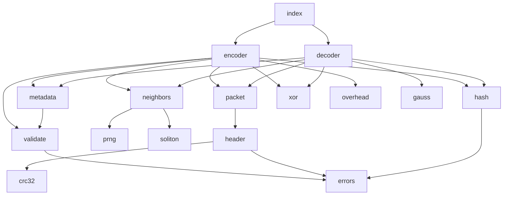

# Design Document

## Overview

`@strip/codec` is pure TypeScript with zero runtime dependencies. It has no DOM and no Node types, and it runs unchanged in Node and browsers.
The Encoder turns a Payload into a Coded_Stream (Metadata_Record followed by the file bytes). It splits the stream into K strided Blocks and emits Packets from an LT fountain code (robust soliton degrees).
The Decoder peels, falls back to Gaussian elimination over GF(2) when few Blocks remain, then verifies SHA-256 before it exposes any bytes.
All format-affecting arithmetic is integer-only: xoshiro128** for randomness and a BigInt fixed-point soliton table. No `Math.random`, `Date.now`, `performance.now`, `Math.log` or `Math.sqrt` appears in `src`.
Requirement ids are written R2.7 and so on. Success is stated as three measured claims (M1 late join, M2 cold start with loss, M3 page mode) calibrated into a committed table.

## Module layout (packages/codec/src)

| File | Responsibility | Depends on |
|---|---|---|
| `constants.ts` | `MAGIC=0x5354`, `FORMAT_VERSION=1`, `HEADER_SIZE=26`, `CRC_SIZE=4`, defaults (packetSize 2953, maxPayloadBytes 33554432, maxBlockCount 16384, maxGaussianBlocks 1024), `SOLITON_C`, `SOLITON_DELTA`, `DENSE_PERIOD` (D; provisional initial 4, 0 means none, frozen at the sweep checkpoint from {3, 4, 8, none}). `maxDenseRows = maxGaussianBlocks + 64` is derived, not a constant | none |
| `errors.ts` | `ERROR_CODES` const tuple, `ErrorCode` union, `IgnoreReason` (`DUPLICATE_PACKET | SESSION_MISMATCH | ALREADY_COMPLETE | DENSE_STORE_FULL`), `CodecError extends Error` with `readonly code` | none |
| `validate.ts` | Hand-written validators; plain functions that throw `CodecError` (`INVALID_INPUT`) | errors, constants |
| `crc32.ts` | Table-driven CRC-32 | none |
| `prng.ts` | SplitMix32 seeding, xoshiro128**, `bounded(n)` | none |
| `header.ts` | `encodeHeader` / `decodeHeader` on a `DataView`, big-endian | constants, crc32, errors |
| `packet.ts` | `encodePacket` / `decodePacket`, check ordering and limits | header, crc32, errors |
| `metadata.ts` | `serializeMetadata`, `parseMetadata`, `readRecordLength`, hand-written UTF-8 codec | errors, validate |
| `hash.ts` | `HashFn` type, `sha256WebCrypto` using `globalThis.crypto.subtle` | errors |
| `soliton.ts` | Integer-only robust soliton threshold table, cached by K | constants |
| `neighbors.ts` | (sessionId, seq, K) to neighbor set, and `isDense(seq, K, D)`; shared by Encoder and Decoder | prng, soliton, constants |
| `xor.ts` | `xorInto` with `Uint32Array` views plus byte tail | none |
| `overhead.ts` | Reads `overhead-table.json` (at `src/overhead-table.json`, imported with `resolveJsonModule`); `fLatePermille`, `fColdPermille`, `lateCount`, `coldLimit`, `R`. Internal, not in the barrel | none |
| `encoder.ts` | `encode()`, `Encoder` | everything above except gauss, decoder |
| `gauss.ts` | GF(2) elimination on bitset rows | xor |
| `decoder.ts` | `createDecoder()`, `Decoder` | packet, metadata, neighbors, gauss, xor, hash |
| `index.ts` | Barrel; the only public surface | encoder, decoder, metadata, packet, errors, hash |



The graph is acyclic and leaf modules import nothing. Tests live in `packages/codec/test` and perf scripts in `packages/codec/perf`, both outside `src`. `packages/codec/perf/calibrate.ts` (outside `src`) generates `overhead-table.json`.
The barrel exports exactly these runtime symbols: `encode`, `createDecoder`, `serializeMetadata`, `parseMetadata`, `encodePacket`, `decodePacket`, `CodecError`, `ERROR_CODES`, `sha256WebCrypto`. Its type-only exports are exactly: `PayloadInput`, `Metadata`, `EncodeOptions`, `DecoderOptions`, `Encoder`, `Decoder`, `PushStatus`, `PacketFields`, `Limits`, `HashFn`, `ErrorCode`, `IgnoreReason`, `Progress`.

## Wire formats

### Packet (big-endian, `DataView`)

| Offset | Field | Type | Value |
|---|---|---|---|
| 0 | magic | u16 | 0x5354 |
| 2 | version | u8 | 1 |
| 3 | flags | u8 | 0 |
| 4 | sessionId | u32 | |
| 8 | L | u32 | Coded_Stream length |
| 12 | blockSize | u16 | |
| 14 | K | u32 | |
| 18 | seq | u32 | |
| 22 | headerCrc | u32 | CRC-32 of bytes 0..21 |
| 26 | payload | blockSize bytes | XOR payload |
| 26+blockSize | trailing CRC | u32 | CRC-32 of bytes 0..26+blockSize-1 |

Packet length is `blockSize + 30`.

maxPayloadBytes bounds L on both sides, so a stream the Encoder accepts is never rejected by a Decoder with the same limit.

`decodePacket` check order. Steps 3 to 9 run only after the header CRC passes, and no buffer is sized from L or K before steps 5 and 6.

| # | Check | Failure |
|---|---|---|
| 1 | length >= 26 | `BAD_HEADER` |
| 2 | header CRC over bytes 0..21 | `BAD_CRC` (wins over every later defect) |
| 3 | magic, flags == 0 | `BAD_HEADER` |
| 4 | version == 1 | `UNSUPPORTED_VERSION` |
| 5 | L <= maxPayloadBytes | `PAYLOAD_TOO_LARGE` |
| 6 | K <= maxBlockCount | `TOO_MANY_BLOCKS` |
| 7 | blockSize in [16, 65535] and K == ceil(L / blockSize) | `BAD_HEADER` |
| 8 | packet length == 30 + blockSize | `BAD_HEADER` |
| 9 | trailing CRC | `BAD_CRC` |

CRC-32 is IEEE 802.3: reflected polynomial 0xEDB88320, init 0xFFFFFFFF, final xor 0xFFFFFFFF. A 256-entry `Uint32Array` table is built at module load with integer code, and values are stored big-endian.
Test vectors: `crc32("123456789") = 0xCBF43926`, `crc32("") = 0x00000000`, `crc32(bytes 0..31) = 0x91267E8A`.

### Metadata_Record

| Field | Type |
|---|---|
| version | u8 (= 1) |
| nameLen | u16 |
| name | UTF-8, nameLen bytes |
| mimeLen | u8 |
| mime | ASCII, mimeLen bytes |
| byteLength | u32 |
| sha256 | 32 bytes |

`parseMetadata` consumes the input exactly, and every failure is mapped as in R1.4 to R1.7. `readRecordLength(bytes)` reads only the length fields and returns the record length without needing the Payload, so the Decoder can pass exactly those bytes to `parseMetadata` (R1.12).
UTF-8 uses a small hand-written codec. `TextEncoder` is unavailable because the tsconfig `lib` excludes DOM and no Node types are installed. The decoder rejects lone surrogates, overlong forms and invalid sequences with `BAD_METADATA`.

### Coded stream and stride

Blocks live in one buffer with `stride = ceil(blockSize / 4) * 4`, zero padded, so each Block is 4-byte aligned for `Uint32Array` views. The wire payload is the first `blockSize` bytes of a stride-sized Block.
`sessionId` is the big-endian u32 of the first 4 bytes of SHA-256(Metadata_Record).

## Deterministic generation

### PRNG (named: xoshiro128** 1.1, seeded by SplitMix32)

Reference: https://prng.di.unimi.it/xoshiro128starstar.c (Blackman and Vigna, public domain).

```
seed32 = (sessionId XOR imul(seq, 0x9E3779B1)) >>> 0
splitmix32(state):
  state = (state + 0x9E3779B9) >>> 0
  z = state
  z = imul(z ^ (z >>> 16), 0x85EBCA6B)
  z = imul(z ^ (z >>> 13), 0xC2B2AE35)
  return (z ^ (z >>> 16)) >>> 0
init: s0..s3 = four successive splitmix32 outputs; if all are 0 then s0 = 1
next():
  result = imul(rotl(imul(s1, 5), 7), 9) >>> 0
  t = s1 << 9
  s2 ^= s0; s3 ^= s1; s1 ^= s2; s0 ^= s3; s2 ^= t; s3 = rotl(s3, 11)
  return result
```

Seeding is injective in `seq` for a fixed session. Test vectors (checked against the C reference and a JS implementation):

| sessionId | seq | seed32 | state s0..s3 | first 4 outputs |
|---|---|---|---|---|
| 0x12345678 | 0 | 12345678 | 047660ea 6072b3dc 49dccea9 3bc1e822 | 14ced9f9 7e9a7d82 4c49953b 7c472bc4 |
| 0x12345678 | 1 | 8c032fc9 | a3f886a5 3b1e4b3a d532f859 afd58365 | 299c99ab 26b9e952 797f6441 ce7b1972 |
| 0xDEADBEEF | 4000000000 | cb5316ef | b3e8a9cd a539246e 424a4fdd 787255f9 | 85b3ac05 b09815eb f7d494d0 15187836 |

### bounded(n), n in [1, 2^32]

```
if n == 1: return 0                      // no draw
if n == 2^32: return next()              // full range, no rejection
bits = 32 - clz32(n - 1)
loop: x = next() >>> (32 - bits); if x < n: return x
```

Rejection sampling is unbiased and takes fewer than 2 draws on average.

### Robust soliton table (`soliton.ts`)

Parameters are c = 1/10 and delta = 1/2, recorded in the overhead table. They are provisional until the c/delta sweep checkpoint (Risk 1). Changing them changes sampled degrees, so golden vectors and the overhead table must be regenerated before release and a format version bump is needed after release.
The table is a pure function of K, built once per K and cached. It uses BigInt fixed point with F = 2^48. BigInt arithmetic is exact, and it runs only at table build, never per packet.

```
isqrt(n): Newton iteration on BigInt
lnQ(vQ):                                  // ln of a Q48 value, returns signed Q48
  n = bitLength(v) - 1
  m = v normalized to [1,2) as Q48
  frac = 0
  repeat 48 times:
    m = (m*m) >> 48; frac <<= 1
    if m >= 2*F: m >>= 1; frac |= 1
  log2Q = ((n - 48) << 48) + frac
  return (log2Q * LN2_Q48) >> 48          // LN2_Q48 = 195103586505167 = floor(ln2 * 2^48)

SQ     = isqrt(K << 96)                   // sqrt(K) in Q48
lnKd   = lnQ((2K) << 48)                  // ln(K/delta), delta = 1/2
S_Q    = max(F, (lnKd * SQ / F) / 10)     // S = c ln(K/delta) sqrt(K), clamped >= 1
pivot  = clamp(floor(K*F / S_Q), 1, K)
rho(1) = F / K;  rho(i) = F / (i*(i-1)), i = 2..K
tau(i) = S_Q / (K*i)                      for i < pivot
tau(pivot) = ((S_Q * lnQ(2*S_Q)) / F) / K // ln(S/delta)
tau(i) = 0                                for i > pivot
w_i = rho(i) + tau(i);  W_i = prefix sums
cumT[i] = floor(W_i * 2^32 / W_K) as Number, i = 1..K;  cumT[K] = 2^32
```

All divisions are BigInt floor divisions. `cumT` is a `Float64Array` of integers, because 2^32 does not fit `Uint32Array`. The degree is sampled by `u = next()` (the first draw of the packet) and a binary search for the smallest `i` with `u < cumT[i]`. For K = 1 the degree is always 1.

### Neighbor selection (`neighbors.ts`)

```
if seq < K:  return {seq}                 // systematic, PRNG unused
init PRNG(sessionId, seq)
d = sampleDegree()
for j in 0..d-1:                          // partial Fisher-Yates on scratch perm[0..K)
  r = j + bounded(K - j); swap(perm[j], perm[r]); neighbor_j = perm[j]
restore touched perm entries from the undo log
```

The scratch permutation is reusable and each call costs O(d). The neighbor SET defines the packet, since XOR commutes and order does not affect bytes. A repair payload is the XOR of the stride-aligned Blocks at the neighbor indices, truncated to `blockSize` wire bytes.
A golden neighbor-set vector will be committed during implementation and cross-checked by an independent script. No numbers are invented here.

### Dense repair rule (R2.2, R2.10 to R2.13)

Precedence: `seq < K` is systematic, else dense iff `isDense`, else sparse.

```
isDense(seq, K, D) = D > 0 && seq >= K && ((seq - K) % D) == D - 1
```

It uses plain integer arithmetic on the u32 `seq` and needs no random draw and no session data. After the sequence wrap (2^32-1 to K) the rule still holds because it only uses `seq - K`.

Dense Block set (no degree draw):

```
init PRNG(sessionId, seq) exactly as for sparse
nw = ceil(K / 32)
word[w] = (w+1)-th next() output, w = 0..nw-1
Block b is included iff ((word[b >>> 5] >>> (b & 31)) & 1) == 1     // high bits of the last word ignored
if no Block is included: set = { seq mod K }
```

Encoder: a Dense_Packet payload is the XOR of about K/2 stride-aligned Blocks via the same `xorInto`, about (K/2) x blockSize/4 word operations per Packet.

Reference vector (design-time, to be re-derived by the independent Python generator in Group 5). Cross-checked between a C implementation and a JS implementation, which agree. These rows test the dense algorithm itself, so they are treated as dense regardless of D. Seq 53 with K = 50 is j = 3, dense at D = 4.

| sessionId | seq | K | words (w0..) | Block set |
|---|---|---|---|---|
| 0x12345678 | 53 | 50 | b955b964 80f65a30 | 2 5 6 8 11 12 13 15 16 18 20 22 24 27 28 29 31 36 37 41 43 44 46 49 (24 Blocks) |
| 0x12345678 | 103 | 100 | 9ad034a6 7b210bdb c61b69ef 37855ee7 | 1 2 5 7 10 12 13 20 22 23 25 27 28 31 32 33 35 36 38 39 40 41 43 48 53 56 57 59 60 61 62 64 65 66 67 69 70 71 72 75 77 78 80 81 83 84 89 90 94 95 96 97 98 (53 Blocks) |
| 0xDEADBEEF | 7 | 1 | 2e0cc0c3 | 0 (1 Block) |
| 0xDEADBEEF | 7 | 5 | 2e0cc0c3 | 0 1 |

## Encoder

`encode(payload, options)`:

1. Validate the arguments.
2. `await hash(payload bytes)`.
3. Build the Metadata_Record.
4. `await hash(record)` and take the sessionId.
5. Copy the Coded_Stream into the strided buffer (K Blocks).
6. Check limits (`PAYLOAD_TOO_LARGE`, `TOO_MANY_BLOCKS`). The limit applies to the coded stream (record + payload). The `PAYLOAD_TOO_LARGE` check happens after the Metadata_Record is built, as L > maxPayloadBytes with L = record length + payload length.
7. Return `Encoder { next(), page(), sessionId, K, blockSize, packetSize, totalLength }`.

`next()` and `page()` are synchronous.

| Method | Behavior |
|---|---|
| `next()` | Returns a fresh `Uint8Array` per Packet. Scratch (perm, undo log, neighbor list) is reused. The u32 `seq` counter goes 0..K-1, K, K+1, ..., and wraps from 2^32-1 to K (R4.2). |
| `page()` | Allocates one `ArrayBuffer` for the whole page and returns `subarray` views (aliasing is documented). repairCount defaults to `R(K)` from `overhead.ts` (R4.4). |

`xorInto(dst, src, words)` XORs `floor(blockSize / 4)` words through `Uint32Array` views, then a byte tail of `blockSize % 4` bytes through `Uint8Array`. XOR is bytewise, so the result does not depend on platform endianness. Systematic Packets copy the Block with no XOR. Cost per Packet is O(d * blockSize / 4).

### Overhead calibration

**Table.** `packages/codec/src/overhead-table.json` holds integers only, so no floating point is involved:

```json
{ "formatVersion": 1, "c": [1, 10], "delta": [1, 2], "D": 4, "samples": {"K<=500": 2000, "K>=1000": 500},
  "quantile": "0.995",
  "rows": [ { "K": 10, "fLatePermille": 0, "fColdPermille": 0, "R": 0 } ] }
```

Rows exist for K in {10, 25, 50, 100, 250, 500, 1000, 2000}. `samples` records N_cal per K range. The values above are placeholders; the real ones come from `calibrate.ts`. The count for a factor is `ceilDiv(permille * K, 1000)`. `D` is an integer (0 = none) and records the dense period under which the table was calibrated. `calibrate.ts` takes `--D`; M1, M2, M3 and calibration run with the frozen D. The sweep covers (c, delta) in {(0.1, 0.5), (0.03, 0.5)} x D in {none, 8, 4, 3}.

**`overhead.ts` API.** `fLatePermille(K)`, `fColdPermille(K)`, `lateCount(K) = ceilDiv(fLatePermille(K) * K, 1000)`, `coldLimit(K)` likewise with `fColdPermille`, and `R(K)`.
For K_lo < K < K_hi (adjacent rows), `v = ceilDiv(v_lo * (K_hi - K) + v_hi * (K - K_lo), K_hi - K_lo)`. K <= 10 or K >= 2000 clamps to the end row. Interpolated permille values are ceil'd again by the consumer. `R(K)` is always an integer >= 0 and is the default `page()` repairCount.

**`perf/calibrate.ts`** is seeded and deterministic. It sits outside `src`, so it may import `src` modules by relative path. It uses the real encoder and decoder with `sha256WebCrypto`, and the codec's own xoshiro128** (`prng.ts`) seeded with a fixed constant mixed with K for all shuffles and loss draws (no `Math.random`). Payload bytes come from the same PRNG and vary per trial so session ids vary. `packetSize` 62 gives blockSize 32 for speed. For each K it runs N_cal trials (2000 for K <= 500, 500 for K = 1000 and 2000):

| Claim | Simulation | Recorded value |
|---|---|---|
| M1 | Seeded shuffle of repair seq K..5K-1, push in that order until complete. n_needed is Infinity if not complete within 4K pushes. | fLate = 0.995 quantile of n_needed / K, rounded up to permille |
| M2 | Stream from seq 0. Each Packet is lost if `next() < 1288490189` (0.30 x 2^32). Stop at completion or after 20K sequence numbers. | fCold = 0.995 quantile of received count / K, rounded up to permille |
| M3 | Same stream with loss `next() < 214748365` (0.05 x 2^32). Record the 1-based stream position at completion. | R = 0.995 quantile of (position - K), floored at 0 |

Calibration targets the 0.995 quantile while the properties assert 0.99. The margin absorbs sampling noise between the calibration sample and the fresh-seed assertion sample.
If any quantile is Infinity, calibrate exits non-zero, prints the failing K and writes nothing. It prints the table and a Wilson lower bound for each cell, and writes the JSON only with an explicit `--write` flag.
The suite test re-runs calibrate for K in {10, 25, 50} with the table's N_cal and fails on any difference from the committed rows (R10.5). Rows for K >= 100 are verified by running calibrate manually or in perf, not in the default suite (runtime).

M1, M2 and M3 use fresh seeds different from the calibration seed.

**Why there is no fixed overhead claim.** No code, including an ideal dense random linear code, reaches 0.99 success below roughly K + 7 received Packets (failure probability about 2^-(m-K)). That is 1.14 x K at K = 50. A fixed 1.1 x K claim is unreachable at small K and MUST NOT be re-added. Overhead is stated per K from the calibrated table.

## Decoder

### State (typed arrays; no per-packet allocation beyond the returned status)

| Structure | Purpose |
|---|---|
| params | Fixed by the first valid Packet (sessionId, L, blockSize, K) |
| `blocks` | `K * stride` bytes |
| `solved` | `Uint8Array(K)`, plus `solvedCount` |
| equation slab | `eqVal` (stride bytes each, allocated in chunks of 64), `eqDegree` (`Uint32Array`), `eqNbrOff` and `eqNbr` flat neighbor lists |
| adjacency | Per-block linked lists: `head[b]`, `nextEdge[e]`, `edgeEq[e]`, grown by amortized doubling |
| ripple | Queue of equation ids whose degree is 1 |
| `seen` | `Set<number>` of accepted seq numbers |
| dense store | Up to `maxDenseRows` slots with a free list. Per slot: `denseBits` (K-bit row, `Uint32Array`, `ceil(K/32)` words), `densePayload` (stride bytes), `denseFolded` (K-bit row of solved columns already XORed into the payload). Dense rows are never added to adjacency or the ripple. |

### push flow

1. `decodePacket` with the decoder limits. Failures give `rejected` with the code.
2. The first valid Packet fixes session and params. A different sessionId gives `ignored` with `SESSION_MISMATCH`. Same session with inconsistent params gives `rejected` with `BAD_HEADER`. A seq in `seen` gives `ignored` with `DUPLICATE_PACKET`.
2a. If `seq >= K` and `isDense(seq, K, D)`: build the K-bit row directly from the PRNG words (no neighbor array). If stored dense rows == `maxDenseRows`, return `ignored` with `DENSE_STORE_FULL`, with state unchanged, not counted in `distinctPackets` and `seq` not added to `seen` (a retransmission can be accepted after a row is freed). Otherwise store the row and payload, count it as distinct, record `seq` in `seen`, and return `accepted`. Steps 3 to 6 do not apply to dense Packets.
3. Compute the neighbors.
4. XOR already-solved Blocks into the equation and decrement its degree.
5. Degree 0: discard (still counted as distinct). Degree 1: solve the Block and propagate. Otherwise store it and add adjacency edges.
6. Peeling: when Block b is solved, for each equation e in `adj[b]`, do `eqVal[e] ^= block; degree--` and enqueue if the degree becomes 1. The one unsolved neighbor of a degree-1 equation is found by scanning its neighbor list.

Sparse and systematic Packets keep peeling while the dense store is full (R5.21).

Memory bound: at most `maxStored = 2K + 64` stored (unreduced) sparse equations. Packets beyond that count toward `distinctPackets` and are reported `accepted`, but their values are dropped. This is a deliberate trade-off.
At K = 11,479 with stride 2924, `blocks` is about 33.6 MB and stored equations add up to about 2K x 2.9 KB, about 67 MB. The Gaussian bit matrix adds at most 128 KiB at the default cap (1024 x 32 words). At K = 16384 the dense store is at most 1088 rows x (2 KiB `denseBits` + 2 KiB `denseFolded` + about 2.9 KiB payload), about 7.6 MB. The 32 MiB case is therefore measured and reported (R8.5), not budgeted.

### Gaussian fallback (`gauss.ts`)

`maxGaussianBlocks` defaults to 1024 and is configurable. Trigger, evaluated after a push: ripple empty, unsolved U > 0, U <= maxGaussianBlocks, (stored sparse equations + stored dense rows) >= U, and the retry backoff below is satisfied.

Lazy dense folding runs at the start of each attempt. For each stored dense row and each newly solved column c with its bit set in `denseBits` and not set in `denseFolded`, XOR Block c into the row payload and set the folded bit, so no Block is XORed twice. A row whose columns are all solved is discarded and its slot freed (R5.22); such a row carries no information because every Block is already known. The count of unsolved columns per row is computed lazily here, so peeling pays no per-Block cost for dense rows.

If the residual after peeling exceeds the cap, the decoder does not error, does not change the status kind for that reason, and keeps collecting Packets. Each push still costs O(d * stride/4) of peeling work. Once peeling reduces the residual to <= cap, Gaussian elimination becomes eligible. If peeling alone solves every Block, completion happens without Gaussian elimination (R5.15, R5.16).

| Phase | Work |
|---|---|
| A (rank) | Build U-column bitset rows (`Uint32Array`, `ceil(U/32)` words) from stored sparse equations (degree >= 2) and from the folded dense rows, restricted to unsolved columns. Eliminate on a copy to find rank and pivot rows. If rank r < U, abort and wait for more Packets. |
| B (solve) | Only at full rank: choose U pivot rows, run Gauss-Jordan with row value XORs (stride/4 words per row op), then mark all Blocks solved. |

Retry backoff: after a failed Phase A with rank r, Gaussian elimination is retried only after at least `max(1, U - r)` further equations have been stored, so repeated attempts do not dominate.

Cost at U = 1024: the Phase A bit matrix is 1024 rows x 32 words = 128 KiB. Phase A work is about U^3/32 word operations (about 34 million). Phase B value work is up to about U^2/2 row XORs of stride/4 words each: at default stride 2924, about 5.2e5 x 731 = 3.8e8 word XORs worst case, roughly 0.3 to 1 s in JS. This is an estimate to be measured, not a measurement.

Lazy folding cost at K = 11,500 and U <= 1024, estimate only: about (K - U)/2, roughly 5.2k, Block XORs of 731 words per dense row, about 3.8e6 word operations per row and about 4e9 for 1088 rows. To be MEASURED and reported, with no budget.

### Completion

All K Blocks solved: assemble the Coded_Stream (strip stride padding, truncate to L), `readRecordLength`, `parseMetadata` on exactly the record bytes, `await hash(payload bytes)`, compare hash and byteLength.

| Outcome | Result |
|---|---|
| Match | `complete = true`; `result()` returns `{ payload, metadata }` |
| Mismatch | Terminal failed state. `push` returns `rejected` with `HASH_MISMATCH`. Bytes are never exposed. `result()` throws `INCOMPLETE_DECODE`. |

Bytes are exposed only after the SHA-256 match, whichever Packet kinds (dense, sparse, systematic) contributed (R5.23).

`push()` is async only because of the hash. Overlapping calls are serialized with an internal promise chain, so state transitions never interleave. After completion, same-session Packets return `ignored` with reason `ALREADY_COMPLETE` and no state change.

```ts
type PushStatus = {
  kind: 'accepted' | 'ignored' | 'rejected'
  reason?: IgnoreReason   // 'DUPLICATE_PACKET' | 'SESSION_MISMATCH' | 'ALREADY_COMPLETE' | 'DENSE_STORE_FULL'
  code?: ErrorCode
  progress: { solvedBlocks: number; totalBlocks: number; distinctPackets: number; complete: boolean }
}
```

Complexity: peeling is O(E * stride/4) with E the total edge count (about n times the mean degree, which scales with ln K). Gaussian cost is as in the table above.

## Errors, validation, public API

```ts
export const ERROR_CODES = ['INVALID_INPUT','PAYLOAD_TOO_LARGE','TOO_MANY_BLOCKS','BAD_METADATA','BAD_HEADER',
  'UNSUPPORTED_VERSION','BAD_CRC','SESSION_MISMATCH','INCOMPLETE_DECODE','HASH_MISMATCH'] as const
export type ErrorCode = typeof ERROR_CODES[number]
export class CodecError extends Error { readonly code: ErrorCode }   // message always non-empty
```

Validators run on every argument before any other processing. On failure they throw `CodecError`, `INVALID_INPUT` unless a more specific code applies.

| Input | Rule |
|---|---|
| `packetSize` | integer in [46, 65565] |
| `repairCount` | integer, >= 0, <= 2^32 - 1 - K |
| `maxPayloadBytes` | integer >= 1. The limit applies to the coded stream (record + payload), not the payload alone |
| `maxBlockCount` | integer >= 1 |
| `maxGaussianBlocks` | integer >= 0 |
| `hash` | function |
| payload | `Uint8Array`, plus name (string) and mime (string) |
| packet | `Uint8Array` |

Public signatures:

```ts
export function encode(payload: PayloadInput, options?: EncodeOptions): Promise<Encoder>
export interface Encoder { next(): Uint8Array; page(): Uint8Array[]; readonly sessionId: number; readonly K: number; readonly blockSize: number }
export function createDecoder(options?: DecoderOptions): Decoder
export interface Decoder { push(packet: Uint8Array): Promise<PushStatus>; result(): { payload: Uint8Array; metadata: Metadata }; progress(): Progress }
export function serializeMetadata(m: Metadata): Uint8Array
export function parseMetadata(bytes: Uint8Array): Metadata
export function encodePacket(p: PacketFields): Uint8Array
export function decodePacket(bytes: Uint8Array, limits?: Limits): PacketFields
export { CodecError, type ErrorCode }
export const sha256WebCrypto: HashFn        // Default_Hash
```

Type-only exports are exactly those listed in Module layout; the runtime exports are exactly the nine listed there.

## Correctness properties

*A property is a characteristic or behavior that should hold true across all valid executions of a system-essentially, a formal statement about what the system should do. Properties serve as the bridge between human-readable specifications and machine-verifiable correctness guarantees.*

All use fast-check. Measured properties use fixed seeds.

| Id | Statement (for all ...) | Generator | Runs | Validates |
|---|---|---|---|---|
| P1 | For any payload, name and mime, pushing all systematic Packets in shuffled order recovers identical bytes and Metadata. | Length 0..70000 mixing `uint8Array` and lengths around multiples of blockSize; name and mime arbitraries; packetSize in 46..400 or default | 200 | R1.2, R1.8, R2.5, R5.12 |
| P2 | For any `maxGaussianBlocks` in 0..10, K in 20..60 and any sufficient shuffled loss-free Packet set (all systematic plus repair), the Decoder completes with identical bytes, no Packet is rejected for exceeding the cap, and a Packet pushed after completion returns `ignored` with `ALREADY_COMPLETE` and a deep-equal state. | Cap, K and shuffle arbitraries; blockSize 32 | 200 | R5.8, R5.9, R5.15, R5.16, R5.17 |
| P3 | For any sufficient Packet set and any two permutations of it, the recovered bytes are equal. | Permutations of a set from P1 | 200 | R5.14 |
| P4 | For any push sequence containing duplicates and foreign-session Packets, duplicates leave a state snapshot deep-equal, foreign Packets are ignored with `SESSION_MISMATCH`, and the final result equals the original. | Interleave duplicates and foreign Packets | 200 | R5.3, R5.4, R2.6 |
| P5 | For any valid Packet and any bit index, flipping that bit makes `decodePacket` fail and `push` return `rejected`. Plus one exhaustive unit over every bit of a small Packet. | `fc.nat` over bit index | 1000 | R3.9 |
| P6 | For any valid header and payload field values, `decodePacket(encodePacket(p))` equals `p`. | Valid field ranges | 500 | R3.1, R3.15 |
| P7a | For any valid Metadata (including unicode names), parse after serialize equals the input. | Valid name and mime arbitraries | 500 | R1.3 |
| P7b | For any invalid name (empty, 256+ bytes, `/`, `\`, NUL, control, `.`, `..`), serialization throws `BAD_METADATA`. | Class-specific generators | 500 | R1.4 |
| P7c | For any valid record mutated by truncation, appended bytes or a corrupted length field, parse throws `BAD_METADATA`. | Mutations | 500 | R1.6 |
| P8 | For any payload and options, two independent `encode` calls give identical bytes for the first 3K Packets and identical `page()`. | As P1 | 100 | R6.1, R4.1 |
| P9 | For any push sequence, `solvedBlocks` and `distinctPackets` never decrease, `solvedBlocks <= totalBlocks`, and `complete` holds iff all Blocks are solved and the hash matched. With an injected wrong-digest HashFn the result is `HASH_MISMATCH` and `complete` stays false. | Random sequences with duplicates and foreign Packets; call-recording HashFn | 200 | R5.6, R5.10, R5.11 |
| P10 | For any (sessionId, seq, K), `neighbors` is pure, returns d distinct values in [0, K) with d in [1, K], and a systematic seq i gives {i}. | Random triples | 500 | R2.3, R2.4, R6.2 |
| P11 | For any arbitrary or mutated bytes, `push` never throws, a `rejected` status carries a valid ErrorCode, and the progress snapshot is unchanged. | Random bytes; mutated valid Packets | 500 | R7.7, R9.2 |
| P12 | For any K in 1..5000, the overhead module returns integers with R >= 0, values equal to the table at table K, linear in between within ceil rounding, and clamped outside [10, 2000]. | `fc.integer(1, 5000)` | 300 | R10.3 |
| P13 | For any invalid option or payload shape, the public function throws `CodecError` (`INVALID_INPUT` or a more specific code) with no partial effect on existing Encoder or Decoder state. | Invalid options and shapes | 300 | R9.2, R9.3 |
| P14 | Dense-or-sparse rule. For any K in 1..20000, any seq (including seq >= 2^32 - 50 and the wrap) and every D in {0, 3, 4, 8}, kind(seq) equals the index rule: systematic if seq < K, dense iff D > 0 and (seq-K) mod D == D-1, else sparse. | K, seq and D arbitraries with wrap-biased seq | 1000 | R2.2, R2.10 |
| P15 | Hash-gated dense safety. For any decoder fed only dense and systematic Packets (random subsets, some dense payloads corrupted with a recomputed valid CRC), the Decoder either never completes or completes with bytes equal to the original, and never exposes bytes when the hash fails. | Subset and corruption arbitraries; blockSize 32 | 200 | R5.18 to R5.23, R5.10, R5.11 |
| P16 | Dense determinism. For any payload and options, two independent encodes give byte-identical dense Packets, and the dense Block set equals a reference algorithm re-implemented inside the test from the word/bit rule. | As P1 | 200 | R6.7, R2.11, R2.12, R2.13 |
| M1 | Late join. Pool is repair seq K..5K-1; subset of size `ceil(f_late x K)`; asserts observed success >= 0.99. Reports the observed rate and Wilson lower bound. | Fixed fast-check seed (not the calibration seed); payload varies per trial; blockSize 32; K in {50, 100, 500} | N = 1000 per K | R2.7, R2.9, R10.6 |
| M2 | Cold start with loss 0.30. Stream from seq 0; asserts received count <= `ceil(f_cold x K)` in >= 0.99 of trials. Reports rate and Wilson lower bound. | As M1 | N = 1000 per K | R2.8, R2.9, R10.6 |
| M3 | Page mode. Default `page()` of T = K + R(K) Packets, loss 0.05; asserts completion >= 0.99. Reports rate and Wilson lower bound, plus informational success at loss 0.02 and 0.10 (no assertion). | As M1 | N = 1000 per K | R4.7, R2.9, R10.6 |

Wilson 95% lower bound, with p the observed rate, n trials and z = 1.96:

```
lower = (p + z²/(2n) - z * sqrt(p(1-p)/n + z²/(4n²))) / (1 + z²/n)
```

For n = 1000 and p = 0.99 the bound is about 0.982. These are measurements with a stated sample size, so they are evidence and not proof.

## Test strategy

PBT fits the pure logic (codec, packet and metadata formats, decoder). It does not fit the Playwright, perf and static-check items, which are example or smoke tests.

| Area | Location and approach |
|---|---|
| Unit and property | `packages/codec/test/*.test.ts`, fast-check with a minimum of 100 runs per property. Each property test carries a tag comment `Feature: codec, Property N: <text>`. Each property is one test. |
| Measured | `test/measured/*.test.ts` (M1, M2, M3). Own vitest project with script `test:measured`. Included in `pnpm test` unless runtime exceeds 60 s, in which case the exception is documented. |
| Golden | `test/golden/vectors.json` is committed and generated once by an independent script, never silently regenerated. It holds a fixed payload, name, mime and options, the hex of the first Packets, sessionId, K, neighbor sets for several seq, PRNG vectors and CRC vectors. A test fails on any count or byte difference (R6.4). |
| Perf | `perf/*.perf.ts` with `vitest.perf.config.ts` and a perf script. 3 warm-ups and 20 timed runs, `process.hrtime.bigint`, median asserted against budget. Output records the Node version, CPU model (`os.cpus()[0].model`) and p95. The 32 MiB run is informational (R8.5). |
| Playwright | A tiny Vite-served page in `apps/strip/e2e-harness` imports the built codec through the barrel. It checks Default_Hash parity (including empty input) and that golden-vector Packets equal the JSON byte for byte (R1.11, R9.5). |
| Calibration | A unit test re-runs `perf/calibrate.ts` for K in {10, 25, 50} and fails on any difference from the committed table rows (R10.5). `calibrate.ts --write` is the only way the table changes. |
| Static | Compile with `lib: ["ES2023"]`, no DOM, no `@types/node` (R9.4). A test asserts `packages/codec/package.json` has no `dependencies` key (R9.6, R9.7). A purity scan over `src` finds zero occurrences of `Math.random`, `Date.now`, `performance.now`, `Math.log`, `Math.sqrt`, `Math.exp` and `Math.pow` (R6.2, R6.5). The ESLint ban list is unchanged. The hook script `.kiro/hooks/scripts/purity.mjs` must be extended to the same list (a task, not done here). The ESLint rule test in `tools/lint-rules.test.ts` covers R6.6. |

Tests sit outside `src`, so the ESLint bans do not apply to them, but they still use only seeded fast-check and fixed seeds. Perf timing uses `process.hrtime.bigint` only in `perf/`.
Unit tests cover specific examples (R3 check ordering, R4.2 wrap, R7.3 and R7.4 limit boundaries, R1.7, the four dense reference-vector rows, and `DENSE_STORE_FULL` behaviour with acceptance of a retransmission after a row is freed, R5.20 and R5.22), edge cases (empty payload, K = 1) and error codes.

## Performance notes

Hot loops allocate nothing. The perm, undo log and neighbor scratch are reused. XOR runs through `Uint32Array` views, equations live in a chunked slab, and CRC uses a byte table. The only per-packet allocation is the returned Packet.
A dense Packet costs about K/2 Block XORs. The only budget is at K = 359 (1 MiB): the median of 20 timed runs after 3 warm-ups for a dense `next()` must be under 20 ms. If it misses, the author stops and reports (R8.7). At K = 11,500 (32 MiB) the per-dense-Packet cost is measured and reported with no budget, and so is the lazy folding cost.
The soliton table costs O(K) BigInt operations once per K and is cached by K. Expected complexities are as in the Decoder section.
For 1 MiB at the default size, K = 359. Encode is 359 copies of 2923 bytes plus SHA-256 and CRC. Decode is dominated by CRC and SHA-256 when fed Systematic_Packets.
R8.2 fixtures: (a) the K Systematic_Packets of the 1 MiB input, and (b) `ceil(f_late(K) x K)` seeded random repair Packets of the same input. Both are asserted at the 500 ms median budget, and output bytes are compared with the input in every timed run.

## Risks and open decisions

### Risk 1: attainability cost of M2 and M3, and dense rows

The user approved dense repair rows. The (c, delta) x D sweep decides D, and D = none remains a candidate. Gaussian elimination now also depends on dense rows, so it is limited by `maxGaussianBlocks` = 1024. The figures below are the pre-implementation estimate and are kept for reference.

A throwaway estimate (scratch script, `Math.random`, float soliton, unlimited Gaussian elimination, which equals the decoder for K <= 1024; N = 1000 trials for K = 50 and 100, N = 300 for K = 500) gave the observed 0.99 quantile of each claim:

| (c, delta) | K | f_late | f_cold | R (loss 0.05) |
|---|---|---|---|---|
| (0.1, 0.5) | 50 | 1.54 | 2.00 | 50 |
| (0.1, 0.5) | 100 | 1.53 | 1.91 | 100 |
| (0.1, 0.5) | 500 | 1.12 | 1.72 | 452 |
| (0.2, 0.01) | 50 | 2.10 | 2.52 | 69 |
| (0.2, 0.01) | 100 | 1.88 | 2.37 | 133 |
| (0.2, 0.01) | 500 | 1.39 | 2.18 | 502 |
| (0.03, 0.5) | 50 | 1.56 | 1.98 | 49 |
| (0.03, 0.5) | 100 | 1.41 | 1.91 | 95 |
| (0.03, 0.5) | 500 | 1.12 | 1.72 | 425 |

R at loss 0.02 / 0.10 for (0.1, 0.5): K = 50: 43 / 62, K = 100: 84 / 112, K = 500: 358 / 549.

Cause: with systematic-first emission, one lost systematic Block can only be recovered by a repair Packet that contains it. A sparse repair Packet contains a given Block with probability about (mean degree)/K, so about K/(mean degree) x ln(100) repair Packets are needed for 0.99 even when one Block is missing. The claims are always satisfiable with large f and R, since they are measurements, but plain LT costs near 2x on the page at K = 50..500.

Remedy, now adopted (see Dense repair rule): mix a fraction q of dense repair rows (each Block included with probability 1/2, decoded by Gaussian elimination). Estimate at (0.1, 0.5):

| q | K | f_late | f_cold | R |
|---|---|---|---|---|
| 0.05 | 50 | 1.38 | 1.90 | 46 |
| 0.05 | 100 | 1.12 | 1.58 | 72 |
| 0.05 | 500 | 1.02 | 1.29 | 208 |
| 0.25 | 50 | 1.16 | 1.44 | 30 |
| 0.25 | 100 | 1.08 | 1.27 | 37 |
| 0.25 | 500 | 1.02 | 1.17 | 101 |

Dense rows rely on Gaussian elimination, so they are limited by `maxGaussianBlocks` = 1024 and the cost in the Decoder section. Report the sweep table at the checkpoint and freeze D there.

### Risk 2: Gaussian elimination cost at the 1024 cap and the R8.2 fixture (b) budget

Estimated 0.3 to 1 s worst case per full elimination at U = 1024 and default stride. At the 1 MiB fixture, K = 359, so the residual is at most 359 and the cost is about (359/1024)^2 of that. Lazy dense folding adds to this cost (estimate in the Decoder section) and is measured with fixture (b) and at K = 11,500. Fixture (b) must be measured. If it exceeds 500 ms the author stops and reports (R8.6). A mitigation that needs no format change: apply value XORs only for the pivot rows chosen in Phase A.

### Risk 3: calibration stability and runtime

The 0.995 calibration quantile against the 0.99 assertion leaves a margin, but a rare false stop is still possible. Calibration at K = 1000 and 2000 is slow (minutes), and at K = 2000 the 1024 cap may delay completion. The table records N_cal. Recommended default: keep the margin, run K >= 1000 calibration offline with `--write`, and verify only K in {10, 25, 50} in the default suite.

## Architecture

See Module layout (dependency graph) and Deterministic generation.

## Components and Interfaces

See Encoder, Decoder, and Errors, validation, public API.

## Data Models

See Wire formats (Packet, Metadata_Record, stride layout) and the Decoder state table.

## Error Handling

See Errors, validation, public API, the `decodePacket` check-order table in Wire formats, and the HASH_MISMATCH terminal state in Decoder.

## Testing Strategy

See Test strategy. PBT applies to the pure codec logic (Correctness properties). Each property is one fast-check test with at least 100 runs, tagged `Feature: codec, Property N: <text>`.
