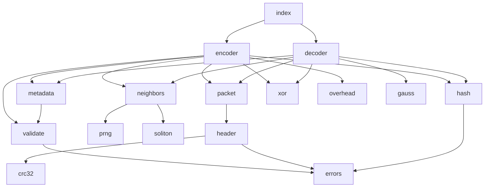

# Design Document

## Overview

`@strip/codec` is pure TypeScript with zero runtime dependencies. It has no DOM and no Node types, and it runs unchanged in Node and browsers.
The Encoder turns a Payload into a Coded_Stream (Metadata_Record followed by the file bytes). It splits the stream into K strided Blocks and emits Packets from an LT fountain code (robust soliton degrees).
The Decoder peels, falls back to Gaussian elimination over GF(2) when few Blocks remain, then verifies SHA-256 before it exposes any bytes.
All format-affecting arithmetic is integer-only: xoshiro128** for randomness and a BigInt fixed-point soliton table. No `Math.random`, `Date.now`, `performance.now`, `Math.log` or `Math.sqrt` appears in `src`.
Requirement ids are written R2.7 and so on. Section 11 holds one blocking decision (Risk 1): the R2.7 bound is not reachable at 1.1 x K with the current distribution.

## Module layout (packages/codec/src)

| File | Responsibility | Depends on |
|---|---|---|
| `constants.ts` | `MAGIC=0x5354`, `FORMAT_VERSION=1`, `HEADER_SIZE=26`, `CRC_SIZE=4`, defaults (packetSize 2953, maxPayloadBytes 33554432, maxBlockCount 16384, maxGaussianBlocks 256), `SOLITON_C`, `SOLITON_DELTA` | none |
| `errors.ts` | `ERROR_CODES` const tuple, `ErrorCode` union, `IgnoreReason`, `CodecError extends Error` with `readonly code` | none |
| `validate.ts` | Hand-written validators; plain functions that throw `CodecError` (`INVALID_INPUT`) | errors, constants |
| `crc32.ts` | Table-driven CRC-32 | none |
| `prng.ts` | SplitMix32 seeding, xoshiro128**, `bounded(n)` | none |
| `header.ts` | `encodeHeader` / `decodeHeader` on a `DataView`, big-endian | constants, crc32, errors |
| `packet.ts` | `encodePacket` / `decodePacket`, check ordering and limits | header, crc32, errors |
| `metadata.ts` | `serializeMetadata`, `parseMetadata`, `readRecordLength`, hand-written UTF-8 codec | errors, validate |
| `hash.ts` | `HashFn` type, `sha256WebCrypto` using `globalThis.crypto.subtle` | errors |
| `soliton.ts` | Integer-only robust soliton threshold table, cached by K | constants |
| `neighbors.ts` | (sessionId, seq, K) to neighbor set; shared by Encoder and Decoder | prng, soliton |
| `xor.ts` | `xorInto` with `Uint32Array` views plus byte tail | none |
| `overhead.ts` | `overhead(K)` and the default repairCount function (provisional, Risk 1) | none |
| `encoder.ts` | `encode()`, `Encoder` | everything above except gauss, decoder |
| `gauss.ts` | GF(2) elimination on bitset rows | xor |
| `decoder.ts` | `createDecoder()`, `Decoder` | packet, metadata, neighbors, gauss, xor, hash |
| `index.ts` | Barrel; the only public surface | encoder, decoder, metadata, packet, errors, hash |



The graph is acyclic and leaf modules import nothing. Tests live in `packages/codec/test` and perf scripts in `packages/codec/perf`, both outside `src`.

## Wire formats

### Packet (big-endian, `DataView`)

| Offset | Field | Type | Value |
|---|---|---|---|
| 0 | magic | u16 | 0x5354 |
| 2 | version | u8 | 1 |
| 3 | flags | u8 | 0 |
| 4 | sessionId | u32 | |
| 8 | L | u32 | Coded_Stream length |
| 12 | blockSize | u16 | |
| 14 | K | u32 | |
| 18 | seq | u32 | |
| 22 | headerCrc | u32 | CRC-32 of bytes 0..21 |
| 26 | payload | blockSize bytes | XOR payload |
| 26+blockSize | trailing CRC | u32 | CRC-32 of bytes 0..26+blockSize-1 |

Packet length is `blockSize + 30`.

`decodePacket` check order. Steps 3 to 9 run only after the header CRC passes, and no buffer is sized from L or K before steps 5 and 6.

| # | Check | Failure |
|---|---|---|
| 1 | length >= 26 | `BAD_HEADER` |
| 2 | header CRC over bytes 0..21 | `BAD_CRC` (wins over every later defect) |
| 3 | magic, flags == 0 | `BAD_HEADER` |
| 4 | version == 1 | `UNSUPPORTED_VERSION` |
| 5 | L <= maxPayloadBytes | `PAYLOAD_TOO_LARGE` |
| 6 | K <= maxBlockCount | `TOO_MANY_BLOCKS` |
| 7 | blockSize in [16, 65535] and K == ceil(L / blockSize) | `BAD_HEADER` |
| 8 | packet length == 30 + blockSize | `BAD_HEADER` |
| 9 | trailing CRC | `BAD_CRC` |

CRC-32 is IEEE 802.3: reflected polynomial 0xEDB88320, init 0xFFFFFFFF, final xor 0xFFFFFFFF. A 256-entry `Uint32Array` table is built at module load with integer code, and values are stored big-endian.
Test vectors: `crc32("123456789") = 0xCBF43926`, `crc32("") = 0x00000000`, `crc32(bytes 0..31) = 0x91267E8A`.

### Metadata_Record

| Field | Type |
|---|---|
| version | u8 (= 1) |
| nameLen | u16 |
| name | UTF-8, nameLen bytes |
| mimeLen | u8 |
| mime | ASCII, mimeLen bytes |
| byteLength | u32 |
| sha256 | 32 bytes |

`parseMetadata` consumes the input exactly, and every failure is mapped as in R1.4 to R1.7. `readRecordLength(bytes)` reads only the length fields and returns the record length without needing the Payload, so the Decoder can pass exactly those bytes to `parseMetadata` (R1.12).
UTF-8 uses a small hand-written codec. `TextEncoder` is unavailable because the tsconfig `lib` excludes DOM and no Node types are installed. The decoder rejects lone surrogates, overlong forms and invalid sequences with `BAD_METADATA`.

### Coded stream and stride

Blocks live in one buffer with `stride = ceil(blockSize / 4) * 4`, zero padded, so each Block is 4-byte aligned for `Uint32Array` views. The wire payload is the first `blockSize` bytes of a stride-sized Block.
`sessionId` is the big-endian u32 of the first 4 bytes of SHA-256(Metadata_Record).

## Deterministic generation

### PRNG (named: xoshiro128** 1.1, seeded by SplitMix32)

Reference: https://prng.di.unimi.it/xoshiro128starstar.c (Blackman and Vigna, public domain).

```
seed32 = (sessionId XOR imul(seq, 0x9E3779B1)) >>> 0
splitmix32(state):
  state = (state + 0x9E3779B9) >>> 0
  z = state
  z = imul(z ^ (z >>> 16), 0x85EBCA6B)
  z = imul(z ^ (z >>> 13), 0xC2B2AE35)
  return (z ^ (z >>> 16)) >>> 0
init: s0..s3 = four successive splitmix32 outputs; if all are 0 then s0 = 1
next():
  result = imul(rotl(imul(s1, 5), 7), 9) >>> 0
  t = s1 << 9
  s2 ^= s0; s3 ^= s1; s1 ^= s2; s0 ^= s3; s2 ^= t; s3 = rotl(s3, 11)
  return result
```

Seeding is injective in `seq` for a fixed session. Test vectors (checked against the C reference and a JS implementation):

| sessionId | seq | seed32 | state s0..s3 | first 4 outputs |
|---|---|---|---|---|
| 0x12345678 | 0 | 12345678 | 047660ea 6072b3dc 49dccea9 3bc1e822 | 14ced9f9 7e9a7d82 4c49953b 7c472bc4 |
| 0x12345678 | 1 | 8c032fc9 | a3f886a5 3b1e4b3a d532f859 afd58365 | 299c99ab 26b9e952 797f6441 ce7b1972 |
| 0xDEADBEEF | 4000000000 | cb5316ef | b3e8a9cd a539246e 424a4fdd 787255f9 | 85b3ac05 b09815eb f7d494d0 15187836 |

### bounded(n), n in [1, 2^32]

```
if n == 1: return 0                      // no draw
if n == 2^32: return next()              // full range, no rejection
bits = 32 - clz32(n - 1)
loop: x = next() >>> (32 - bits); if x < n: return x
```

Rejection sampling is unbiased and takes fewer than 2 draws on average.

### Robust soliton table (`soliton.ts`)

Parameters are c = 1/10 and delta = 1/2. They are provisional (Risk 1). Changing them changes sampled degrees, so golden vectors must be regenerated before release and a format version bump is needed after release.
The table is a pure function of K, built once per K and cached. It uses BigInt fixed point with F = 2^48. BigInt arithmetic is exact, and it runs only at table build, never per packet.

```
isqrt(n): Newton iteration on BigInt
lnQ(vQ):                                  // ln of a Q48 value, returns signed Q48
  n = bitLength(v) - 1
  m = v normalized to [1,2) as Q48
  frac = 0
  repeat 48 times:
    m = (m*m) >> 48; frac <<= 1
    if m >= 2*F: m >>= 1; frac |= 1
  log2Q = ((n - 48) << 48) + frac
  return (log2Q * LN2_Q48) >> 48          // LN2_Q48 = 195103586505167 = floor(ln2 * 2^48)

SQ     = isqrt(K << 96)                   // sqrt(K) in Q48
lnKd   = lnQ((2K) << 48)                  // ln(K/delta), delta = 1/2
S_Q    = max(F, (lnKd * SQ / F) / 10)     // S = c ln(K/delta) sqrt(K), clamped >= 1
pivot  = clamp(floor(K*F / S_Q), 1, K)
rho(1) = F / K;  rho(i) = F / (i*(i-1)), i = 2..K
tau(i) = S_Q / (K*i)                      for i < pivot
tau(pivot) = ((S_Q * lnQ(2*S_Q)) / F) / K // ln(S/delta)
tau(i) = 0                                for i > pivot
w_i = rho(i) + tau(i);  W_i = prefix sums
cumT[i] = floor(W_i * 2^32 / W_K) as Number, i = 1..K;  cumT[K] = 2^32
```

All divisions are BigInt floor divisions. `cumT` is a `Float64Array` of integers, because 2^32 does not fit `Uint32Array`. The degree is sampled by `u = next()` (the first draw of the packet) and a binary search for the smallest `i` with `u < cumT[i]`. For K = 1 the degree is always 1.

### Neighbor selection (`neighbors.ts`)

```
if seq < K:  return {seq}                 // systematic, PRNG unused
init PRNG(sessionId, seq)
d = sampleDegree()
for j in 0..d-1:                          // partial Fisher-Yates on scratch perm[0..K)
  r = j + bounded(K - j); swap(perm[j], perm[r]); neighbor_j = perm[j]
restore touched perm entries from the undo log
```

The scratch permutation is reusable and each call costs O(d). The neighbor SET defines the packet, since XOR commutes and order does not affect bytes. A repair payload is the XOR of the stride-aligned Blocks at the neighbor indices, truncated to `blockSize` wire bytes.
A golden neighbor-set vector will be committed during implementation and cross-checked by an independent script. No numbers are invented here.

## Encoder

`encode(payload, options)`:

1. Validate the arguments.
2. `await hash(payload bytes)`.
3. Build the Metadata_Record.
4. `await hash(record)` and take the sessionId.
5. Copy the Coded_Stream into the strided buffer (K Blocks).
6. Check limits (`PAYLOAD_TOO_LARGE`, `TOO_MANY_BLOCKS`).
7. Return `Encoder { next(), page(), sessionId, K, blockSize, packetSize, totalLength }`.

`next()` and `page()` are synchronous.

| Method | Behavior |
|---|---|
| `next()` | Returns a fresh `Uint8Array` per Packet. Scratch (perm, undo log, neighbor list) is reused. The u32 `seq` counter goes 0..K-1, K, K+1, ..., and wraps from 2^32-1 to K (R4.2). |
| `page()` | Allocates one `ArrayBuffer` for the whole page and returns `subarray` views (aliasing is documented). repairCount defaults to the function in `overhead.ts`; the current default is `ceil(1.375 K) - K` (R4.4). |

`xorInto(dst, src, words)` XORs `floor(blockSize / 4)` words through `Uint32Array` views, then a byte tail of `blockSize % 4` bytes through `Uint8Array`. XOR is bytewise, so the result does not depend on platform endianness. Systematic Packets copy the Block with no XOR. Cost per Packet is O(d * blockSize / 4).

## Decoder

### State (typed arrays; no per-packet allocation beyond the returned status)

| Structure | Purpose |
|---|---|
| params | Fixed by the first valid Packet (sessionId, L, blockSize, K) |
| `blocks` | `K * stride` bytes |
| `solved` | `Uint8Array(K)`, plus `solvedCount` |
| equation slab | `eqVal` (stride bytes each, allocated in chunks of 64), `eqDegree` (`Uint32Array`), `eqNbrOff` and `eqNbr` flat neighbor lists |
| adjacency | Per-block linked lists: `head[b]`, `nextEdge[e]`, `edgeEq[e]`, grown by amortized doubling |
| ripple | Queue of equation ids whose degree is 1 |
| `seen` | `Set<number>` of accepted seq numbers |

### push flow

1. `decodePacket` with the decoder limits. Failures give `rejected` with the code.
2. The first valid Packet fixes session and params. A different sessionId gives `ignored` with `SESSION_MISMATCH`. Same session with inconsistent params gives `rejected` with `BAD_HEADER`. A seq in `seen` gives `ignored` with `DUPLICATE_PACKET`.
3. Compute the neighbors.
4. XOR already-solved Blocks into the equation and decrement its degree.
5. Degree 0: discard (still counted as distinct). Degree 1: solve the Block and propagate. Otherwise store it and add adjacency edges.
6. Peeling: when Block b is solved, for each equation e in `adj[b]`, do `eqVal[e] ^= block; degree--` and enqueue if the degree becomes 1. The one unsolved neighbor of a degree-1 equation is found by scanning its neighbor list.

Memory bound: at most `maxStored = 2K + 64` stored (unreduced) equations. Packets beyond that count toward `distinctPackets` and are reported `accepted`, but their values are dropped. This is a deliberate trade-off.
At K = 11,479 with stride 2924, `blocks` is about 33.6 MB and stored equations add up to about 2K x 2.9 KB, about 67 MB. The 32 MiB case is therefore measured and reported (R8.5), not budgeted.

### Gaussian fallback (`gauss.ts`)

Trigger, evaluated after a push: ripple empty, unsolved U > 0, U <= maxGaussianBlocks, stored equations >= U, and at least one equation stored since the last attempt (so duplicates never re-run it).

| Phase | Work |
|---|---|
| A (rank) | Build U-column bitset rows (`Uint32Array`, `ceil(U/32)` words) from stored equations restricted to unsolved columns. Eliminate on a copy to find rank and pivot rows. Cost O(R * U * ceil(U/32)). If rank < U, abort and wait for more Packets. |
| B (solve) | Only at full rank: choose U pivot rows, run Gauss-Jordan with row value XORs (stride/4 words per row op), O(U^2 * stride/4) worst case, then mark all Blocks solved. |

### Completion

All K Blocks solved: assemble the Coded_Stream (strip stride padding, truncate to L), `readRecordLength`, `parseMetadata` on exactly the record bytes, `await hash(payload bytes)`, compare hash and byteLength.

| Outcome | Result |
|---|---|
| Match | `complete = true`; `result()` returns `{ payload, metadata }` |
| Mismatch | Terminal failed state. `push` returns `rejected` with `HASH_MISMATCH`. Bytes are never exposed. `result()` throws `INCOMPLETE_DECODE`. |

`push()` is async only because of the hash. Overlapping calls are serialized with an internal promise chain, so state transitions never interleave. After completion, same-session Packets return `accepted` with no state change (gap noted in Risk 2).

```ts
type PushStatus = {
  kind: 'accepted' | 'ignored' | 'rejected'
  reason?: IgnoreReason
  code?: ErrorCode
  progress: { solvedBlocks: number; totalBlocks: number; distinctPackets: number; complete: boolean }
}
```

Complexity: peeling is O(E * stride/4) with E the total edge count (about n times the mean degree, which scales with ln K). Gaussian cost is as in the table above.

## Errors, validation, public API

```ts
export const ERROR_CODES = ['INVALID_INPUT','PAYLOAD_TOO_LARGE','TOO_MANY_BLOCKS','BAD_METADATA','BAD_HEADER',
  'UNSUPPORTED_VERSION','BAD_CRC','SESSION_MISMATCH','INCOMPLETE_DECODE','HASH_MISMATCH'] as const
export type ErrorCode = typeof ERROR_CODES[number]
export class CodecError extends Error { readonly code: ErrorCode }   // message always non-empty
```

Validators run on every argument before any other processing. On failure they throw `CodecError`, `INVALID_INPUT` unless a more specific code applies.

| Input | Rule |
|---|---|
| `packetSize` | integer in [46, 65565] |
| `repairCount` | integer, >= 0, <= 2^32 - 1 - K |
| `maxPayloadBytes`, `maxBlockCount` | integer >= 1 |
| `maxGaussianBlocks` | integer >= 0 |
| `hash` | function |
| payload | `Uint8Array`, plus name (string) and mime (string) |
| packet | `Uint8Array` |

Public signatures:

```ts
export function encode(payload: PayloadInput, options?: EncodeOptions): Promise<Encoder>
export interface Encoder { next(): Uint8Array; page(): Uint8Array[]; readonly sessionId: number; readonly K: number; readonly blockSize: number }
export function createDecoder(options?: DecoderOptions): Decoder
export interface Decoder { push(packet: Uint8Array): Promise<PushStatus>; result(): { payload: Uint8Array; metadata: Metadata }; progress(): Progress }
export function serializeMetadata(m: Metadata): Uint8Array
export function parseMetadata(bytes: Uint8Array): Metadata
export function encodePacket(p: PacketFields): Uint8Array
export function decodePacket(bytes: Uint8Array, limits?: Limits): PacketFields
export { CodecError, type ErrorCode }
export const sha256WebCrypto: HashFn        // Default_Hash
```

Type-only exports (`PayloadInput`, `Metadata`, option types, `PushStatus`, `PacketFields`, `HashFn`) are required to use the API; see Risk 2.

## Correctness properties

*A property is a characteristic or behavior that should hold true across all valid executions of a system-essentially, a formal statement about what the system should do. Properties serve as the bridge between human-readable specifications and machine-verifiable correctness guarantees.*

All use fast-check. Measured properties use fixed seeds.

| Id | Statement (for all ...) | Generator | Runs | Validates |
|---|---|---|---|---|
| P1 | For any payload, name and mime, pushing all systematic Packets in shuffled order recovers identical bytes and Metadata. | Length 0..70000 mixing `uint8Array` and lengths around multiples of blockSize; name and mime arbitraries; packetSize in 46..400 or default | 200 | R1.2, R1.8, R2.5, R5.12 |
| P2 | For any payload with K in {50, 100, 500}, a random subset of `ceil(overhead(K) x K)` distinct Packets from pool [0, 3K) decodes to identical bytes with observed rate >= 0.99. Prints the observed rate and Wilson lower bound; also prints the repair-only pool (seq >= K) rate, informational. | Fixed seed; payload varies per trial so session ids vary; blockSize 32; length chosen so K is exact | N = 1000 per K | R2.7, R2.8, R2.9 |
| P3 | For any sufficient Packet set and any two permutations of it, the recovered bytes are equal. | Permutations of a set from P1 | 200 | R5.14 |
| P4 | For any push sequence containing duplicates and foreign-session Packets, duplicates leave a state snapshot deep-equal, foreign Packets are ignored with `SESSION_MISMATCH`, and the final result equals the original. | Interleave duplicates and foreign Packets | 200 | R5.3, R5.4, R2.6 |
| P5 | For any valid Packet and any bit index, flipping that bit makes `decodePacket` fail and `push` return `rejected`. Plus one exhaustive unit over every bit of a small Packet. | `fc.nat` over bit index | 1000 | R3.9 |
| P6 | For any valid header and payload field values, `decodePacket(encodePacket(p))` equals `p`. | Valid field ranges | 500 | R3.1, R3.15 |
| P7a | For any valid Metadata (including unicode names), parse after serialize equals the input. | Valid name and mime arbitraries | 500 | R1.3 |
| P7b | For any invalid name (empty, 256+ bytes, `/`, `\`, NUL, control, `.`, `..`), serialization throws `BAD_METADATA`. | Class-specific generators | 500 | R1.4 |
| P7c | For any valid record mutated by truncation, appended bytes or a corrupted length field, parse throws `BAD_METADATA`. | Mutations | 500 | R1.6 |
| P8 | For any payload and options, two independent `encode` calls give identical bytes for the first 3K Packets and identical `page()`. | As P1 | 100 | R6.1, R4.1 |
| P9 | For any push sequence, `solvedBlocks` and `distinctPackets` never decrease, `solvedBlocks <= totalBlocks`, and `complete` holds iff all Blocks are solved and the hash matched. With an injected wrong-digest HashFn the result is `HASH_MISMATCH` and `complete` stays false. | Random sequences with duplicates and foreign Packets; call-recording HashFn | 200 | R5.6, R5.10, R5.11 |
| P10 | For any (sessionId, seq, K), `neighbors` is pure, returns d distinct values in [0, K) with d in [1, K], and a systematic seq i gives {i}. | Random triples | 500 | R2.3, R2.4, R6.2 |
| P11 | For any arbitrary or mutated bytes, `push` never throws, a `rejected` status carries a valid ErrorCode, and the progress snapshot is unchanged. | Random bytes; mutated valid Packets | 500 | R7.7, R9.2 |
| P12 | For any payload with K in {50, 100, 500}, a default `page()` with a random 20% of Packets lost (`round(0.2 x total)`, uniform positions) decodes with observed rate >= 0.99. Reports rate and Wilson lower bound. | Fixed seed | N = 1000 per K | R4.7 |
| P13 | For any invalid option or payload shape, the public function throws `CodecError` (`INVALID_INPUT` or a more specific code) with no partial effect on existing Encoder or Decoder state. | Invalid options and shapes | 300 | R9.2, R9.3 |

Wilson 95% lower bound, with p the observed rate, n trials and z = 1.96:

```
lower = (p + z²/(2n) - z * sqrt(p(1-p)/n + z²/(4n²))) / (1 + z²/n)
```

For n = 1000 and p = 0.99 the bound is about 0.982. These are measurements with a stated sample size, so they are evidence and not proof.

## Test strategy

PBT fits the pure logic (codec, packet and metadata formats, decoder). It does not fit the Playwright, perf and static-check items, which are example or smoke tests.

| Area | Location and approach |
|---|---|
| Unit and property | `packages/codec/test/*.test.ts`, fast-check with a minimum of 100 runs per property. Each property test carries a tag comment `Feature: codec, Property N: <text>`. Each property is one test. |
| Measured | `test/measured/*.test.ts` (P2, P12). Own vitest project with script `test:measured`. Included in `pnpm test` unless runtime exceeds 60 s, in which case the exception is documented. |
| Golden | `test/golden/vectors.json` is committed and generated once by an independent script, never silently regenerated. It holds a fixed payload, name, mime and options, the hex of the first Packets, sessionId, K, neighbor sets for several seq, PRNG vectors and CRC vectors. A test fails on any count or byte difference (R6.4). |
| Perf | `perf/*.perf.ts` with `vitest.perf.config.ts` and a perf script. 3 warm-ups and 20 timed runs, `process.hrtime.bigint`, median asserted against budget. Output records the Node version, CPU model (`os.cpus()[0].model`) and p95. The 32 MiB run is informational (R8.5). |
| Playwright | A tiny Vite-served page in `apps/strip/e2e-harness` imports the built codec through the barrel. It checks Default_Hash parity (including empty input) and that golden-vector Packets equal the JSON byte for byte (R1.11, R9.5). |
| Static | Compile with `lib: ["ES2023"]`, no DOM, no `@types/node` (R9.4). A test asserts `packages/codec/package.json` has no `dependencies` key (R9.6, R9.7). A purity scan over `src` finds zero banned symbols (R6.5). The ESLint rule test in `tools/lint-rules.test.ts` covers R6.6. |

Tests sit outside `src`, so the ESLint bans do not apply to them, but they still use only seeded fast-check and fixed seeds. Perf timing uses `process.hrtime.bigint` only in `perf/`.
Unit tests cover specific examples (R3 check ordering, R4.2 wrap, R7.3 and R7.4 limit boundaries, R1.7), edge cases (empty payload, K = 1) and error codes.

## Performance notes

Hot loops allocate nothing. The perm, undo log and neighbor scratch are reused. XOR runs through `Uint32Array` views, equations live in a chunked slab, and CRC uses a byte table. The only per-packet allocation is the returned Packet.
The soliton table costs O(K) BigInt operations once per K and is cached by K. Expected complexities are as in the Decoder section.
For 1 MiB at the default size, K = 359. Encode is 359 copies of 2923 bytes plus SHA-256 and CRC. Decode fed the first ceil(1.1 K) stream Packets is dominated by CRC and SHA-256.
R8.2 does not define which Packets form the 1.1 K set. This design measures two fixtures and reports both: (a) the first ceil(1.1 K) stream Packets, and (b) a seeded random mixed subset. Only (a) is asserted against the 500 ms budget unless the user decides otherwise. Fixture (b) may not decode at 1.1 K (Risk 1), so its time is reported with the decode outcome.

## Risks and open decisions

### Risk 1 (blocking): R2.7 is not reachable at 1.1 x K with the current distribution

A throwaway simulation (scratch script, not committed, plain `Math.random`, c = 0.1, delta = 0.5, robust soliton, N = 300 trials per cell) estimated an upper bound on decode success. It used full GF(2) rank, which is unlimited Gaussian elimination and is at least what the capped decoder achieves. Subsets of m = ceil(r x K) Packets came from the stated pool. Cells show full-rank / peeling-only.

Mixed pool [0, 3K):

| K | 1.1 | 1.2 | 1.3 | 1.5 | 1.75 | 2.0 |
|---|---|---|---|---|---|---|
| 50 | 0.18/0.02 | 0.43/0.18 | 0.67/0.46 | 0.89/0.86 | 0.98/0.97 | 0.99/0.99 |
| 100 | 0.18/0.01 | 0.50/0.14 | 0.72/0.49 | 0.93/0.92 | 0.98/0.98 | 1.00/1.00 |
| 500 | 0.06/0.00 | 0.77/0.11 | 0.90/0.80 | 0.98/0.98 | 0.99/0.99 | 1.00/1.00 |

Repair-only pool (seq >= K):

| K | 1.1 | 1.2 | 1.3 | 1.5 |
|---|---|---|---|---|
| 50 | 0.81/0.03 | 0.93/0.13 | 0.94/0.37 | 1.00/0.80 |
| 100 | 0.91/0.01 | 0.96/0.16 | 0.98/0.57 | 0.99/0.89 |
| 500 | 0.97/0.00 | 1.00/0.48 | 0.99/0.94 | 1.00/1.00 |

Peeling leftover (unsolved Blocks) at 1.1 K, median: mixed pool about 28% of K (K = 100: 28, K = 500: 141, K = 2000: 519). Repair-only pool about 70 to 79% of K (K = 500: 396).

Interpretation:
- At 1.1 K the R2.7 bound (0.99 on the mixed pool) is not reachable with plain LT and robust soliton at c = 0.1, delta = 0.5, even with unlimited Gaussian elimination.
- A random subset of the mixed pool holds only about 1/3 systematic Packets, and the repair Packets are thinned by the already-known Blocks.
- Even an ideal dense random linear code needs about K + 7 Packets for 0.99 (failure probability about 2^-(m-K)). That is 1.14 K at K = 50, so a pure 1.1 K at K = 50 is unreachable by any code.

| Option | Description |
|---|---|
| A (recommended default) | A per-K `overhead(K)` in `overhead.ts`, used by both P2 and the `page()` default repairCount. The simulation says the mixed pool needs about 1.75 to 2.0 x K for 0.98 to 0.99 with the current distribution, far above "about 1.1". Measure on the real implementation first. |
| B | Redefine the measured pool (for example repair-only, or a contiguous window of the stream) and keep overhead near 1.2 to 1.3. Needs the user's decision. |
| C | Change the code (denser repair rows or a precode). This deviates from R2.2. Needs the user's decision. |

Tuning c and delta is a separate lever. The Gaussian cap also matters: `maxGaussianBlocks = 256` is below the repair-only leftover for K >= about 350, so a decoder fed mostly repair Packets at 1.1 K can stall for large K. Raising the cap costs O(U^3 / 32) bit operations plus value XORs.
Per the working rules, if the measured result misses 0.99 the implementation stops and reports (R2.9).

### Risk 2: requirement wording gaps (requirements unchanged)

| Gap | Note |
|---|---|
| No Ignore_Reason for Packets after completion | The design returns `accepted` with no state change. |
| R9.1 says "no other public symbol" | Type-only exports are needed to use the API (section 7). |
| R8.2 does not define the 1.1 K Packet set | Two fixtures are used (Performance notes). |
| R6.2 and floating point | Honored: the BigInt fixed-point table is used, and no `Number` float arithmetic, `Math.log` or `Math.sqrt` appears in format-affecting code. |

### Risk 3: decoder memory and Gaussian cost at the 32 MiB cap

Peak memory is about 100 MB, and Gaussian cost grows with the cap. After `HASH_MISMATCH` the decoder is in a terminal failed state. Recommended default: report-only at 32 MiB, terminal failed state, and the caller creates a new decoder.

## Architecture

See Module layout (dependency graph) and Deterministic generation.

## Components and Interfaces

See Encoder, Decoder, and Errors, validation, public API.

## Data Models

See Wire formats (Packet, Metadata_Record, stride layout) and the Decoder state table.

## Error Handling

See Errors, validation, public API, the `decodePacket` check-order table in Wire formats, and the HASH_MISMATCH terminal state in Decoder.

## Testing Strategy

See Test strategy. PBT applies to the pure codec logic (Correctness properties). Each property is one fast-check test with at least 100 runs, tagged `Feature: codec, Property N: <text>`.
