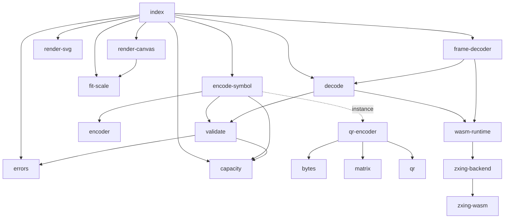

# Design Document

## Overview

`@strip/symbols` turns one codec Packet (1..2953 bytes) into a QR symbol matrix, renders it to canvas or SVG, and decodes camera or image pixels back to the exact Packet bytes. It is pure TypeScript (lib ES2023, no DOM lib, no Node types, no fetch, no clock) and imports only types from `@strip/codec` (R1.11).

The library pair is fixed and approved (requirements, Resolved questions 1 and 7): `qr` 0.7.2 as encoder only, `zxing-wasm` 3.1.7 as reader only, both exact-pinned. Bytes reach `qr` through a Latin-1 mapping (one byte, one character code). Decoding reads `result.bytes` from zxing with no text decoding (R5.6).

Default_Cell: version 30, ECC L, 1732-byte packet, 4 px/module (R14.1). It comes from a saturated synthetic grid (Risk 1).

Two user-approved amendments extend the design after Group 4. Amendment 1 adds multi-symbol decoding through one option, `maxSymbols`, with the outcome `found_many` (section "Multi-symbol decoding"; requirements R16, R6.12, R6.13, R7.13, R12.4). Amendment 2 adds `worker-src 'self'` to the Strip_CSP (section "CSP effects"; R9.3, R9.5, R9.11). With `maxSymbols` 1, the default, nothing else in this document changes.

Requirement ids are written R2.7 and so on. Evidence for numbers is `docs/spikes/symbols-decoder.md` ("the spike").

## Module layout

### packages/symbols/src

| File | Responsibility | May import |
|---|---|---|
| `index.ts` | Barrel, the public runtime surface (R12.1); the only other public entry is the subpath export of `wasm-url.ts` | everything below except `qr-encoder`, `zxing-backend`, `wasm-url` |
| `errors.ts` | `SYMBOL_ERROR_CODES` tuple, `SymbolErrorCode`, `SymbolError extends Error` with `readonly code` (R8.1) | none |
| `validate.ts` | Hand-written validators that throw `SymbolError` INVALID_INPUT: `assertBytes`, `assertImageDataLike`, `assertEncodeOptions`, `assertRenderOptions`, `assertDecodeOptions`. No Zod in this package (R5.5, R8.3) | errors, capacity |
| `capacity.ts` | `QR_CAPACITY`, `QR_CAPACITY_BY_VERSION` (40 x 4 table, defined here, R1.4), `QR_DEFAULTS` (R14.1), `smallestVersion(len, ecc)` | errors |
| `bytes.ts` | Latin-1 mapping: `bytesToLatin1`, `latin1Char`; `textEncoder` for qr (section 3) | none |
| `matrix.ts` | `SymbolMatrix` type, `matrixFromRows`, `moduleAt`; invariants helper used by tests only through `test/helpers` | none |
| `encode-symbol.ts` | `encodeSymbol`: validate, capacity check, delegate to the `Encoder` (R1) | validate, capacity, encoder, qr-encoder |
| `encoder.ts` | Internal `Encoder` interface (R11.6) | matrix, capacity |
| `qr-encoder.ts` | `createQrEncoder(): Encoder`. The only file importing `qr` | encoder, bytes, matrix, capacity, errors, **`qr`** |
| `render-canvas.ts` | `renderToCanvas`, structural `Canvas2DLike` type (R3.1, R3.2) | matrix, fit-scale, validate, errors |
| `render-svg.ts` | `renderToSvg` (R4) | matrix, validate |
| `fit-scale.ts` | `fitScale` (R3.5, R3.6, R14.5) | matrix, validate |
| `decoder-backend.ts` | Internal `DecoderBackend` interface (R11.6). Amendment 1 adds one method `readMany` that returns a list (section "Multi-symbol decoding") | none |
| `zxing-backend.ts` | `createZxingBackend(runtime): DecoderBackend`. The only file importing `zxing-wasm` | decoder-backend, **`zxing-wasm/reader`** |
| `wasm-url.ts` | The Wasm_URL_Module: `import readerWasmUrl from "zxing-wasm/reader/zxing_reader.wasm?url"; export { readerWasmUrl }`. Vite-only construct. Exposed as the subpath `@strip/symbols/wasm-url`. Not imported by `index.ts` or by any other src file, so the Node test graph never loads it (R10.4, R12.3) | none (a `?url` import) |
| `wasm-runtime.ts` | Once-per-page init, memoised by source (R5.7, R5.8, R8.5) | zxing-backend, errors |
| `decode.ts` | `decodeFrame` (R5, R16): single-symbol path through `read`, multi-symbol path through `readMany` | wasm-runtime, validate, capacity |
| `frame-decoder.ts` | `createFrameDecoder` (R7) | decode internals, wasm-runtime, validate |



### Import rules (ESLint `no-restricted-imports` per file group)

| Rule | Enforcement |
|---|---|
| `qr` only in `qr-encoder.ts`; `qr` decoder entry never imported (R11.5) | ESLint override + unit test grepping src |
| `zxing-wasm/reader` only in `zxing-backend.ts`; never `zxing-wasm`, `zxing-wasm/full`, `zxing-wasm/writer` (R11.4) | same |
| `?url` imports only in `wasm-url.ts`; no other src file imports `wasm-url.ts` or any `?url` module (R10.4) | ESLint `no-restricted-imports` with a pattern `*?url` for all src files except `wasm-url.ts`, plus a unit test grepping src |
| `@strip/codec` only as `import type` (R1.11); `verbatimModuleSyntax` makes a value import visible | ESLint `consistent-type-imports` + test |
| No `Math.random`, `Date.now`, `performance.now`, `fetch`, `document`, `window` in `src` (R10.1, R10.4) | existing purity ESLint rule |
| Apps import `@strip/symbols` barrel only (via `exports`) | existing boundary rule |

Dependency direction is codec <- symbols <- app. The zxing types never leak through the barrel (R11.7): the barrel's public types are declared in `src` (`DecodeOutcome`, `SymbolMatrix`, ...) and no signature mentions a `zxing-wasm` or `qr` type. zxing-wasm's `.d.ts` files mention DOM types (`ImageData`, `Blob`). The DOM-free tsconfig (lib ES2023) copes through `skipLibCheck: true`, already in `tsconfig.base.json`. Only `zxing-backend.ts` sees those declarations, and it converts to and from local types.

### packages/symbols (outside src)

| Path | Content |
|---|---|
| `package.json` | `exports: { ".": "./src/index.ts", "./wasm-url": "./src/wasm-url.ts" }`, exactly these two entries (R12.3); scripts `test`, `test:measured`, `perf`, `typecheck`; dependencies `qr` 0.7.2 and `zxing-wasm` 3.1.7 exact-pinned (R11.1, approved), each added together with its docs/dependencies.md row (R11.3) |
| `tsconfig.json`, `tsconfig.test.json` | lib ES2023, no DOM; test config may add Node types |
| `vitest.config.ts`, `vitest.measured.config.ts`, `vitest.perf.config.ts` | split as in the codec package |
| `test/*.test.ts` | unit and property tests, one file per area (`capacity`, `capacity-table`, `bytes`, `matrix`, `canvas`, `svg`, `fit-scale`, `decode`, `frame-decoder`, `errors`, `barrel`, `codec-integration`, `notices`, `csp`) |
| `test/helpers/matrix-to-image.ts` | `matrixToImageData(matrix, ppm, quietZone): ImageDataLike` (see section 4) |
| `test/helpers/degrade.ts` | Seeded degrader (section 8) |
| `test/helpers/fake-backend.ts` | Controllable `DecoderBackend` for P12, P13; gains a scriptable `readMany` for P31 to P33 (its `read` behaviour is unchanged, so earlier tests stay valid) |
| `test/helpers/composite.ts` | `compositeImage(matrices, layout)`: a clean grid of symbol tiles on white built with `matrixToImageData` (Amendment 1, P27, P28) |
| `test/helpers/page-photo.ts` | Seeded TypeScript port of the spike page-photo generator (section "Multi-symbol decoding", P35, P36) |
| `test/helpers/wilson.ts`, `test/helpers/prng.ts` | Wilson bound, seeded PRNG (mulberry32 in test code) |
| `test/fixtures/iso-capacity.ts` | The ISO_Capacity_Table: 40 versions x L, M, Q, H byte-mode capacities, typed from ISO/IEC 18004 (data only, R1.14) |
| `test/fixtures/degraded/recipes.json`, `test/fixtures/degraded/*.pgm.gz` | Section 8 |
| `perf/encode.perf.ts`, `perf/decode.perf.ts`, `perf/wasm-init.perf.ts`, `perf/measure.ts` | Perf_Method scripts (R7.5 to R7.7); `perf/page-photo.perf.ts` (R7.13) |
| `perf/measured/*.measured.ts` | N=200 Wilson runs and informational grids (R6); `page-photo.measured.ts` (R6.12, R6.13) |
| `README.md` | API, QR_DEFAULTS documentation (R14.6), real-device check template link |

### apps/strip (app side)

| Path | Content |
|---|---|
| `src/symbols-wasm.ts` | `import { readerWasmUrl } from "@strip/symbols/wasm-url"`; exports `wasmSource = { kind: 'url', url: readerWasmUrl }`. The app has no `zxing-wasm` dependency (R11.8) |
| `src/csp.ts` | The single source of the Strip_CSP string (R9.7); imported by the vite dev server config, the e2e harness server and the documented host config generator |
| `src/decode.worker.ts` | Dedicated module worker owning the Frame_Decoder (section 6) |
| `src/decode-client.ts` | Main-thread wrapper: idle flag, frame transfer, outcome callback |
| `vite.config.ts` | `server.headers` and `preview.headers` set `Content-Security-Policy` from `csp.ts`; asset rules (section 5) |
| `e2e-harness/server.ts` | Static server for the built harness that sends the Strip_CSP header on every response including worker JS and `.wasm`, logs requests, and can start with an alternative CSP (negative test) |
| `e2e-harness/index.html`, `main.ts` | Extended: encode, render, decode, round trip, worker path |
| `e2e/symbols-*.spec.ts` | Playwright tests of section 8 |
| `public/THIRD_PARTY_NOTICES` | Static committed notices file, never generated (R15.1) |

## Byte mapping into qr (Latin-1 mechanism)

`qr` 0.7.2 takes a string. A string is not byte-safe by default: the text encoder is UTF-8, so bytes at or above 0x80 would expand. The mapping makes each byte one character, and a custom `textEncoder` returns the byte back. Option names below were verified against the installed 0.7.2 type declarations during the spike review (`qr` `QrOpts` has `ecc`, `encoding`, `textEncoder`, `version`, `mask`, `border`, `scale`, `optimize`); the first implementation task re-checks them only when adding the pinned dependencies.

```ts
// bytes.ts
const CHUNK = 8192; // keeps String.fromCharCode.apply under argument limits
export function bytesToLatin1(b: Uint8Array): string {
  let s = "";
  for (let i = 0; i < b.length; i += CHUNK) {
    s += String.fromCharCode.apply(null, b.subarray(i, i + CHUNK) as unknown as number[]);
  }
  return s;
}
export const latin1TextEncoder = {
  encode(s: string): Uint8Array {
    const out = new Uint8Array(s.length);
    for (let i = 0; i < s.length; i++) out[i] = s.charCodeAt(i); // all codes <= 0xFF
    return out;
  },
};
```

```ts
// qr-encoder.ts (only file importing qr)
import { encodeQR } from "qr";
const rows: boolean[][] = encodeQR(bytesToLatin1(bytes), "raw", {
  ecc: eccName[ecc],           // 'low' | 'medium' | 'quartile' | 'high'
  version,                     // always passed: chosen by capacity.ts, not by qr
  encoding: "byte",            // forces byte mode (R1.13); no auto-detect
  textEncoder: latin1TextEncoder,
  border: 1,                   // qr rejects border 0; the one-module ring is sliced off (R2.2)
});
```

Design points:

- **Capacity check is ours.** When `textEncoder` is given, `qr` skips its UTF-8 length pre-check, so the package checks first: `bytes.length > QR_CAPACITY_BY_VERSION[version][ecc]` throws `PACKET_TOO_LARGE` (R1.5, R1.12). With no version option the limit is `QR_CAPACITY[ecc]`. If our check passed and `qr` still throws (including its `Capacity overflow` error), the adapter maps it to `ENCODE_FAILED` (R8.4). That mapping is a defect signal, not a normal path.
- **Version.** `smallestVersion(len, ecc)` scans the table for the smallest version with capacity >= len (R1.2), and the adapter passes it explicitly, so version never depends on `qr` internals. Length exactly `QR_CAPACITY[ecc]` gives version 40 (R1.6).
- **ECC and mask.** ECC defaults to L (R1.3). The mask is whatever `qr` selects by its penalty rule; the package does not pass a mask. It is deterministic for equal input (R1.9), and a test asserts equal matrices from repeated calls and from fresh module state (P2). The chosen mask is read back from the format information in the matrix and stored in `SymbolMatrix.mask`.
- **Matrix.** `encodeQR(..., 'raw')` returns `boolean[][]` (`true` = dark). `qr` 0.7.2 rejects `border: 0` ("invalid border=0"), so the adapter requests `border: 1` and slices the one-module ring off every side, leaving `size x size`. (Implementation deviation approved by the user at the Group 1 checkpoint.) `matrixFromRows` flattens it row-major to `modules: boolean[]` after checking `size === 17 + 4 * version` (R2.1).
- **Decode side.** `zxing-backend.ts` takes `result.bytes` (Uint8Array) and copies it out. It never reads `result.text` (R5.6).
- **Evidence.** The spike round-tripped 51 payload cases (49 exact, 2 deliberate or mistaken over-capacity failures that raised a capacity error) and 30 real codec packets at sizes 2953, 1000 and 500, all 256 byte values included. Those become P1 and its fixtures.

```ts
export type SymbolMatrix = {
  readonly size: number;                 // 17 + 4 * version
  readonly modules: readonly boolean[];  // row-major, length size * size, true = dark
  readonly version: number;              // 1..40
  readonly ecc: EccLevel;                // 'L' | 'M' | 'Q' | 'H'
  readonly mask: number;                 // 0..7
};
```

## Renderers

### Canvas (R3)

```ts
export type Canvas2DLike = {
  fillStyle: string | unknown;
  imageSmoothingEnabled: boolean;
  fillRect(x: number, y: number, w: number, h: number): void;
  // renderToCanvas resizes the target through the optional `canvas` property when present
  readonly canvas?: { width: number; height: number };
};
export type RenderOptions = { ppm: number; quietZone?: number; allowShortQuietZone?: boolean;
  dark?: string; light?: string; mm?: number };   // mm used by SVG only
export function renderToCanvas(ctx: Canvas2DLike, m: SymbolMatrix, o: RenderOptions): { width: number; height: number };
```

- `ppm` is an integer >= 1 (validator). Pixel width = `(size + 2 * quietZone) * ppm`. Quiet zone below 4 modules needs `allowShortQuietZone`, otherwise INVALID_INPUT (R2.3).
- Draw: set `imageSmoothingEnabled = false`, fill the whole area with `light`, then one `fillRect` per dark module on integer coordinates `(qz + x) * ppm`. Merging horizontal runs into one `fillRect` per run is allowed and reduces calls; pixels are identical.
- Missing `fillRect` or `imageSmoothingEnabled` in the context throws UNSUPPORTED_ENVIRONMENT (R8.5). The structural type means no DOM lib is needed (R3.2). If `canvas` is present its width and height are set before drawing.
- No blended pixel exists because every edge is on an integer coordinate and smoothing is off (R3.3). P6 checks this in Chromium.

### fitScale (R3.5, R3.6, R14.5)

```ts
export function fitScale(m: SymbolMatrix, quietZone: number, box: { width: number; height: number }):
  { ppm: number; width: number; height: number };
// modules = m.size + 2 * quietZone
// ppm = Math.floor(Math.min(box.width, box.height) / modules)
// ppm < 1 -> { ppm: 0, width: 0, height: 0 }   (no throw, R3.6)
```

The 70% rule (R14.5) is the caller's: the box passed is `0.7 * min(frameW, frameH)`. Modules including a 4-module quiet zone are `25 + 4 v`. At 720p (box 504): v25 has 125 modules, 504 / 125 = 4.03, scale 4; v26 has 129 modules, 3.91, scale 3. At 1080p (box 756): v40 has 185 modules, 4.09, scale 4. These match R14.5.

### SVG (R4)

```ts
export function renderToSvg(m: SymbolMatrix, o: RenderOptions): string;
```

Output shape (one line, no whitespace between tags):

```
<svg xmlns="http://www.w3.org/2000/svg" viewBox="0 0 {W} {W}" width="{mm}mm" height="{mm}mm" shape-rendering="crispEdges">
<rect width="{W}" height="{W}" fill="{light}"/>
<path fill="{dark}" d="M{x} {y}h{n}v1h-{n}z..."/></svg>
```

- `W = size + 2 * quietZone`, in module units (R4.1). `width` and `height` appear only when `mm` is given (R4.3); then they are `"{mm}mm"`.
- The path holds one subpath per merged horizontal run of dark modules (R4.2).
- Colours go in `fill` presentation attributes only (R4.4). Colour strings are validated against `^#[0-9a-fA-F]{3,8}$` or a short keyword list, so attribute injection is impossible.
- Nothing that conflicts with the Strip_CSP is emitted: no `<script>`, `<style>`, `style=`, `on*=`, `href`, `xlink:href`, `url(`, `data:` (R4.5). The page may display the string by assigning to `innerHTML` of a container or by parsing with `DOMParser`; the app never uses a `data:` or `blob:` image URL, because img-src is not set and falls back to 'self' (R9.5).

### matrixToImageData (test support, not public)

`matrixToImageData(matrix, ppm, quietZone): { width, height, data: Uint8ClampedArray }` produces the same pixels the canvas path draws (black on white, RGBA, alpha 255). It is a pure Node function used by tests and by R13.2. Per R12.1 the barrel's runtime export list is exact, so it is **not** exported from the barrel. It lives in `test/helpers/matrix-to-image.ts`. The app has no use for it, because it renders through canvas. P6 proves it equals the canvas output in Chromium, which ties the Node tests to the real renderer.

## Wasm loading and self-hosting under Vite

### Source type and app side

```ts
export type WasmSource =
  | { kind: "url"; url: string }
  | { kind: "bytes"; bytes: ArrayBuffer | Uint8Array };
// DecodeOptions.wasm?: WasmSource
```

```ts
// packages/symbols/src/wasm-url.ts  (the Wasm_URL_Module; package subpath "@strip/symbols/wasm-url")
import readerWasmUrl from "zxing-wasm/reader/zxing_reader.wasm?url";
export { readerWasmUrl };
```

```ts
// apps/strip/src/symbols-wasm.ts
import { readerWasmUrl } from "@strip/symbols/wasm-url";
export const wasmSource = { kind: "url", url: readerWasmUrl } as const;
```

**Why a subpath and not the barrel.** The `?url` suffix is a Vite construct. Node, Vitest without the Vite asset plugin, and the pure src graph cannot resolve it. The barrel export list is exact (R12.1), and `index.ts` must stay loadable in Node. So `wasm-url.ts` is the single file with the `?url` import, nothing in src imports it, and `package.json` `exports` lists it as the only subpath next to `"."` (R12.3). The app imports that documented subpath, never a package internal path. Vite resolves `zxing-wasm/reader/zxing_reader.wasm` relative to `packages/symbols`, where `zxing-wasm` is a dependency, so `apps/strip` needs no `zxing-wasm` dependency (R11.8).

**Types.** `packages/symbols/src/vite-url.d.ts` declares `module "*?url" { const url: string; export default url; }`, so the DOM-free typecheck passes without `vite/client`. The ESLint rule allows `?url` imports only in `wasm-url.ts` (R10.4).

**Export shape.** The subpath exports one value, `readerWasmUrl: string`. The barrel does not re-export it. `WasmSource` accepts it as `{ kind: "url", url: readerWasmUrl }`.

**Dependency on zxing-wasm exports.** `zxing-wasm` 3.1.7 must expose `./reader/zxing_reader.wasm` in its `exports` (checked against its `package.json` during the spike review; the task that adds the package re-checks it).

**Build-and-load test (R9.10).** A Playwright test runs against the production Vite build of the app: it reads the URL from `@strip/symbols/wasm-url`, asserts it is a hashed same-origin `.wasm` asset and not a `data:` URL, decodes a symbol with it, and asserts `apps/strip/package.json` lists no `zxing-wasm`. **Contingency, not a default:** only if this test fails (for example, pnpm or Vite does not resolve the import from the symbols package), the task adds a direct `apps/strip` dependency on `zxing-wasm` 3.1.7 with the identical exact pin and its own docs/dependencies.md row in that same task, and R11.8 and R9.10 are amended in that task. The task records which path was taken.

### Vite behaviour and asserted facts

| Fact | Effect | Test |
|---|---|---|
| `build.assetsInlineLimit` default is 4096 bytes; the file is 946,598 bytes | never inlined as a `data:` URL | built URL does not start with `data:` (R7.8, R9.10) |
| Assets are emitted with a content hash under `build.assetsDir` (default `assets`) | cache-busting, same origin | URL matches `^/assets/zxing_reader-[\w-]+\.wasm$` |
| Size budget | | built file <= 1,000,000 bytes (R7.8) |
| Response `Content-Type: application/wasm` is required | see below | e2e asserts header on the `.wasm` response |

Why the MIME type matters: Emscripten glue first tries `WebAssembly.instantiateStreaming`. A wrong MIME type makes it fail, log a console warning or error, and fall back to `ArrayBuffer` instantiation. The decode still works, but R9.8 demands zero console errors, so the fallback would fail the test. The harness server and the documented host config therefore set `application/wasm`. (Vite's dev and preview servers do this already; the custom harness server must set it explicitly.)

### Init through the module overrides

`setZXingModuleOverrides` is deprecated in 3.1.7 (the spike used it only in scripts). The package calls `prepareZXingModule`:

```ts
// wasm-runtime.ts
import { prepareZXingModule } from "zxing-wasm/reader"; // via zxing-backend.ts in the real layout
const cache = new Map<string, Promise<ZxingModule>>();   // key: url, or a per-bytes WeakMap entry

export function ensureRuntime(src: WasmSource | undefined): Promise<ZxingModule> {
  if (src === undefined) {
    return Promise.reject(new SymbolError("INVALID_INPUT", "wasm source is required")); // R5.8: no jsDelivr
  }
  const hit = lookup(src);
  if (hit) return hit;
  const overrides =
    src.kind === "url"
      ? { locateFile: (p: string) => (p.endsWith(".wasm") ? src.url : p) }
      : { wasmBinary: toArrayBuffer(src.bytes) };
  const p = prepareZXingModule({ overrides, fireImmediately: true }).catch((e) => {
    forget(src);                                   // allow retry after failure
    throw new SymbolError("UNSUPPORTED_ENVIRONMENT", `reader wasm failed to load: ${String(e)}`); // R8.5
  });
  remember(src, p);
  return p;
}
```

- The zxing module cache compares overrides shallowly. A fresh `locateFile` closure on each call would look like a new configuration and could re-instantiate. `wasm-runtime.ts` memoises the init Promise per source (url string, or the bytes object identity) and calls `prepareZXingModule` once per source (R5.7). A second, different source after the first is initialised is rejected with INVALID_INPUT, because zxing keeps module-global state.
- A missing source throws INVALID_INPUT and nothing is fetched. No code path leaves the default jsDelivr `locateFile` in place (R5.8, R9.2).
- Failure of fetch, compile or instantiate maps to UNSUPPORTED_ENVIRONMENT (R8.5). The negative CSP test (section 8) depends on this mapping.

### CSP effects

Strip_CSP (R9.3), owned by `apps/strip/src/csp.ts` (R9.7):

```
default-src 'self'; script-src 'self' 'wasm-unsafe-eval'; worker-src 'self'; connect-src 'self'; object-src 'none'; base-uri 'none'; form-action 'none'; frame-ancestors 'none'
```

Amendment 2 added `worker-src 'self'` after `script-src`. The string is also the App_CSP of the app spec (dependency D3). The harness server's alternative policy for the negative test (Playwright b) is the same string without `'wasm-unsafe-eval'`.

| Directive | Why it is enough |
|---|---|
| `'wasm-unsafe-eval'` in `script-src` | allows WebAssembly compile and instantiate only |
| no `'unsafe-eval'` | the spike's grep of the shipped glue found no `new Function` or `eval(`; the only `Function(` matches were `destructorFunction` |
| `connect-src 'self'` | covers the same-origin `fetch` of the `.wasm` |
| `worker-src 'self'` | explicit (R9.5, R9.11); the worker script and the `.wasm` are same-origin files emitted by Vite, no `blob:` worker. The policy no longer relies on the fallback chain from `script-src` |
| `img-src`, `style-src` unset | fall back to `default-src 'self'` (R9.5) |
| `frame-ancestors` | ignored in a `<meta>`, so the header is the only delivery (R9.6) |

A dedicated worker script is governed by the CSP in the HTTP response of the worker script itself, not by the page's policy. The host must send the Strip_CSP header on every response, including the worker JS and the `.wasm`. The harness server does so for all paths, and a test asserts it for the three resource types (P15).

## Frame-decoder API

### Types

```ts
export type ImageDataLike = { width: number; height: number; data: Uint8ClampedArray };

export type DecodeOptions = {
  wasm?: WasmSource;                 // required in practice; absent -> INVALID_INPUT (R5.8)
  mode?: "video" | "photo";          // default "video"
  maxSymbols?: number;               // integer 1..16, default 1 (Amendment 1, R16.1)
};

export type FoundSymbol = { bytes: Uint8Array; version?: number; ecc?: EccLevel;
  corners?: readonly [Point, Point, Point, Point] };   // same fields as `found` (R16.4)

export type DecodeOutcome =
  | { kind: "found"; bytes: Uint8Array; version?: number; ecc?: EccLevel;
      corners?: readonly [Point, Point, Point, Point] }
  | { kind: "found_many"; symbols: FoundSymbol[]; skipped: number }   // only when maxSymbols > 1 (R16.4)
  | { kind: "not_found" }
  | { kind: "not_strip_packet"; length: number }   // payload > 2953 bytes, only when maxSymbols is 1 (R5.4, R16.7)
  | { kind: "dropped" };                           // only from FrameDecoder.submit

export type FrameDecoderOptions = DecodeOptions & {
  maxWidth: number; maxHeight: number;             // integers >= 1
};

export interface FrameDecoder {
  submit(frame: ImageDataLike): Promise<DecodeOutcome>;
  readonly busy: boolean;
  dispose(): void;
}

export function decodeFrame(frame: ImageDataLike, options: DecodeOptions): Promise<DecodeOutcome>;
export function createFrameDecoder(options: FrameDecoderOptions): Promise<FrameDecoder>;
```

`decodeFrame` never returns `dropped`. With `maxSymbols` 1 (the default) the outcome is never `found_many`, so every earlier consumer stays valid. `bytes` is a fresh copy of `result.bytes`. `version`, `ecc` and `corners` are filled when zxing reports them (R5.2). Validation (`assertImageDataLike`) runs first and throws INVALID_INPUT (R5.5).

`createFrameDecoder` is async because it awaits the wasm init, so an init failure rejects with `SymbolError` UNSUPPORTED_ENVIRONMENT. This is stated in R7.1 and R5.7: init is async, so a synchronous factory could not report it. After creation, `submit` never waits for init.

### Behaviour

| Rule | Design | Req |
|---|---|---|
| One decode in flight | `busy` flag set before the backend call, cleared in `finally` | R7.10 |
| Drop while busy | `submit` while busy resolves `{ kind: "dropped" }` at once; the frame is **not** queued. Pending frames: zero (R7.11) | R7.11 |
| Staging buffer | One `Uint8ClampedArray(maxWidth * maxHeight * 4)` allocated at creation. When idle, `submit` copies the frame in with `set`, then decodes `staging.subarray(0, w * h * 4)` through a `{width, height, data}` view. The caller may reuse its buffer as soon as `submit` returns the Promise | R7.1 |
| Oversize | `w > maxWidth` or `h > maxHeight` throws INVALID_INPUT (checked before the busy check, so an oversize frame never silently drops) | R7.4 |
| Modes | below | R7.2, R7.3 |
| After `dispose` | `submit` throws INVALID_INPUT | R8.3 |

Reader options (zxing `readBarcodes`):

| Mode | Options |
|---|---|
| `video` (default) | `{ formats: ["QRCode"], tryHarder: true, tryRotate: true, tryDownscale: true, maxNumberOfSymbols: 1, binarizer: "LocalAverage", tryInvert: false }`. These are exactly the options the spike measured, and every budget was measured with them |
| `photo` | the same plus `tryInvert: true`, and on a miss one retry with `binarizer: "GlobalHistogram"`. The benefit of the retry is measured in the implementation task and not gated (R7.3) |

`mode` is the only effort knob (R7.2, R7.3). `maxSymbols` is not an effort knob: it changes only `maxNumberOfSymbols` in the table above (the next section).

Known cost: `zxing-wasm` copies each frame into wasm memory per call. That allocation is outside our control, and our staging buffer removes only the JS-side allocation per frame. Results copy `result.bytes` out because the wasm heap view is not stable.

Not in this package: camera access, video-to-canvas capture, frame scheduling, and the worker.

### App side: decode worker (decision for R7.9 and Open question (c))

**Decision: decode in a dedicated module worker.** The Frame_Decoder itself stays environment-agnostic (no `self`, no `postMessage`), so it also runs on the main thread in Node and in the Playwright CSP test.

```ts
// main thread
const worker = new Worker(new URL("./decode.worker.ts", import.meta.url), { type: "module" });
```

Vite emits the worker as a same-origin hashed file. `worker-src` falls back to `script-src 'self'`, so no `blob:` is needed (R9.5). The `.wasm` URL is resolved on the main thread from `@strip/symbols/wasm-url` (through `symbols-wasm.ts`) and sent in the init message, so the worker file needs no `?url` import.

Message protocol:

| Direction | Message | Notes |
|---|---|---|
| main -> worker | `{ type: "init", wasmUrl, maxWidth, maxHeight, mode, maxSymbols? }` | worker creates the Frame_Decoder; `maxSymbols` is optional and defaults to 1 (R16.12) |
| worker -> main | `{ type: "ready" }` or `{ type: "init-error", code, message }` | code from `SYMBOL_ERROR_CODES` |
| main -> worker | `{ type: "frame", id, width, height, buffer: ArrayBuffer }` (transferred) or `{ type: "bitmap", id, bitmap: ImageBitmap }` (transferred; the worker draws it to an `OffscreenCanvas` to get RGBA) | only sent when the worker is idle |
| worker -> main | `{ type: "outcome", id, outcome }` (`bytes` transferred; for `found_many` the `bytes.buffer` of every symbol is in the transfer list, each exactly once) and then the client marks idle | each Found_Symbol owns its own buffer (R16.8), so the transfer list has no duplicates |
| worker -> main | `{ type: "error", id, code, message }` | frame rejected, loop continues |

The main thread sends a new frame only when the worker has reported idle, so frames are dropped on the main-thread side without copying. The worker's own Frame_Decoder still enforces one in flight, as a second line. Camera capture to a transferable `ImageBitmap` or `ArrayBuffer` is the app's job.

R7.9 test: in Chromium, observe `PerformanceObserver({ type: "longtask" })` on the main thread while the worker decodes a sequence of frames, and assert no entry longer than 50 ms attributable to the decode (P21). If the worker cannot start under the Strip_CSP or fails the criterion, the recorded fallback is a main-thread decode with a yield per frame (Open question (c)).

## Multi-symbol decoding (Amendment 1)

Decision source: `docs/spikes/symbols-multi.md` (requirements, Resolved question 8). The reader's own multi-symbol read (`maxNumberOfSymbols`) reads a page of nine symbols. Tiling is not used.

### Option and outcome

| Rule | Design | Req |
|---|---|---|
| Option | `maxSymbols?: number` on `DecodeOptions` and `FrameDecoderOptions`; integer 1..16; default 1 | R16.1 |
| Validation | `assertDecodeOptions` rejects a non-integer, NaN, below 1 or above 16 with INVALID_INPUT, before the backend is called. `createFrameDecoder` validates at creation, before the wasm init, so a bad option never starts a load | R16.1 |
| Default | `maxSymbols` absent or 1 takes the existing path unchanged: `backend.read` with `maxNumberOfSymbols: 1`, outcomes `found`, `not_found`, `not_strip_packet`. No existing test changes | R16.2 |
| Reader options | `maxSymbols` greater than 1: the mode table of "Frame-decoder API" with `maxNumberOfSymbols: maxSymbols` and nothing else changed | R16.3 |
| Outcome | `{ kind: "found_many", symbols: FoundSymbol[], skipped: number }` | R16.4 |

### Rule for the outcome (maxSymbols greater than 1)

Let `R` be the list of valid symbols the reader returns, `U` the ones with a payload of at most 2953 bytes, and `skipped = |R| - |U|`.

| `R` | `U` | Outcome |
|---|---|---|
| empty | empty | `{ kind: "not_found" }` |
| not empty | empty | `{ kind: "found_many", symbols: [], skipped }` (`skipped` at least 1) |
| not empty | not empty | `{ kind: "found_many", symbols: U, skipped }` |

`not_strip_packet` exists only for `maxSymbols` 1. Rationale: with several symbols in view, one over-long symbol must not hide the others, and a single outcome kind with a count is easier for a caller than a mix of kinds. An empty `symbols` list with `skipped` above zero lets the app show the "not a Strip packet" notice without a new outcome kind. This is the recommended rule, stated here as the decision.

- **Fresh copies.** Each `FoundSymbol.bytes` is `new Uint8Array(result.bytes)` copied out of the wasm view in the backend, so each owns its buffer (R16.8).
- **Order and duplicates.** The list order is the reader's order and is unspecified. The package does not sort and does not remove duplicate payloads. The codec ignores duplicate Packets (R16.9).
- **Photo mode.** The GlobalHistogram retry runs when the first read returned no result at all (`R` is empty), as for a miss today. A first read that returned only over-long symbols is a result, so there is no retry (R16.10).

### Backend seam

`DecoderBackend` keeps `read(frame, options)` unchanged and gains `readMany(frame, options): Promise<BackendResult[]>`, where `options` is the same reader-options object plus `maxNumberOfSymbols`. Choice and reason: adding a method rather than changing the return type of `read` leaves every fake-backend test and the single-symbol code path byte-for-byte as it is, which is what R16.2 requires. `zxing-backend.ts` implements both on one call to the reader (`read` takes the first result). The `BackendResult` type is internal and carries `bytes`, `version?`, `ecc?`, `corners?`. `decode.ts` and `frame-decoder.ts` choose the method by `maxSymbols`: 1 gives `read`, greater than 1 gives `readMany` and the rule above. The fake backend of the tests gains a scriptable `readMany`.

### App side

- `decode-protocol.ts`: `init` gains `maxSymbols?: number`; the `outcome` message type carries the extended `DecodeOutcome`.
- `decode.worker.ts`: passes `maxSymbols` to `createFrameDecoder`; for `found_many` the transfer list holds every `symbols[i].bytes.buffer` (a pure function `transferListOf(outcome)` that tests exercise directly, P34).
- `decode-client.ts`: carries `maxSymbols` in `init` and exposes the outcome unchanged. Still one worker, one decode in flight, a frame offered while busy is dropped without a copy.

### Test support: composite images and the page-photo generator

- `test/helpers/composite.ts`: places 2..6 matrices in a clean grid on white, each tile `matrixToImageData(matrix, 4, 4)`, one tile per grid cell, no overlap. Used by the unit and property tests (P27 to P29) and by the Playwright test (P37), where the same layout is drawn on a canvas.
- `test/helpers/page-photo.ts`: the seeded TypeScript port of the spike generator `page.mjs` (not in the repository; the spike report gives the method). Parameters: page A4 portrait white; 3 x 3 grid of version 30 L symbols, 145 modules wide with the 4-module quiet zone, module 0.4048 mm, grid origin 28 mm from the top; photo 3000 x 4000, dark surround, the page filling a stated fraction of the photo height (0.92 and 0.75); inverse homography per output pixel with 2 x 2 supersampling; rotation up to ±10 degrees and perspective up to ±4% random per page; blur sigma 1 px; 70% contrast; 4% noise; mild brightness gradient. The seed is hashed from the page index. It takes the photo size as a parameter, so determinism tests run at a small size. A payload counts as read only when its bytes equal one of the page's nine payloads.
- **Fidelity rule.** The port must reproduce the spike within the Wilson interval (99 of 100 pages with 9 of 9, 899 of 900 symbols; the gate lower bound is 0.90). If it does not, the task stops and reports; it does not retune the generator.
- **Memory.** One 12 MP RGBA image is 48 MB. The measured test generates, decodes and drops one page at a time.

### Gates and budgets

| Item | Value | Req |
|---|---|---|
| Gate | N = 100 pages, at least 8 of 9 symbols, Wilson lower bound at least 0.90; reports symbols-read rate, 9-of-9 pages, decode median and p95 | R6.12 |
| Informational | page 75% (about 4 px per module), reported without assertion | R6.13 |
| Perf | 12 MP Page_Photo, `maxSymbols` 9, median at most 250 ms (spike 78 ms, about 3 times headroom) | R7.13 |

The gate uses the video-mode reader options, as the spike did.

## Correctness properties

*A property is a characteristic or behavior that should hold true across all valid executions of a system-essentially, a formal statement about what the system should do. Properties serve as the bridge between human-readable specifications and machine-verifiable correctness guarantees.*

PBT fits the pure logic (encode, matrix, fitScale, validators, SVG text, frame-decoder state machine with a fake backend). Rendering to pixels, CSP, network and worker items are example or Playwright tests. Test kinds: **PBT** (fast-check, at least 100 runs, fixed seed), **unit**, **PW** (Playwright), **perf**, **measured**.

| # | Property (for all ...) | Covers | Kind |
|---|---|---|---|
| P1 | For any byte array of 1..`QR_CAPACITY[ecc]` bytes and each ecc, encode, rasterise at 4 ppm, decode with the zxing backend returns identical bytes. This is the independent oracle for `qr` output (zxing-wasm decoding what `qr` encodes). Plus a unit case over all 256 byte values, and the 30-packet codec set. Runs decode in Node; run count per ecc is lower (N=100 total per ecc, because each decode costs ms) | R1.1, R1.7, R1.8, R5.1, R5.6 | PBT + unit |
| P2 | For any bytes and options, two `encodeSymbol` calls return deep-equal matrices (same `mask`) | R1.9, R10.2 | PBT |
| P3 | For any encoded matrix: `modules.length == size * size`, `size == 17 + 4 * version`; finder patterns, separators, timing row and column 6, the dark module, format information (BCH check, both copies) and, for version >= 7, version information (BCH check, both copies) match the spec | R2.1, R2.4, R14.4 | PBT |
| P4 | For any ecc and for any version v (explicit option), with capacity(v, ecc) taken from the ISO_Capacity_Table: a payload of that many bytes encodes at exactly v, and one byte more throws `PACKET_TOO_LARGE`; exhaustively over all 160 cells as well. With no version, `QR_CAPACITY[ecc]` bytes gives version 40 and +1 throws | R1.5, R1.6, R1.12, R1.14 | PBT (over v, ecc) + unit (all 160 cells) |
| P5 | For any length and ecc, with no version option the matrix version equals the smallest v whose table capacity >= length | R1.2 | PBT |
| P6 | For any matrix, ppm in 1..8 and quiet zone >= 4: canvas pixels in Chromium equal `matrixToImageData`; every pixel is exactly the dark or light colour (no blended pixel) | R3.1, R3.3, R3.4 | PW |
| P7 | For any matrix, quiet zone and box: `fitScale` returns the largest integer ppm with `modules * ppm <= min(box)`, width and height `= modules * ppm`; returns `{0,0,0}` and never throws when the box is smaller than `modules` | R3.5, R3.6, R14.5 | PBT |
| P8 | For any matrix and options, the SVG string has no `<script`, `<style`, `style=`, `on\w+=`, `href`, `url(` or `data:`, has `shape-rendering="crispEdges"`, a viewBox in module units and mm width and height iff `mm` given. In Chromium the rasterised SVG decodes to the input bytes | R4.1 to R4.6 | PBT + PW |
| P9 | For blank frames (any size, any uniform colour) and seeded noise frames, `decodeFrame` resolves `not_found` and never throws | R5.3, R8.2 | PBT |
| P10 | For any frame-like value with wrong type, non-integer or non-positive size, wrong data type or wrong data length, `decodeFrame` and `FrameDecoder.submit` throw `SymbolError` INVALID_INPUT before the backend is called (fake backend call count 0) | R5.5, R8.3, R7.4 | PBT |
| P11 | For any invalid input to any public function, the thrown error is a `SymbolError` whose `code` is in `SYMBOL_ERROR_CODES`; failure to load wasm gives `UNSUPPORTED_ENVIRONMENT`; a missing wasm source gives INVALID_INPUT | R8.1, R8.3, R8.5, R8.6, R5.8 | PBT + unit |
| P12 | For any sequence of `submit` calls with a controllable fake backend: at most one backend call is in flight, a call made while one is in flight resolves `dropped` and never reaches the backend, and after the in-flight decode resolves the next `submit` runs | R7.10, R7.11 | PBT (model-based) |
| P13 | For any sequence of frames up to the max size, the staging buffer object passed to the backend is the same `ArrayBuffer` every time, and mutating the caller's buffer after `submit` returns does not change the decode result | R7.1 | PBT |
| P14 | Default_Cell (v30 L, 1732 bytes, 4 ppm, blur 1) under the Typical_Profile, N = 200 fresh seeds: Wilson lower bound >= 0.90 (screen) and >= 0.97 (print) | R6.8, R6.9 | measured |
| P15 | The served `Content-Security-Policy` header equals the R9.3 string exactly (including `worker-src 'self'`) on the page, the worker script and the `.wasm`; the worker script is a same-origin file, not a `blob:`; the page loads under it with zero `securitypolicyviolation` events and zero console errors; the `.wasm` response has `Content-Type: application/wasm` | R9.3 to R9.8, R9.11 | PW + unit |
| P16 | Every request recorded during the round trip goes to the harness origin; none to another origin (jsDelivr included); the `.wasm` is requested from the same origin | R9.1, R9.2, R9.9 (including no script loaded or dynamically imported from another origin) | PW |
| P17 | The runtime export list of the barrel equals exactly the 11 names of R12.1, and does not include `readerWasmUrl`; package `exports` has exactly the entries `.` and `./wasm-url`; no export type or value comes from `qr` or `zxing-wasm`. After Amendment 1 the list is still exactly the 11 names, and the type exports include `FoundSymbol` (R12.4) | R12.1 to R12.4, R11.7 | unit |
| P18 | For any file (seeded) encoded by the codec at `packetSize` 1732: each Packet through `encodeSymbol`, `matrixToImageData`, `decodeFrame` and the codec decoder completes with the identical file. Same through canvas and SVG in Chromium | R13.1, R13.2, R1.10 | PBT (small N) + PW |
| P19 | The static committed `THIRD_PARTY_NOTICES` names `qr` 0.7.2 (MIT), `zxing-wasm` 3.1.7 (MIT), zxing-cpp (Apache-2.0) and the zxing-wasm C++ glue (Apache-2.0), each with version and licence, contains the Apache-2.0 text, does not mention zint; the served file is same origin and linked | R15.1, R15.2, R15.4, R15.5 | unit + PW |
| P20 | For any bytes in 0..255 repeated or mixed, `bytesToLatin1` then `latin1TextEncoder.encode` returns the input; each char code equals the byte | R1.13 | PBT |
| P21 | While the worker decodes a frame sequence, the main thread records no longtask over 50 ms attributable to decoding | R7.9 | PW |
| P22 | For any `ppm`, quiet zone < 4 without `allowShortQuietZone` throws INVALID_INPUT, with it renders | R2.3 | PBT |
| P23 | For any fixed set of inputs (seeded bytes at versions 1, 2, 7, 10, 20, 30, 40 and each ecc), the matrices encoded in Node equal the matrices encoded by the same encoder in Chromium (Node output compared with Chromium output, no stored files) | R10.3 | PW |
| P24 | For any payload longer than 2953 bytes in a decoded symbol, the outcome is `not_strip_packet` (tested with a fake backend returning that many bytes) | R5.4 | unit |
| P25 | Clean fixtures: every version 1..40 at each ecc, 4 and 8 ppm (320 fixtures) decode to the input | R6.1 | measured |
| P26 | `QR_CAPACITY_BY_VERSION` equals the committed ISO_Capacity_Table in all 160 cells, and `QR_CAPACITY` equals its version 40 row (2953, 2331, 1663, 1273; v30: 1732, 1370, 982, 742); the codec default stays 2953; for each ecc and each codec packetSize in 46..65565 up to capacity, the size is accepted | R1.4, R1.10, R14.1 to R14.3, R1.14 | unit |

Amendment 1 properties (numbered after P26, no existing number changes):

| # | Property (for all ...) | Covers | Kind |
|---|---|---|---|
| P27 | For any set of 1..6 distinct payloads (versions 3..10, any ecc) placed in a clean grid on white (4 ppm, 4-module quiet zone), `decodeFrame` with `maxSymbols` equal to 6 returns `found_many` whose `symbols` payloads, as a set, equal exactly that set, with `skipped` 0. For one payload the outcome is `found_many` with one symbol. A repeated payload still yields that payload at least once and nothing else | R16.4, R16.5, R16.9 | PBT (reduced runs, decodes in the loop) |
| P28 | For any set of 1..6 payloads and any permutation of their grid positions, the set of returned payloads is the same (order independence; symbols are identified by content) | R16.5, R16.9 | PBT (reduced runs) |
| P29 | Default unchanged: for any composite with several symbols and `maxSymbols` absent or 1, `decodeFrame` returns a single `found` whose bytes equal one of the payloads; with a fake backend, the reader receives `maxNumberOfSymbols` 1, `read` is called and `readMany` is not | R16.2, R5.1 | PBT + unit |
| P30 | For any value that is not an integer in 1..16 (floats, NaN, 0, negatives, 17 and above, strings, null), `decodeFrame` and `createFrameDecoder` throw SymbolError INVALID_INPUT with the fake backend call count 0; for every integer in 1..16 the option is accepted and the reader receives `maxNumberOfSymbols` equal to it (for 2..16 through `readMany`) | R16.1, R16.3 | PBT |
| P31 | For any list of reader payload lengths (0 to 4000 bytes, any mix, 0 to 16 entries) from a fake backend, with `maxSymbols` greater than 1: `symbols` holds exactly the payloads of at most 2953 bytes in reader order, `skipped` equals the count of the others, and the outcome kind follows the zero-usable table (`not_found`, `found_many` with empty `symbols`, `found_many`); `not_strip_packet` is never returned | R16.4, R16.6, R16.7 | PBT |
| P32 | For any reader result list, each `FoundSymbol.bytes` is a Uint8Array with its own ArrayBuffer; mutating or transferring one symbol's buffer changes no other symbol and no backend-owned buffer | R16.8 | PBT |
| P33 | For any `maxSymbols` in 1..16 and any sequence of `submit` calls with a controllable fake backend: the reader gets `maxNumberOfSymbols` equal to `maxSymbols`, at most one backend call is in flight, and a call made while one is in flight resolves `dropped` and never reaches the backend. In photo mode with `maxSymbols` above 1, the GlobalHistogram retry happens only when the first read is empty | R16.3, R16.10, R16.11 | PBT (model-based) |
| P34 | For any `found_many` outcome (0 to 16 symbols), `transferListOf(outcome)` contains the `bytes.buffer` of every symbol exactly once, with no duplicates and no other buffer; and the client posts `init` with the given `maxSymbols` and drops a frame while busy | R16.12 | PBT + unit |
| P35 | For any seed, the page-photo generator returns byte-identical images on two calls and different images for different seeds; the nine payloads are distinct and 1732 bytes long. Run at a reduced photo size | R6.12 (generator fidelity) | PBT (small size) |
| P36 | Page_Photo_Gate: N = 100 pages (12 MP, 3 x 3 v30 L, page 92% of the height, Typical_Profile with rotation up to 10 degrees, perspective up to 4%, blur 1 px), `maxSymbols` 9: pages with at least 8 of 9 symbols have a Wilson lower bound of at least 0.90; the run reports the symbols-read rate and the decode time | R6.12, R6.13 | measured |
| P37 | A page of several symbols drawn on a canvas in Chromium under the Strip_CSP and decoded through the worker with `maxSymbols` above 1 returns every payload of the page | R16.13, R9.11 | PW |

P18's run count is small because each case encodes and decodes a whole file; each iteration uses a few KB of file.

## Test strategy

### Test configs

| Command | Config | Runs |
|---|---|---|
| `pnpm test` | `vitest.config.ts` | unit and property tests incl. the ISO_Capacity_Table checks, P1 with reduced runs, P2 to P13, P17, P19 (static part), P20 to P22, P24 to P26, P27 to P35 (P27 and P28 with reduced runs, small composite images, fixed seeds), the fixture-size budget. Fast (target under 60 s) |
| `pnpm test:measured` | `vitest.measured.config.ts` | N = 200 Wilson runs (P14, tagged [measured] for R6.8 and R6.9), clean 320 fixtures (P25, R6.1 tagged [measured]), the Page_Photo_Gate (P36, R6.12) and its informational 75% batch (R6.13), informational grids (Harsh_Profile, 3 ppm at blur 1, all Degradation_Families). Prints rate, N and Wilson bound per cell (R6.2 to R6.5, R6.10, R6.11) |
| `pnpm perf` | `vitest.perf.config.ts` | `perf/*.perf.ts`, Perf_Method (R7.5 to R7.7, R7.13) |
| `pnpm --filter @strip/app e2e` | Playwright | Section "Playwright" below |

### Unit and property tests

fast-check with fixed seeds for CI, at least 100 runs each, tagged `Feature: symbols, Property N: <text>`. No `Math.random` in `src`; test helpers use a seeded mulberry32 PRNG. Each property is one test.

### Independent oracle and capacity table (R1.7, R1.8, R1.14, R2.4)

There are no golden matrix files and no Python tooling. Correctness of `qr` output rests on three independent checks:

1. **Decoder oracle.** zxing-wasm decodes what `qr` encodes, over all 256 byte values and random payloads at each ecc (P1, R1.7, R1.8).
2. **Structure.** The matrix invariants of R2.4 (finder, separators, timing, dark module, format and version information with BCH checks) are asserted by P3.
3. **Capacity table.** `test/fixtures/iso-capacity.ts` holds the ISO/IEC 18004 byte-mode capacities for all 40 versions x L, M, Q, H, typed from the standard (data only, no import from `src`). The test asserts it equals `QR_CAPACITY_BY_VERSION` (P26), and cross-checks it at runtime: for each of the 160 cells it calls `encodeSymbol` with an explicit version and a payload of exactly the table capacity (expects success at that version) and with capacity + 1 bytes (expects `SymbolError` PACKET_TOO_LARGE) (P4, R1.14). The `+1` rejection comes from the package's own check, which reads `QR_CAPACITY_BY_VERSION`; the success case at exactly capacity is what proves `qr` accepts that many bytes at that version.

Node-vs-Chromium parity (P23, R10.3) compares matrices produced by the same encoder in the two environments; nothing is stored.

### Degraded-image fixtures

`test/helpers/degrade.ts` is a seeded, pure TypeScript port of the spike's degrader: render with a 4-module quiet zone onto a grey frame 1.2 x the symbol size, rotation, projective warp, 2x2 supersampling, Gaussian blur (sigma in capture pixels), contrast compression, linear brightness gradient, Gaussian noise, clamp and round. Presets: `TYPICAL` (rotation ±5°, perspective ±4%, contrast 70%, noise 4%, gradient ±10) and `HARSH` (±10°, ±8%, 50%, 8%, ±16). Seeds hash the cell parameters and the trial index.

| Fixture kind | Content | Size policy |
|---|---|---|
| Recipes | `recipes.json`: `{ version, ecc, ppm, blur, seed, profile, sha256 }` per case, `sha256` of the expected payload bytes (payload regenerated from the seed) | text, small |
| Real images | At most 6 gzipped PGM images of small symbols (about 45 to 65 modules wide, 4 ppm), each well under 50 KB gzipped, total under 300 KB. They pin decoder behaviour even if the degrader changes | a test fails if any file exceeds 50 KB or the total exceeds 300 KB, or there are more than 6 |

Expected baseline from the spike (the numbers are measurements, not guarantees):

| Cell | Expected |
|---|---|
| Typical_Profile, Default_Cell, 4 ppm, blur 0 and 1 | 200/200 (asserted at blur 1 via the Wilson bound, R6.8, R6.9) |
| 3 ppm at blur 1 | 0.26 to 0.45 (documented limit, reported, not asserted, R6.11) |
| Harsh_Profile | informational only (R6.6, R6.10) |

If the TypeScript degrader gives a rate that differs from the spike's script numbers beyond the Wilson interval, stop and report instead of retuning (project rule on counterexamples).

### Playwright (bundled Chromium, localhost harness)

| # | Test | Req |
|---|---|---|
| a | Wasm loads and the full round trip (encode, canvas, decode, codec) runs under the real Strip_CSP header served by the harness server: zero `securitypolicyviolation`, zero console errors | R9.8 |
| b | The same page served under a CSP without `'wasm-unsafe-eval'` fails with `UNSUPPORTED_ENVIRONMENT`. This makes (a) meaningful | R8.5, R9.4 |
| c | Request log: all requests same origin, none to jsDelivr, `.wasm` same origin; `Content-Type: application/wasm`; CSP header present on page, worker and wasm responses | R9.1, R9.2, R9.7, R9.9 |
| d | Worker decode with a `longtask` observer; no entry over 50 ms | R7.9 |
| e | Canvas and SVG rasterisation decode to the input; canvas pixels equal `matrixToImageData`; built `.wasm` URL is not `data:` and the file is <= 1,000,000 bytes | R3.3, R4.6, R7.8 |
| f | Matrix parity: Node output equals Chromium output of the same encoder for the same inputs | R10.3 |
| g | `THIRD_PARTY_NOTICES` served same origin and linked from the app | R15.5 |
| i | Build-and-load: against the production Vite build, the URL from `@strip/symbols/wasm-url` is a hashed same-origin `.wasm` (not `data:`), the decoder loads it and decodes a symbol, and `apps/strip/package.json` has no `zxing-wasm`. Contingency only on failure: add the direct app dependency with the identical pin (see Wasm loading) | R9.10, R11.8 |
| h | Codec integration through canvas and SVG | R13.1 |
| j | Multi-symbol (P37): a composite page of several symbols drawn on a canvas decodes through the worker with `maxSymbols` above 1 under the real Strip_CSP and returns all payloads; the worker script is a same-origin file | R16.13, R9.11 |

### Perf scripts (R7.5 to R7.7)

`perf/` scripts use the codec's Perf_Method: median of 20 runs after 3 warm-ups, `process.hrtime.bigint`, results printed with frame content, version and ECC stated. Assertions: decode median <= 20 ms at 1280x720 and <= 40 ms at 1920x1080; encode median <= 5 ms for 1732 bytes at v30 L; wasm init <= 500 ms.

### Manual real-device check (R6.7, R7.12, Open questions a and d)

`docs/spikes/symbols-device-check.md` (template, created in the implementation tasks) records: device, OS, camera, display or print, distance, symbol version, ppm, mode, result, time per decode, on at least one mid-range phone.

## Performance notes

| Item | Measured (spike, Reference_Machine, Node 25.9) | Budget | Headroom |
|---|---|---|---|
| Decode 1280x720 | 3.4 to 4.4 ms median | 20 ms | about 4.5x |
| Decode 1920x1080 | 8.4 to 8.9 ms median | 40 ms | about 4.5x |
| Encode v30 L, 1732 B | 0.40 ms | 5 ms | 12x |
| Wasm init (compile plus instantiate) | about 23 ms | 500 ms | 20x |
| Reader `.wasm` | 946,598 bytes | 1,000,000 bytes | 5.3% |
| Decode 12 MP page photo, `maxSymbols` 9 (spike, same machine, under 4-way parallel load) | 78 ms median (p95 113 ms) | 250 ms | about 3x |
| Camera loop | not measured on mid-range hardware | 5 decodes per second (200 ms each) | assumes a 5 to 10x slower phone: 50 to 110 ms |

The JS side allocates nothing per frame beyond the returned bytes: the staging buffer is reused, and the options object is built once. The wasm side copies each frame. The worker keeps the decode cost off the main thread, which makes the main-thread budget independent of the decode time; the 5-per-second target is then a worker throughput question.

The `.wasm` is a precache candidate for the service worker (about 1 MB, see Risk 2).

## Risks

1. **Defaults rest on synthetic images and a saturated grid.** The grid's upper limit was v30, all 90 cells scored 200/200, so the grid does not locate an optimum. The probe showed v40 also passes at 4 px/module. Moiré, glare, motion blur, rolling shutter and print defects are not modelled. Mitigation: `QR_DEFAULTS` is one object in `capacity.ts`; version and ECC are overrides (R14.2); the manual device test runs before release and can move the default. The decision to keep v30 is in Resolved questions 6.
2. **Wasm delivery chain.** The chain has several links that must all hold: MIME type `application/wasm`, the CSP header on every response including the worker and the `.wasm`, Vite asset handling (no inlining, hashed name), the roughly 1 MB service-worker precache, and Emscripten console noise on an instantiateStreaming fallback. Mitigation: the Playwright tests (a) to (e) and (i), the size and `data:` assertions, and the negative CSP test (b).
3. **Dependence on zxing-wasm behaviour we do not control.** Per-call copy into wasm memory, module-global state, the shallow overrides equality check, and version upgrades that change accuracy or size. Mitigation: the exact pin, the internal `DecoderBackend` interface (R11.6), the pinned real-image fixtures, and the budgets in the perf and measured suites.
4. **Multi-symbol evidence is synthetic and partly unmeasured.** The page photos are generated; no real photo of a printed page has been decoded. The gate (0.90) depends on the TypeScript port of the generator reproducing the spike. The photo-mode path with several symbols (inverted-polarity detection and the retry) is not gated; the live camera at 1080p gives fewer pixels per module than a 12 MP still. Mitigation: the stop-and-report rule on the port, the informational 75% batch, and the device check (`docs/device-test.md`).
5. **The 16-symbol ceiling and cost.** `maxSymbols` 16 read the same symbols as 9 in the spike at a similar median (87 ms against 78 ms in the main batch, 138 ms against 84 ms in the 75% batch). The app should pass the smallest value that covers its layout (9 for the board grid). Mitigation: the perf criterion R7.13 is measured with 9.

## Review amendments applied

Amendments 1 (multi-symbol decoding) and 2 (app CSP) were approved by the user after Group 4 and are described in "Multi-symbol decoding" and "CSP effects". The user's decisions A to F (Resolved questions 6 and 7 in requirements.md) are applied to both documents: default cell kept at v30; dependencies approved with their docs rows added in the task that adds each package; no golden matrices (ISO_Capacity_Table and the zxing-wasm round trip are the oracle); `@strip/symbols/wasm-url` subpath; static THIRD_PARTY_NOTICES; and the five requirement changes (R7.11, R7.1 with R5.7, R7.2 and R7.3, R6.1 R6.8 R6.9 tags, R9.1 with R9.9).

## Architecture

See Module layout (dependency graph and import rules).

## Components and Interfaces

See Byte mapping into qr, Renderers, Wasm loading and self-hosting under Vite, and Frame-decoder API.

## Data Models

See `SymbolMatrix` in Byte mapping into qr, and the `WasmSource`, `DecodeOptions` and `DecodeOutcome` types in Wasm loading and Frame-decoder API.

## Error Handling

See `errors.ts` in Module layout, the `PACKET_TOO_LARGE` and `ENCODE_FAILED` mapping in Byte mapping into qr, and the `UNSUPPORTED_ENVIRONMENT` mapping in Wasm loading.

## Testing Strategy

See Correctness properties and Test strategy. PBT applies to the pure logic. Each property is one fast-check test with at least 100 runs (P1, P18, P27 and P28 use the reduced counts stated in their tasks, because each case decodes an image).
